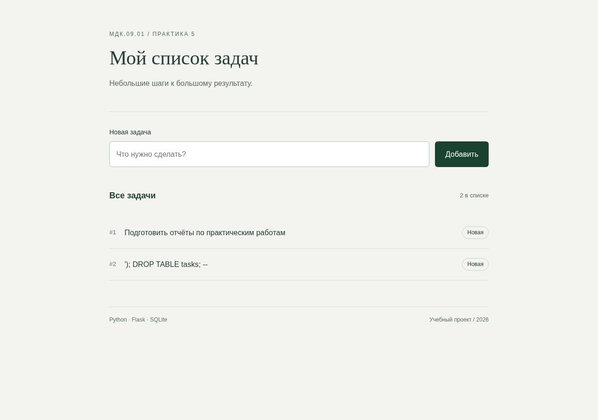

# Практические работы МДК.09.01 и МДК.05.03

**Миронова Анна Андреевна · 4-ИСП9-46 · 08.11.2026**

В репозитории — пять выбранных работ по веб-разработке (№1–5), восемь разных работ по тестированию и **13 отдельных PDF в корне**. У каждого отчёта есть описание, анализ сложности, скриншоты/примеры, ответы и листинги. Оригинальные условия и точные версии источников: [SOURCES.md](SOURCES.md).

[Скачать весь комплект ZIP](https://github.com/RealLalka/mdk-coursework-mironova-2026/archive/refs/heads/main.zip) · [Сводка проверок](evidence/verification.md) · [Скриншоты](evidence/screenshots)

## Отчёты и код

| Работа | PDF | Код |
|---|---|---|
| МДК.09.01 №1: Инициализация базы данных SQLite | [Открыть PDF](%D0%9C%D0%94%D0%9A09_%D0%9F%D0%A001_SQLite_%D0%9C%D0%B8%D1%80%D0%BE%D0%BD%D0%BE%D0%B2%D0%B0_%D0%90%D0%BD%D0%BD%D0%B0_%D0%90%D0%BD%D0%B4%D1%80%D0%B5%D0%B5%D0%B2%D0%BD%D0%B0_4-%D0%98%D0%A1%D0%9F9-46.pdf) | [Исходники](web/practice_01) |
| МДК.09.01 №2: Базовые CRUD-операции через консоль | [Открыть PDF](%D0%9C%D0%94%D0%9A09_%D0%9F%D0%A002_CRUD_%D0%9C%D0%B8%D1%80%D0%BE%D0%BD%D0%BE%D0%B2%D0%B0_%D0%90%D0%BD%D0%BD%D0%B0_%D0%90%D0%BD%D0%B4%D1%80%D0%B5%D0%B5%D0%B2%D0%BD%D0%B0_4-%D0%98%D0%A1%D0%9F9-46.pdf) | [Исходники](web/practice_02) |
| МДК.09.01 №3: Подключение Flask и первый маршрут | [Открыть PDF](%D0%9C%D0%94%D0%9A09_%D0%9F%D0%A003_Flask_%D0%9C%D0%B8%D1%80%D0%BE%D0%BD%D0%BE%D0%B2%D0%B0_%D0%90%D0%BD%D0%BD%D0%B0_%D0%90%D0%BD%D0%B4%D1%80%D0%B5%D0%B5%D0%B2%D0%BD%D0%B0_4-%D0%98%D0%A1%D0%9F9-46.pdf) | [Исходники](web/practice_03) |
| МДК.09.01 №4: Flask и SQLite: чтение данных | [Открыть PDF](%D0%9C%D0%94%D0%9A09_%D0%9F%D0%A004_%D0%A7%D1%82%D0%B5%D0%BD%D0%B8%D0%B5_%D0%9C%D0%B8%D1%80%D0%BE%D0%BD%D0%BE%D0%B2%D0%B0_%D0%90%D0%BD%D0%BD%D0%B0_%D0%90%D0%BD%D0%B4%D1%80%D0%B5%D0%B5%D0%B2%D0%BD%D0%B0_4-%D0%98%D0%A1%D0%9F9-46.pdf) | [Исходники](web/practice_04) |
| МДК.09.01 №5: Flask и SQLite: добавление данных | [Открыть PDF](%D0%9C%D0%94%D0%9A09_%D0%9F%D0%A005_%D0%A4%D0%BE%D1%80%D0%BC%D0%B0_%D0%9C%D0%B8%D1%80%D0%BE%D0%BD%D0%BE%D0%B2%D0%B0_%D0%90%D0%BD%D0%BD%D0%B0_%D0%90%D0%BD%D0%B4%D1%80%D0%B5%D0%B5%D0%B2%D0%BD%D0%B0_4-%D0%98%D0%A1%D0%9F9-46.pdf) | [Исходники](web/practice_05) |
| МДК.05.03: Тестирование типовых ИС в Linux | [Открыть PDF](%D0%9C%D0%94%D0%9A05_01_linux_system_%D0%9C%D0%B8%D1%80%D0%BE%D0%BD%D0%BE%D0%B2%D0%B0_%D0%90%D0%BD%D0%BD%D0%B0_%D0%90%D0%BD%D0%B4%D1%80%D0%B5%D0%B5%D0%B2%D0%BD%D0%B0_4-%D0%98%D0%A1%D0%9F9-46.pdf) | [Исходники](testing/linux_system) |
| МДК.05.03: Bash: базовые проверки ИС и обработка сбоев | [Открыть PDF](%D0%9C%D0%94%D0%9A05_02_linux_kernel_%D0%9C%D0%B8%D1%80%D0%BE%D0%BD%D0%BE%D0%B2%D0%B0_%D0%90%D0%BD%D0%BD%D0%B0_%D0%90%D0%BD%D0%B4%D1%80%D0%B5%D0%B5%D0%B2%D0%BD%D0%B0_4-%D0%98%D0%A1%D0%9F9-46.pdf) | [Исходники](testing/linux_kernel) |
| МДК.05.03: Bash, часть 1: отдельные тесты и общий запуск | [Открыть PDF](%D0%9C%D0%94%D0%9A05_03_bash_basics_%D0%9C%D0%B8%D1%80%D0%BE%D0%BD%D0%BE%D0%B2%D0%B0_%D0%90%D0%BD%D0%BD%D0%B0_%D0%90%D0%BD%D0%B4%D1%80%D0%B5%D0%B5%D0%B2%D0%BD%D0%B0_4-%D0%98%D0%A1%D0%9F9-46.pdf) | [Исходники](testing/bash_basics) |
| МДК.05.03: Bash, часть 2: логи, архивы, INI, CSV и порты | [Открыть PDF](%D0%9C%D0%94%D0%9A05_04_bash_extended_%D0%9C%D0%B8%D1%80%D0%BE%D0%BD%D0%BE%D0%B2%D0%B0_%D0%90%D0%BD%D0%BD%D0%B0_%D0%90%D0%BD%D0%B4%D1%80%D0%B5%D0%B5%D0%B2%D0%BD%D0%B0_4-%D0%98%D0%A1%D0%9F9-46.pdf) | [Исходники](testing/bash_extended) |
| МДК.05.03: JSON, часть 3: чтение, запись и отчёты | [Открыть PDF](%D0%9C%D0%94%D0%9A05_05_json_operations_%D0%9C%D0%B8%D1%80%D0%BE%D0%BD%D0%BE%D0%B2%D0%B0_%D0%90%D0%BD%D0%BD%D0%B0_%D0%90%D0%BD%D0%B4%D1%80%D0%B5%D0%B5%D0%B2%D0%BD%D0%B0_4-%D0%98%D0%A1%D0%9F9-46.pdf) | [Исходники](testing/json_operations) |
| МДК.05.03: JSON, часть 4: структура, типы и ограничения | [Открыть PDF](%D0%9C%D0%94%D0%9A05_06_json_validation_%D0%9C%D0%B8%D1%80%D0%BE%D0%BD%D0%BE%D0%B2%D0%B0_%D0%90%D0%BD%D0%BD%D0%B0_%D0%90%D0%BD%D0%B4%D1%80%D0%B5%D0%B5%D0%B2%D0%BD%D0%B0_4-%D0%98%D0%A1%D0%9F9-46.pdf) | [Исходники](testing/json_validation) |
| МДК.05.03: Postman: установка, коллекция и первые API-тесты | [Открыть PDF](%D0%9C%D0%94%D0%9A05_07_postman_%D0%9C%D0%B8%D1%80%D0%BE%D0%BD%D0%BE%D0%B2%D0%B0_%D0%90%D0%BD%D0%BD%D0%B0_%D0%90%D0%BD%D0%B4%D1%80%D0%B5%D0%B5%D0%B2%D0%BD%D0%B0_4-%D0%98%D0%A1%D0%9F9-46.pdf) | [Исходники](testing/postman) |
| МДК.05.03: Методологии тестирования и практический цикл STLC | [Открыть PDF](%D0%9C%D0%94%D0%9A05_08_stlc_%D0%9C%D0%B8%D1%80%D0%BE%D0%BD%D0%BE%D0%B2%D0%B0_%D0%90%D0%BD%D0%BD%D0%B0_%D0%90%D0%BD%D0%B4%D1%80%D0%B5%D0%B5%D0%B2%D0%BD%D0%B0_4-%D0%98%D0%A1%D0%9F9-46.pdf) | [Исходники](testing/stlc) |

PDF можно открыть прямо на GitHub. Если просмотрщик не загрузился, используйте кнопку Download raw file. Веб-практики сохраняют отдельный запускаемый результат каждого этапа: чтение списка в №4 и форма добавления в №5. №6–7 не заявлены выполненными — по условию достаточно любых пяти.



## Быстрый запуск

Нужны Python 3.10+ для всего комплекта зависимостей и Bash/curl для Linux-проверок. Рабочий стенд: Arch Linux/WSL, Python 3.14. Точное выполнение на РОСА и Python 3.8 не проверено; переносимые задания выполнены в имеющейся среде, ограничения отражены в отчётах. Данные учебные. Приложения предназначены для локального запуска.

```bash
python3 -m venv .venv
source .venv/bin/activate
python -m pip install -r requirements.txt
python web/practice_05/app.py
```

Открыть http://127.0.0.1:5000. База app.db создаётся рядом с app.py. Для выбора файла базы задайте TASK_DB, для порта — PORT. Debug выключен; для эксперимента с автоперезагрузкой включите FLASK_DEBUG=1. Установленная версия Chromium нужна только для снимков и генерации PDF.

Другие работы запускаются отдельно:

```bash
python web/practice_01/init_db.py
python web/practice_01/check_db.py
python web/practice_02/crud_console.py
python web/practice_03/app.py
python web/practice_04/app.py
```

Остановите текущий сервер Ctrl+C перед запуском другого на том же порту. Практики используют отдельные БД. В №4 запустите `python web/practice_04/crud_console.py` во втором терминале, добавьте/завершите задачу и обновите страницу.

## Проверки

```bash
mkdir -p .scratch
python -m pytest -q --basetemp .scratch/pytest
npm install --prefix .scratch/node newman@6.2.1
python tools/verify.py --workspace "$PWD/.scratch/verify-01" --newman "$PWD/.scratch/node/node_modules/.bin/newman"
```

Для повторного полного прогона укажите **новый** каталог, например verify-02. Нужны Bash, curl, awk, tar, gzip, sha256sum и ss. Для Postman нужен интернет; порт 1 предполагается закрытым. На Windows используйте Linux/WSL. Прогон использует свободные локальные порты, собственные процессы и копии данных. jq — необязательная дополнительная проверка. Ошибка импорта/окружения не считается PASS.

Фактический результат: **53/53 проверенных сценария, 31 Python-тест пройден**. В число 53 входят положительные и намеренно отрицательные прогоны: от отрицательного ожидается exit 1. Есть 9 отдельных повреждений JSON, SQL-инъекция, недоступный сервер, повреждённый архив, дубликат CSV и последующие ретесты. Это число сценариев, а не обещание 100% покрытия кода. [Полные протоколы](evidence).

[Дополнительные эксперименты](evidence/additional_checks.md): транзакции DDL и настоящая автоперезагрузка Flask на изолированной копии. [Запуск cron](evidence/cron.md): отдельный планировщик, задания каждые 5 и 15 минут; системный crontab не изменялся. [Замер Python/jq](evidence/json-benchmark.md).

Нагрузочная работа ограничена 20 последовательными запросами к локальному стенду; это не оценка конкурентной производительности. Публичный example.com проверен отдельно, и неожиданные HTTP-коды честно сохранены.

## Postman

Импортируйте оба файла из testing/postman: `homework.postman_collection.json` и `test.postman_environment.json`. Выберите окружение **Тест**. В нём уже заданы base_url и имя **Анна**. Коллекция **Домашняя работа** содержит два GET-запроса и пять проверок. Для выполнения без GUI:

```bash
.scratch/node/node_modules/.bin/newman run testing/postman/homework.postman_collection.json -e testing/postman/test.postman_environment.json
```

`negative.postman_collection.json` специально содержит неверное ожидание HTTP 404; её ненулевой код — ожидаемый результат. В [настоящем окне Postman](evidence/screenshots/postman-desktop-tests.png) зафиксированы коллекция и зелёные проверки. Для локального Scratch Pad без регистрации использован Postman 9.31.30; текущая скачанная версия 12.35.5 ограничивает работу с коллекциями без аккаунта. Установщик и профиль в репозиторий не включены.

## Структура и воспроизведение отчётов

- `web/` — пять независимых этапов приложения.
- `testing/` — Bash, Linux, JSON, Postman и STLC, включая планы, кейсы и Gherkin.
- `tests/` — автоматические Python-проверки.
- `reports/` — редактируемые исходники отчётов и перечень PDF.
- `evidence/` — реальные результаты и скриншоты.
- `sources/` — исходные условия преподавателя.
- `tools/` — повторяемый запуск и сборка.

Для повторных снимков установите Chromium и выполните `python tools/capture.py --workspace "$PWD/.scratch/capture-01"`. Снимки настоящего Postman сделаны в запущенном приложении отдельно. Для пересборки PDF нужен pandoc и Chromium: `python tools/build_reports.py --workspace "$PWD/.scratch/pdf-build"`. В сборщике закреплена ссылка этого репозитория; если переносите комплект, обновите REPO в tools/build_reports.py.

## Границы сдачи

В отчётах указаны реальные результаты Arch Linux. Проверки РОСА/RPM и служб, которых нет на стенде, не выдаются за выполненные. Один исходный Bash-файл дублируется под двумя именами и учтён один раз. Отчёты и код опубликованы для просмотра; письмо преподавателю автоматически не отправлялось.
