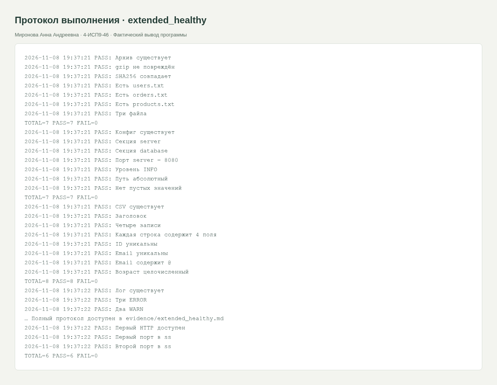
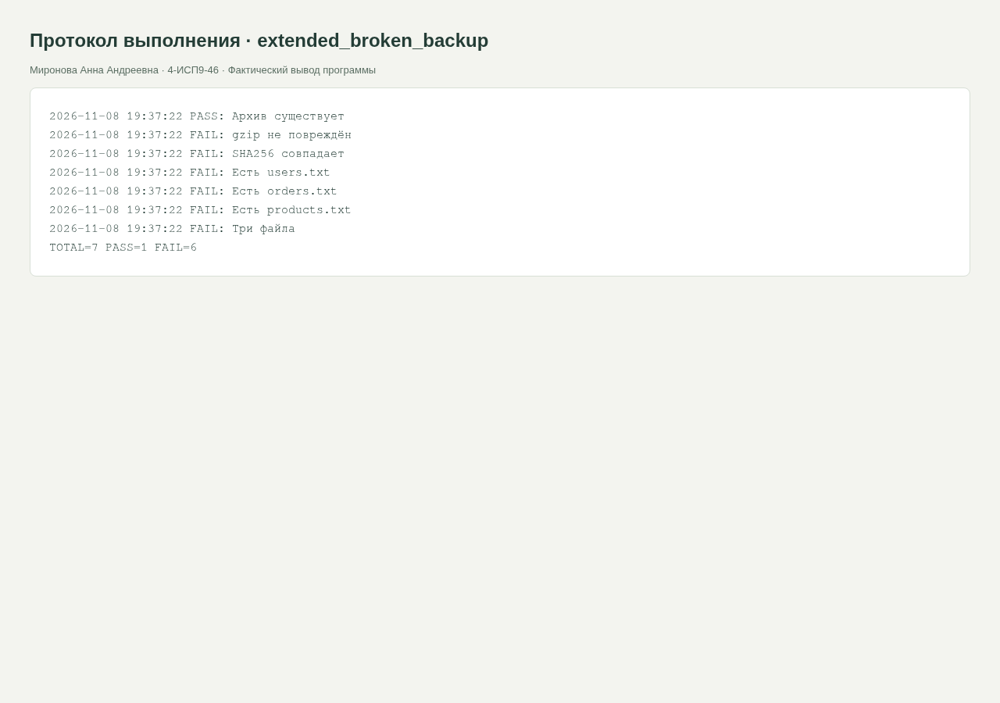

<div class="cover"><p class="course">ПРАКТИЧЕСКАЯ РАБОТА · МДК.05.03</p><h1>Bash, часть 2: логи, архивы, INI, CSV и порты</h1><div class="author"><p>Выполнила: Миронова Анна Андреевна<br>Группа: 4-ИСП9-46</p></div><div class="meta"><p>Преподаватель: А. Кондыбаева<br>Дата выполнения: 08.11.2026<br>Репозиторий: <a href="https://github.com/RealLalka/mdk-coursework-mironova-2026">https://github.com/RealLalka/mdk-coursework-mironova-2026</a></p></div></div>

## Цель работы

Проверить корректность работы ИС и научиться обнаруживать воспроизводимые дефекты.

Условие: [practice_rose_test_bash_system_part_1.md](https://github.com/softboxdev/test_methodologies/blob/e428908592dc365348cf30024e3e61cbc9e97395/it_test_methodologies/practice_rose_test_bash_system_part_1.md).

## Выполненная работа

Выполнены практики 7–11. Лог содержит 3 ERROR и 2 WARN; проверяются дата, запуск и отсутствие FATAL. Архив содержит users.txt, orders.txt, products.txt; проверяются gzip, SHA256 и список файлов. INI проверяется по секциям, серверному порту, уровню логирования и пустым значениям. CSV содержит 4 записи, уникальные ID/email и числовой возраст. Проверены два локальных порта, их наличие в ss и закрытый контрольный порт.

## Стенд и воспроизведение

Фактическая ОС: Arch Linux в WSL/Linux, ядро 6.6.87.2-microsoft-standard-WSL2. Python 3.14.6, SQLite 3.53.3, Flask 3.1.2; браузер Chromium; настольный Postman 9.31.30 и Newman 6.2.1 для API-прогонов. Условия некоторых заданий называют РОСА и Python 3.8: переносимые команды выполнены на текущем Linux; совместимость именно с РОСА и Python 3.8 отдельным прогоном не подтверждена. Ограничения окружения отражены как WARN/SKIP, а не как успешные проверки.

Команды установки и запуска приведены в [README](https://github.com/RealLalka/mdk-coursework-mironova-2026#readme). Полный автоматический прогон: `python tools/verify.py --workspace <новый-каталог-результатов> --newman <путь-к-newman>`. Он создаёт изолированные копии, запускает локальные сервисы и отрицательные сценарии, затем останавливает собственные процессы. Ненулевой код ожидается только в явно помеченных отрицательных опытах.

## Анализ сложности

Логи, INI, CSV: O(B) при линейном проходе; сортировка уникальных значений O(n log n). SHA256 и проверка сжатого потока O(B), listing архива O(m) элементов плюс чтение сжатых данных. Число проверяемых портов фиксировано: O(1).

### Отрицательные прогоны

К архиву дописаны посторонние байты: gzip/SHA256 обнаружили изменение. В INI добавлена пустая строка user=: проверка отклонена. В CSV изменён ID второй записи на ID первой: уникальность отклонена. Все изменения выполнены только на копиях данных. В исходном файле задания отдельные контрольные вопросы отсутствуют; приведён разбор пяти ключевых приёмов.

## Скриншоты и примеры выполнения

<figure><figcaption>Рисунок 1. extended_healthy. Фактический запуск; для консольных работ показан оформленный протокол вывода, для веб-приложений и Postman — интерфейс программы.</figcaption></figure>

<figure><figcaption>Рисунок 2. extended_broken_backup. Фактический запуск; для консольных работ показан оформленный протокол вывода, для веб-приложений и Postman — интерфейс программы.</figcaption></figure>


## Ответы на контрольные вопросы

### 1. Как различаются grep -c и grep -q?

-c считает строки с совпадениями, а не число всех совпадений. -q возвращает код наличия совпадения и не печатает строки.

### 2. Что даёт SHA256 сверх gzip -t?

gzip проверяет структуру потока и встроенный CRC; SHA256 сравнивает весь файл с доверенным эталоном и выявляет любое изменение байтов. Сам хэш не доказывает доверенность источника.

### 3. Почему нужно проверять секцию INI?

Одинаковый ключ port есть у server и database. Поиск любой строки port=8080 не доказывает правильность серверной секции. Используется awk с текущим именем секции.

### 4. Почему ! awk с условием NF!=4 ошибочен?

awk обычно возвращает 0, даже если напечатал неверную строку. Отрицание тогда всегда даёт ошибку. В решении awk явно завершает END{exit bad}.

### 5. Порт открыт — значит сервис исправен?

Нет. TCP-соединение подтверждает транспортную доступность. Нужны HTTP-код, тело и бизнес-проверки.


## Протоколы проверок

### extended_healthy

Полный протокол: [evidence/extended_healthy.md](https://github.com/RealLalka/mdk-coursework-mironova-2026/blob/main/evidence/extended_healthy.md).

```text
2026-11-08 19:50:47 PASS: Архив существует
2026-11-08 19:50:47 PASS: gzip не повреждён
2026-11-08 19:50:47 PASS: SHA256 совпадает
2026-11-08 19:50:47 PASS: Есть users.txt
2026-11-08 19:50:47 PASS: Есть orders.txt
2026-11-08 19:50:47 PASS: Есть products.txt
2026-11-08 19:50:47 PASS: Три файла
TOTAL=7 PASS=7 FAIL=0
2026-11-08 19:50:47 PASS: Конфиг существует
2026-11-08 19:50:47 PASS: Секция server
2026-11-08 19:50:47 PASS: Секция database
2026-11-08 19:50:47 PASS: Порт server = 8080
2026-11-08 19:50:47 PASS: Уровень INFO
2026-11-08 19:50:47 PASS: Путь абсолютный
2026-11-08 19:50:47 PASS: Нет пустых значений
TOTAL=7 PASS=7 FAIL=0
2026-11-08 19:50:47 PASS: CSV существует
2026-11-08 19:50:47 PASS: Заголовок
2026-11-08 19:50:47 PASS: Четыре записи
2026-11-08 19:50:47 PASS: Каждая строка содержит 4 поля
2026-11-08 19:50:47 PASS: ID уникальны
2026-11-08 19:50:47 PASS: Email уникальны
2026-11-08 19:50:47 PASS: Email содержит @
2026-11-08 19:50:47 PASS: Возраст целочисленный
TOTAL=8 PASS=8 FAIL=0
2026-11-08 19:50:47 PASS: Лог существует
2026-11-08 19:50:47 PASS: Три ERROR
2026-11-08 19:50:47 PASS: Два WARN
2026-11-08 19:50:47 PASS: Событие запуска
2026-11-08 19:50:47 PASS: Нет FATAL
2026-11-08 19:50:47 PASS: Дата в каждой строке
ERROR 3
INFO 3
WARN 2
TOTAL=6 PASS=6 FAIL=0
2026-11-08 19:50:47 PASS: Первый порт открыт
2026-11-08 19:50:47 PASS: Второй порт открыт
2026-11-08 19:50:47 PASS: Контрольный порт закрыт
2026-11-08 19:50:47 PASS: Первый HTTP доступен
2026-11-08 19:50:47 PASS: Первый порт в ss
2026-11-08 19:50:47 PASS: Второй порт в ss
TOTAL=6 PASS=6 FAIL=0
```

### extended_broken_backup

Полный протокол: [evidence/extended_broken_backup.md](https://github.com/RealLalka/mdk-coursework-mironova-2026/blob/main/evidence/extended_broken_backup.md).

```text
2026-11-08 19:50:47 PASS: Архив существует
2026-11-08 19:50:47 FAIL: gzip не повреждён
2026-11-08 19:50:47 FAIL: SHA256 совпадает
2026-11-08 19:50:48 FAIL: Есть users.txt
2026-11-08 19:50:48 FAIL: Есть orders.txt
2026-11-08 19:50:48 FAIL: Есть products.txt
2026-11-08 19:50:48 FAIL: Три файла
TOTAL=7 PASS=1 FAIL=6
```


## Вывод

Положительный и отрицательный прогоны разделены. Намеренный дефект обнаружен, исходные данные не повреждены. Полные протоколы и способ повторения входят в репозиторий; ограничения стенда явно указаны.

## Использованные материалы

Условия работ: репозитории softboxdev/programming_course и softboxdev/test_methodologies; точные ссылки и commit SHA зафиксированы в SOURCES.md.

Документация: [Python sqlite3](https://docs.python.org/3.14/library/sqlite3.html), [Python json](https://docs.python.org/3.14/library/json.html), [Flask Quickstart](https://flask.palletsprojects.com/en/stable/quickstart/), [Postman Newman](https://learning.postman.com/docs/reference/newman-cli/command-line-integration-with-newman/).

<div class="pagebreak"></div>

## Приложение. Листинги файлов

### testing/bash_extended/check.sh

```bash
#!/usr/bin/env bash
set -u
ROOT="$(cd "$(dirname "${BASH_SOURCE[0]}")" && pwd)"
DATA="${QA_DATA:-$ROOT/data}"
RUN="${QA_RUN:-$ROOT/.logs}"
mkdir -p "$RUN"
LOG_FILE="$RUN/test_$(date +%Y%m%d_%H%M%S)_$$.log"
PASS=0
FAIL=0
check() {
    local name="$1"
    shift
    if "$@" >"$RUN/last_stdout.txt" 2>"$RUN/last_stderr.txt"; then
        echo "$(date '+%F %T') PASS: $name" | tee -a "$LOG_FILE"
        PASS=$((PASS + 1))
    else
        echo "$(date '+%F %T') FAIL: $name" | tee -a "$LOG_FILE" "$RUN/alerts.log"
        cat "$RUN/last_stderr.txt" >> "$LOG_FILE"
        FAIL=$((FAIL + 1))
    fi
}
finish() {
    echo "TOTAL=$((PASS + FAIL)) PASS=$PASS FAIL=$FAIL" | tee -a "$LOG_FILE"
    test "$FAIL" -eq 0
}
```

### testing/bash_extended/data/app.conf

```text
[server]
host=127.0.0.1
port=8080
timeout=30
[database]
host=localhost
port=5432
name=shop
user=admin
[logging]
level=INFO
file=/var/log/app.log
```

### testing/bash_extended/data/users.csv

```text
id,name,email,age
1,Иван,ivan@mail.ru,25
2,Мария,maria@mail.ru,30
3,Пётр,petr@mail.ru,17
4,Анна,anna@mail.ru,22
```

### testing/bash_extended/run_all.sh

```bash
#!/usr/bin/env bash
ROOT="$(cd "$(dirname "${BASH_SOURCE[0]}")" && pwd)"
result=0
for script in "$ROOT"/test_*.sh; do bash "$script" || result=1; done
exit "$result"
```

### testing/bash_extended/setup_backup.sh

```bash
#!/usr/bin/env bash
set -eu
TARGET="${1:?Укажите каталог для архива}"
mkdir -p "$TARGET/source"
printf 'user1\n' > "$TARGET/source/users.txt"
printf 'order1\n' > "$TARGET/source/orders.txt"
printf 'product1\n' > "$TARGET/source/products.txt"
cd "$TARGET"
tar -czf backup.tar.gz source/
sha256sum backup.tar.gz > backup.sha256
```

### testing/bash_extended/test_backup.sh

```bash
#!/usr/bin/env bash
source "$(dirname "${BASH_SOURCE[0]}")/check.sh"
cd "${QA_BACKUP:?Укажите QA_BACKUP}"
archive_has() { local list; list="$(tar -tzf backup.tar.gz)" || return 1; [[ "$list" == *"source/$1"* ]]; }
file_count() { local list; list="$(tar -tzf backup.tar.gz)" || return 1; test "$(printf '%s\n' "$list" | grep -c '\.txt$')" -eq 3; }
check "Архив существует" test -s backup.tar.gz
check "gzip не повреждён" gzip -t backup.tar.gz
check "SHA256 совпадает" sha256sum -c backup.sha256
check "Есть users.txt" archive_has users.txt
check "Есть orders.txt" archive_has orders.txt
check "Есть products.txt" archive_has products.txt
check "Три файла" file_count
finish
```

### testing/bash_extended/test_config.sh

```bash
#!/usr/bin/env bash
source "$(dirname "${BASH_SOURCE[0]}")/check.sh"
CONF="$DATA/app.conf"
no_empty() { ! grep -qE '^[a-z]+=[[:space:]]*$' "$CONF"; }
server_port() { awk '/^\[/{section=$0} section=="[server]" && /^port=/{split($0,p,"="); found=1; if(p[2]!=8080)bad=1} END{exit (!found||bad)}' "$CONF"; }
check "Конфиг существует" test -s "$CONF"
check "Секция server" grep -q '^\[server\]$' "$CONF"
check "Секция database" grep -q '^\[database\]$' "$CONF"
check "Порт server = 8080" server_port
check "Уровень INFO" grep -q '^level=INFO$' "$CONF"
check "Путь абсолютный" grep -q '^file=/' "$CONF"
check "Нет пустых значений" no_empty
finish
```

### testing/bash_extended/test_csv.sh

```bash
#!/usr/bin/env bash
source "$(dirname "${BASH_SOURCE[0]}")/check.sh"
FILE="$DATA/users.csv"
rows() { test "$(wc -l < "$FILE")" -eq 5; }
unique_column() { test -z "$(tail -n +2 "$FILE" | cut -d, -f"$1" | sort | uniq -d)"; }
check "CSV существует" test -s "$FILE"
check "Заголовок" grep -q '^id,name,email,age$' "$FILE"
check "Четыре записи" rows
check "Каждая строка содержит 4 поля" awk -F, 'NF!=4{bad=1} END{exit bad}' "$FILE"
check "ID уникальны" unique_column 1
check "Email уникальны" unique_column 3
check "Email содержит @" awk -F, 'NR>1 && $3 !~ /@/{bad=1} END{exit bad}' "$FILE"
check "Возраст целочисленный" awk -F, 'NR>1 && $4 !~ /^[0-9]+$/{bad=1} END{exit bad}' "$FILE"
finish
```

### testing/bash_extended/test_logs.sh

```bash
#!/usr/bin/env bash
source "$(dirname "${BASH_SOURCE[0]}")/check.sh"
FILE="$DATA/app.log"
error_count() { test "$(grep -c ' ERROR ' "$FILE")" -eq 3; }
warn_count() { test "$(grep -c ' WARN ' "$FILE")" -eq 2; }
no_fatal() { ! grep -q FATAL "$FILE"; }
check "Лог существует" test -s "$FILE"
check "Три ERROR" error_count
check "Два WARN" warn_count
check "Событие запуска" grep -q 'Сервер запущен' "$FILE"
check "Нет FATAL" no_fatal
check "Дата в каждой строке" awk '$1 !~ /^[0-9][0-9][0-9][0-9]-[0-9][0-9]-[0-9][0-9]$/{bad=1} END{exit bad}' "$FILE"
awk '{count[$3]++} END{for(k in count)print k,count[k]}' "$FILE" | sort
finish
```

### testing/bash_extended/test_ports.sh

```bash
#!/usr/bin/env bash
source "$(dirname "${BASH_SOURCE[0]}")/check.sh"
port_open() { timeout 2 bash -c 'exec 3<>/dev/tcp/127.0.0.1/$1' bash "$1"; }
port_closed() { ! port_open "$1"; }
check "Первый порт открыт" port_open "${QA_PORT1:-8080}"
check "Второй порт открыт" port_open "${QA_PORT2:-8081}"
check "Контрольный порт закрыт" port_closed "${QA_CLOSED_PORT:-9999}"
check "Первый HTTP доступен" curl -fsS --max-time 3 "http://127.0.0.1:${QA_PORT1:-8080}/"
check "Первый порт в ss" bash -c 'ss -tlnH | grep -qE ":$1[[:space:]]"' bash "${QA_PORT1:-8080}"
check "Второй порт в ss" bash -c 'ss -tlnH | grep -qE ":$1[[:space:]]"' bash "${QA_PORT2:-8081}"
finish
```
