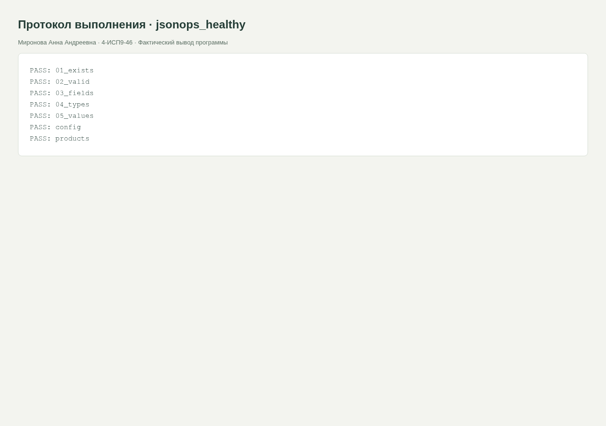
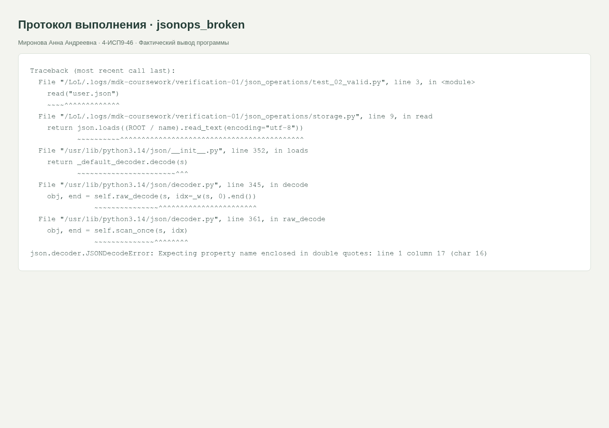

<div class="cover"><p class="course">ПРАКТИЧЕСКАЯ РАБОТА · МДК.05.03</p><h1>JSON, часть 3: чтение, запись и отчёты</h1><div class="author"><p>Выполнила: Миронова Анна Андреевна<br>Группа: 4-ИСП9-46</p></div><div class="meta"><p>Преподаватель: А. Кондыбаева<br>Дата выполнения: 08.11.2026<br>Репозиторий: <a href="https://github.com/RealLalka/mdk-coursework-mironova-2026">https://github.com/RealLalka/mdk-coursework-mironova-2026</a></p></div></div>

## Цель работы

Проверить корректность работы ИС и научиться обнаруживать воспроизводимые дефекты.

Условие: [practice_rose_test_bash_system_part_2.md](https://github.com/softboxdev/test_methodologies/blob/e428908592dc365348cf30024e3e61cbc9e97395/it_test_methodologies/practice_rose_test_bash_system_part_2.md).

## Выполненная работа

Созданы 01_write.py, 02_read.py, 03_edit.py, 04_format.py и тесты структуры/типов/значений. Есть book.json, users_report.py с самым старшим и числом несовершеннолетних, warehouse_report.py со стоимостью склада, test_products.py, config.json и test_config.py. Утилиты json_pretty.py и json_diff.py принимают имена файлов в аргументах. Все файлы UTF-8.

## Стенд и воспроизведение

Фактическая ОС: Arch Linux в WSL/Linux, ядро 6.6.87.2-microsoft-standard-WSL2. Python 3.14.6, SQLite 3.53.3, Flask 3.1.2; браузер Chromium; настольный Postman 9.31.30 и Newman 6.2.1 для API-прогонов. Условия некоторых заданий называют РОСА и Python 3.8: переносимые команды выполнены на текущем Linux; совместимость именно с РОСА и Python 3.8 отдельным прогоном не подтверждена. Ограничения окружения отражены как WARN/SKIP, а не как успешные проверки.

Команды установки и запуска приведены в [README](https://github.com/RealLalka/mdk-coursework-mironova-2026#readme). Полный автоматический прогон: `python tools/verify.py --workspace <новый-каталог-результатов> --newman <путь-к-newman>`. Он создаёт изолированные копии, запускает локальные сервисы и отрицательные сценарии, затем останавливает собственные процессы. Ненулевой код ожидается только в явно помеченных отрицательных опытах.

## Анализ сложности

Загрузка/сериализация B байтов O(B). Отчёт по n пользователям и p товарам O(n+p), память O(n+p) после загрузки JSON. Уникальность ID через set — ожидаемо O(n). Разность ключей объектов O(k1+k2), сортировка вывода O(k log k).

### Полученные результаты

По users.json: всего 3, активных 2, средний возраст 24.0, совершеннолетние Иван и Мария, старшая Мария, несовершеннолетних 1. По products.json: общая стоимость склада 1505.0, самый дорогой товар — Сыр. Результаты сохраняются в users_report.json и warehouse_report.json.

03_edit.py выполняет основной сценарий: возраст 26, город Санкт-Петербург, роль moderator, удаление active. Отдельный флаг --homework выполняет задание 4: новый email, phone и удаление roles. После этого проверка обязательной роли закономерно несовместима с домашним сценарием; в протоколе домашний сценарий отделён, а исходный user.json восстановлен через 01_write.py перед заключительным тестом. json_diff выводит ключи только первого и только второго объектов. json_pretty перезаписывает файл лишь после успешного разбора. Намеренно обрезанный JSON даёт JSONDecodeError и ненулевой код, после восстановления тесты проходят.

Данные для интерактивного примера: {"name":"Анна","age":20,"city":"Москва"}. Возраст и город — исключительно синтетические данные примера, не сведения об авторе отчёта.

## Скриншоты и примеры выполнения

<figure><figcaption>Рисунок 1. jsonops_healthy. Фактический запуск; для консольных работ показан оформленный протокол вывода, для веб-приложений и Postman — интерфейс программы.</figcaption></figure>

<figure><figcaption>Рисунок 2. jsonops_broken. Фактический запуск; для консольных работ показан оформленный протокол вывода, для веб-приложений и Postman — интерфейс программы.</figcaption></figure>


## Ответы на контрольные вопросы

### 1. JSON и Python-словарь: сходство и отличие?

JSON — текстовый формат обмена. dict — объект в памяти Python. Объект JSON соответствует dict со строковыми ключами; JSON допускает также массив и скаляр в корне. В JSON нет кортежей, множеств и произвольных Python-объектов.

### 2. Почему True превращается в true?

Сериализатор переводит логическое значение Python в литерал JSON, заданный его грамматикой: true/false/null вместо True/False/None.

### 3. Для чего ensure_ascii=False?

Сохраняет кириллицу непосредственно в UTF-8 вместо escape-последовательностей \uXXXX. Логическое значение данных остаётся тем же.

### 4. dump/dumps и load/loads?

dump пишет в файловый объект, dumps возвращает строку. load читает из файлового объекта, loads разбирает строку или байты.

### 5. Лишняя запятая в JSON?

Это синтаксическая ошибка. json.load/loads выбрасывают JSONDecodeError с позицией, строкой и колонкой. python -m json.tool завершится ненулевым кодом.

### 6. Влияет ли indent=2 на данные?

Добавляет переносы и два пробела на уровень вложенности. Меняется представление, а не разобранные значения.

### 7. Как обработать отсутствующий файл?

Возникает FileNotFoundError, подкласс OSError. Перехватить, вывести понятную диагностику и вернуть ненулевой exit; не подменять отсутствие файла пустыми данными.

### 8. Есть ли в JSON комментарии?

Стандартный JSON комментариев не допускает. JSONC — отдельное расширение, оно не принимается обычным json.load.


## Протоколы проверок

### jsonops_healthy

Полный протокол: [evidence/jsonops_healthy.md](https://github.com/RealLalka/mdk-coursework-mironova-2026/blob/main/evidence/jsonops_healthy.md).

```text
PASS: 01_exists
PASS: 02_valid
PASS: 03_fields
PASS: 04_types
PASS: 05_values
PASS: config
PASS: products
```

### jsonops_broken

Полный протокол: [evidence/jsonops_broken.md](https://github.com/RealLalka/mdk-coursework-mironova-2026/blob/main/evidence/jsonops_broken.md).

```text
Traceback (most recent call last):
  File "/LoL/.logs/mdk-coursework/verification-final/json_operations/test_02_valid.py", line 3, in <module>
    read("user.json")
    ~~~~^^^^^^^^^^^^^
  File "/LoL/.logs/mdk-coursework/verification-final/json_operations/storage.py", line 9, in read
    return json.loads((ROOT / name).read_text(encoding="utf-8"))
           ~~~~~~~~~~^^^^^^^^^^^^^^^^^^^^^^^^^^^^^^^^^^^^^^^^^^^
  File "/usr/lib/python3.14/json/__init__.py", line 352, in loads
    return _default_decoder.decode(s)
           ~~~~~~~~~~~~~~~~~~~~~~~^^^
  File "/usr/lib/python3.14/json/decoder.py", line 345, in decode
    obj, end = self.raw_decode(s, idx=_w(s, 0).end())
               ~~~~~~~~~~~~~~~^^^^^^^^^^^^^^^^^^^^^^^
  File "/usr/lib/python3.14/json/decoder.py", line 361, in raw_decode
    obj, end = self.scan_once(s, idx)
               ~~~~~~~~~~~~~~^^^^^^^^
json.decoder.JSONDecodeError: Expecting property name enclosed in double quotes: line 1 column 17 (char 16)
```


## Вывод

Положительный и отрицательный прогоны разделены. Намеренный дефект обнаружен, исходные данные не повреждены. Полные протоколы и способ повторения входят в репозиторий; ограничения стенда явно указаны.

## Использованные материалы

Условия работ: репозитории softboxdev/programming_course и softboxdev/test_methodologies; точные ссылки и commit SHA зафиксированы в SOURCES.md.

Документация: [Python sqlite3](https://docs.python.org/3.14/library/sqlite3.html), [Python json](https://docs.python.org/3.14/library/json.html), [Flask Quickstart](https://flask.palletsprojects.com/en/stable/quickstart/), [Postman Newman](https://learning.postman.com/docs/reference/newman-cli/command-line-integration-with-newman/).

<div class="pagebreak"></div>

## Приложение. Листинги файлов

### testing/json_operations/01_write.py

```python
from storage import save

user = {
    "id": 1,
    "name": "Иван",
    "email": "ivan@mail.ru",
    "age": 25,
    "active": True,
    "roles": ["admin", "user"],
}
save("user.json", user)
print("Создан user.json:", user)
```

### testing/json_operations/02_read.py

```python
from storage import read

user = read("user.json")
print("Имя:", user["name"])
print("Возраст:", user["age"])
print("Email:", user["email"])
print("Роли:", user.get("roles", []))
print("Всего ролей:", len(user.get("roles", [])))
print("Активен:", user.get("active", False))
print("Ключей:", len(user))
print("Телефон:", user.get("phone", "не указан"))
```

### testing/json_operations/03_edit.py

```python
import argparse
from storage import read, save

parser = argparse.ArgumentParser()
parser.add_argument("--homework", action="store_true")
args = parser.parse_args()
user = read("user.json")
user["age"] = 26
user["city"] = "Санкт-Петербург"
user.setdefault("roles", [])
if "moderator" not in user["roles"]:
    user["roles"].append("moderator")
user.pop("active", None)
if args.homework:
    user["email"] = "ivan.new@mail.ru"
    user["phone"] = "+7-900-123-45-67"
    user.pop("roles", None)
save("user.json", user)
print(user)
```

### testing/json_operations/04_format.py

```python
import json
from storage import read

user = read("user.json")
print("Компактно:", json.dumps(user, ensure_ascii=False, separators=(",", ":")))
print("Отступы:", json.dumps(user, ensure_ascii=False, indent=2))
print("ASCII:", json.dumps(user, ensure_ascii=True))
print("Сортировка:", json.dumps(user, ensure_ascii=False, sort_keys=True))
```

### testing/json_operations/book.json

```json
{
  "author": "А. С. Пушкин",
  "title": "Капитанская дочка",
  "year": 1836,
  "genres": [
    "повесть",
    "историческая проза"
  ],
  "read": true
}
```

### testing/json_operations/config.json

```json
{
  "server": {
    "host": "127.0.0.1",
    "port": 8080,
    "timeout": 30
  },
  "database": {
    "host": "localhost",
    "port": 5432,
    "name": "shop"
  },
  "logging": {
    "level": "INFO",
    "file": "/var/log/app.log"
  }
}
```

### testing/json_operations/json_diff.py

```python
import argparse
import json
from pathlib import Path

parser = argparse.ArgumentParser()
parser.add_argument("first", type=Path)
parser.add_argument("second", type=Path)
args = parser.parse_args()
try:
    first, second = [
        json.loads(p.read_text(encoding="utf-8")) for p in [args.first, args.second]
    ]
    if not isinstance(first, dict) or not isinstance(second, dict):
        raise ValueError("Оба корня должны быть объектами")
    print("Только в первом:", sorted(first.keys() - second.keys()))
    print("Только во втором:", sorted(second.keys() - first.keys()))
except (OSError, ValueError) as exc:
    parser.exit(1, f"Ошибка: {exc}\n")
```

### testing/json_operations/json_pretty.py

```python
import argparse
import json
from pathlib import Path

parser = argparse.ArgumentParser()
parser.add_argument("filename", type=Path)
args = parser.parse_args()
try:
    value = json.loads(args.filename.read_text(encoding="utf-8"))
    args.filename.write_text(
        json.dumps(value, ensure_ascii=False, indent=2) + "\n", encoding="utf-8"
    )
    print("Отформатирован:", args.filename)
except (OSError, ValueError) as exc:
    parser.exit(1, f"Ошибка: {exc}\n")
```

### testing/json_operations/products.json

```json
[
  {
    "id": 1,
    "name": "Хлеб",
    "price": 40.5,
    "quantity": 10
  },
  {
    "id": 2,
    "name": "Молоко",
    "price": 80.0,
    "quantity": 5
  },
  {
    "id": 3,
    "name": "Сыр",
    "price": 350.0,
    "quantity": 2
  }
]
```

### testing/json_operations/run_tests.sh

```bash
#!/usr/bin/env bash
ROOT="$(cd "$(dirname "${BASH_SOURCE[0]}")" && pwd)"
result=0
for script in "$ROOT"/test_*.py; do
    python3 "$script" || result=1
done
exit "$result"
```

### testing/json_operations/storage.py

```python
import json
import os
from pathlib import Path

ROOT = Path(os.environ.get("JSON_DATA", Path(__file__).parent))


def read(name):
    return json.loads((ROOT / name).read_text(encoding="utf-8"))


def save(name, value):
    (ROOT / name).write_text(
        json.dumps(value, ensure_ascii=False, indent=2) + "\n", encoding="utf-8"
    )
```

### testing/json_operations/test_01_exists.py

```python
from storage import ROOT

assert (ROOT / "user.json").is_file()
print("PASS: 01_exists")
```

### testing/json_operations/test_02_valid.py

```python
from storage import read

read("user.json")
print("PASS: 02_valid")
```

### testing/json_operations/test_03_fields.py

```python
from storage import read

assert {"id", "name", "email", "roles"} <= read("user.json").keys()
print("PASS: 03_fields")
```

### testing/json_operations/test_04_types.py

```python
from storage import read

u = read("user.json")
for k, t in {"id": int, "name": str, "email": str, "roles": list}.items():
    assert type(u[k]) is t
print("PASS: 04_types")
```

### testing/json_operations/test_05_values.py

```python
from storage import read

u = read("user.json")
assert u["id"] == 1 and u["email"].endswith("@mail.ru") and "admin" in u["roles"]
print("PASS: 05_values")
```

### testing/json_operations/test_config.py

```python
from storage import read

c = read("config.json")
assert {"server", "database", "logging"} <= c.keys()
assert type(c["server"]["port"]) is int and 1 <= c["server"]["port"] <= 65535
assert c["logging"]["level"] in ["DEBUG", "INFO", "WARNING", "ERROR"]
assert c["database"]["name"].strip()
print("PASS: config")
```

### testing/json_operations/test_products.py

```python
from storage import read

p = read("products.json")
assert len({x["id"] for x in p}) == len(p)
for x in p:
    assert {"id", "name", "price", "quantity"} <= x.keys()
    assert type(x["price"]) in (int, float) and x["price"] > 0
    assert type(x["quantity"]) is int and x["quantity"] >= 0
print("PASS: products")
```

### testing/json_operations/user.json

```json
{
  "id": 1,
  "name": "Иван",
  "email": "ivan@mail.ru",
  "age": 25,
  "active": true,
  "roles": [
    "admin",
    "user"
  ]
}
```

### testing/json_operations/users.json

```json
[
  {
    "id": 1,
    "name": "Иван",
    "age": 25,
    "active": true
  },
  {
    "id": 2,
    "name": "Мария",
    "age": 30,
    "active": true
  },
  {
    "id": 3,
    "name": "Пётр",
    "age": 17,
    "active": false
  }
]
```

### testing/json_operations/users_report.json

```json
{
  "total": 3,
  "active": 2,
  "average_age": 24.0,
  "adults": [
    "Иван",
    "Мария"
  ],
  "oldest": "Мария",
  "under_18": 1
}
```

### testing/json_operations/users_report.py

```python
from storage import read, save

users = read("users.json")
report = {
    "total": len(users),
    "active": sum(user["active"] for user in users),
    "average_age": sum(user["age"] for user in users) / len(users) if users else 0,
    "adults": [user["name"] for user in users if user["age"] >= 18],
    "oldest": max(users, key=lambda user: user["age"])["name"] if users else None,
    "under_18": sum(user["age"] < 18 for user in users),
}
save("users_report.json", report)
print(report)
```

### testing/json_operations/warehouse_report.json

```json
{
  "total_value": 1505.0,
  "most_expensive": "Сыр"
}
```

### testing/json_operations/warehouse_report.py

```python
from storage import read, save

products = read("products.json")
report = {
    "total_value": round(sum(p["price"] * p["quantity"] for p in products), 2),
    "most_expensive": max(products, key=lambda p: p["price"])["name"]
    if products
    else None,
}
save("warehouse_report.json", report)
print(report)
```
