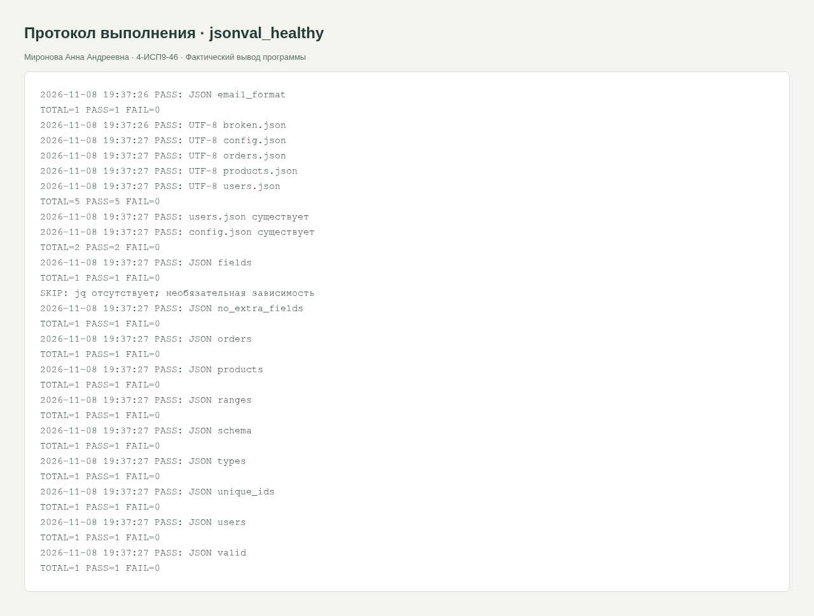
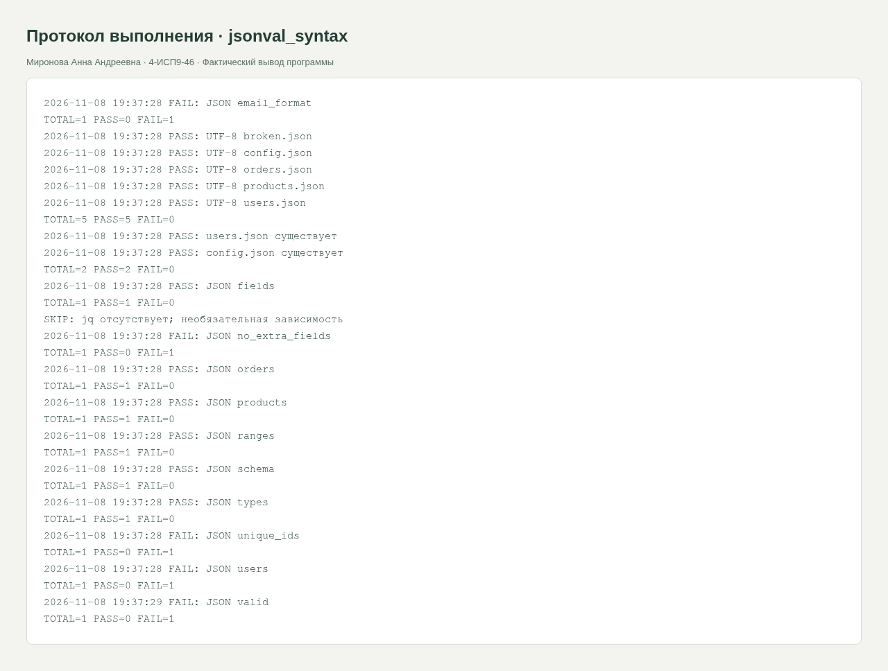

<div class="cover"><p class="course">ПРАКТИЧЕСКАЯ РАБОТА · МДК.05.03</p><h1>JSON, часть 4: структура, типы и ограничения</h1><div class="author"><p>Выполнила: Миронова Анна Андреевна<br>Группа: 4-ИСП9-46</p></div><div class="meta"><p>Преподаватель: А. Кондыбаева<br>Дата выполнения: 08.11.2026<br>Репозиторий: <a href="https://github.com/RealLalka/mdk-coursework-mironova-2026">https://github.com/RealLalka/mdk-coursework-mironova-2026</a></p></div></div>

## Цель работы

Проверить корректность работы ИС и научиться обнаруживать воспроизводимые дефекты.

Условие: [practice_rose_test_bash_system_part_3.md](https://github.com/softboxdev/test_methodologies/blob/e428908592dc365348cf30024e3e61cbc9e97395/it_test_methodologies/practice_rose_test_bash_system_part_3.md).

## Выполненная работа

Созданы отдельные Bash-тесты exists, valid, fields, types, users, unique_ids, email_format, ranges, jq, schema и общий run_all.sh. Дополнительно проверяются orders, отсутствие лишних полей, UTF-8 и products из пяти товаров. Общий Python-валидатор содержит явные проверки без assert, отклоняет bool вместо int, NaN/Infinity и повтор ключей.

## Стенд и воспроизведение

Фактическая ОС: Arch Linux в WSL/Linux, ядро 6.6.87.2-microsoft-standard-WSL2. Python 3.14.6, SQLite 3.53.3, Flask 3.1.2; браузер Chromium; настольный Postman 9.31.30 и Newman 6.2.1 для API-прогонов. Условия некоторых заданий называют РОСА и Python 3.8: переносимые команды выполнены на текущем Linux; совместимость именно с РОСА и Python 3.8 отдельным прогоном не подтверждена. Ограничения окружения отражены как WARN/SKIP, а не как успешные проверки.

Команды установки и запуска приведены в [README](https://github.com/RealLalka/mdk-coursework-mironova-2026#readme). Полный автоматический прогон: `python tools/verify.py --workspace <новый-каталог-результатов> --newman <путь-к-newman>`. Он создаёт изолированные копии, запускает локальные сервисы и отрицательные сценарии, затем останавливает собственные процессы. Ненулевой код ожидается только в явно помеченных отрицательных опытах.

## Анализ сложности

Парсинг B байтов O(B). Проверки каждого массива O(n) в среднем благодаря set для ID; дополнительная память O(n). Проверка email линейна по длине строки для используемого простого шаблона. Полный JSON хранится в памяти O(B).

### Самостоятельные задания и сбои

orders.json: 3 заказа, обязательные поля, положительная сумма, статусы paid/pending/cancelled. products.json: 5 товаров, положительная цена, уникальные целые ID, in_stock строго bool. UTF-8 проверяется чтением bytes с encoding=utf-8. Негативные прогоны отдельно проверили: синтаксис, отсутствие server.port, строковый порт, дубликат ID, лишнее поле, неправильный email, плохую кодировку, отрицательную цену и недопустимый статус заказа.

Типы server.host/server.port/server.timeout: str/int/int. broken.json содержит лишнюю запятую и специально хранится как отрицательный fixture; валидность этого файла не требуется, требуется успешное обнаружение ошибки. jq — необязательная зависимость: при отсутствии печатается SKIP, это не подменяется PASS. Для сравнения производительности предусмотрен отдельный замер Python/jq; результат зависит от установки jq. Cron задан каждые 15 минут, фактическое выполнение отражено отдельно.

## Скриншоты и примеры выполнения

<figure><figcaption>Рисунок 1. jsonval_healthy. Фактический запуск; для консольных работ показан оформленный протокол вывода, для веб-приложений и Postman — интерфейс программы.</figcaption></figure>

<figure><figcaption>Рисунок 2. jsonval_syntax. Фактический запуск; для консольных работ показан оформленный протокол вывода, для веб-приложений и Postman — интерфейс программы.</figcaption></figure>


## Ответы на контрольные вопросы

### 1. Что такое JSON и чем он отличается от обычного текста?

JSON — текст с формальной грамматикой и типами: объект, массив, строка, число, логическое значение и null. Произвольный текст не обязан ей соответствовать.

### 2. Почему ключи в двойных кавычках?

Так определена грамматика JSON. Одинарные кавычки допустимы в Python, но не в JSON.

### 3. Как обнаруживается лишняя запятая?

Парсер выдаёт JSONDecodeError; скрипт фиксирует FAIL и возвращает exit 1.

### 4. Чем load отличается от loads?

load принимает файловый объект, loads — строку/байты с JSON.

### 5. Почему после синтаксиса проверяют тип?

Значение "8080" — корректная строка JSON, но порт должен быть целым числом. Структура и бизнес-правила требуют независимой проверки.

### 6. Зачем set для ID?

Множество устраняет повторы. Сравнение длины множества и списка обнаруживает дубликаты; ожидаемое время O(n), дополнительная память O(n).

### 7. assert и sys.exit(1)?

assert при ложном условии возбуждает AssertionError; с python -O такие проверки удаляются. sys.exit(1) явно завершает процесс ненулевым кодом. Продуктовый валидатор использует явные исключения ValueError, не assert.

### 8. Для чего jq при наличии Python?

jq удобен для коротких фильтров, выборок и конвейеров. Python удобнее для сложной логики и переиспользуемых валидаторов. Скорость зависит от запуска процесса, размера данных и задачи; измеряется на конкретном стенде.


## Протоколы проверок

### jsonval_healthy

Полный протокол: [evidence/jsonval_healthy.md](https://github.com/RealLalka/mdk-coursework-mironova-2026/blob/main/evidence/jsonval_healthy.md).

```text
2026-11-08 19:50:52 PASS: JSON email_format
TOTAL=1 PASS=1 FAIL=0
2026-11-08 19:50:52 PASS: UTF-8 broken.json
2026-11-08 19:50:52 PASS: UTF-8 config.json
2026-11-08 19:50:52 PASS: UTF-8 orders.json
2026-11-08 19:50:52 PASS: UTF-8 products.json
2026-11-08 19:50:52 PASS: UTF-8 users.json
TOTAL=5 PASS=5 FAIL=0
2026-11-08 19:50:52 PASS: users.json существует
2026-11-08 19:50:52 PASS: config.json существует
TOTAL=2 PASS=2 FAIL=0
2026-11-08 19:50:52 PASS: JSON fields
TOTAL=1 PASS=1 FAIL=0
2026-11-08 19:50:52 PASS: jq: синтаксис
2026-11-08 19:50:52 PASS: jq: 3 пользователя
2026-11-08 19:50:52 PASS: jq: порт 8080
TOTAL=3 PASS=3 FAIL=0
2026-11-08 19:50:52 PASS: JSON no_extra_fields
TOTAL=1 PASS=1 FAIL=0
2026-11-08 19:50:52 PASS: JSON orders
TOTAL=1 PASS=1 FAIL=0
2026-11-08 19:50:52 PASS: JSON products
TOTAL=1 PASS=1 FAIL=0
2026-11-08 19:50:52 PASS: JSON ranges
TOTAL=1 PASS=1 FAIL=0
2026-11-08 19:50:52 PASS: JSON schema
TOTAL=1 PASS=1 FAIL=0
2026-11-08 19:50:52 PASS: JSON types
TOTAL=1 PASS=1 FAIL=0
2026-11-08 19:50:52 PASS: JSON unique_ids
TOTAL=1 PASS=1 FAIL=0
2026-11-08 19:50:52 PASS: JSON users
TOTAL=1 PASS=1 FAIL=0
2026-11-08 19:50:52 PASS: users.json синтаксически корректен
2026-11-08 19:50:53 PASS: broken.json отклонён
TOTAL=2 PASS=2 FAIL=0
```

### jsonval_syntax

Полный протокол: [evidence/jsonval_syntax.md](https://github.com/RealLalka/mdk-coursework-mironova-2026/blob/main/evidence/jsonval_syntax.md).

```text
2026-11-08 19:50:53 FAIL: JSON email_format
TOTAL=1 PASS=0 FAIL=1
2026-11-08 19:50:53 PASS: UTF-8 broken.json
2026-11-08 19:50:53 PASS: UTF-8 config.json
2026-11-08 19:50:53 PASS: UTF-8 orders.json
2026-11-08 19:50:53 PASS: UTF-8 products.json
2026-11-08 19:50:53 PASS: UTF-8 users.json
TOTAL=5 PASS=5 FAIL=0
2026-11-08 19:50:53 PASS: users.json существует
2026-11-08 19:50:53 PASS: config.json существует
TOTAL=2 PASS=2 FAIL=0
2026-11-08 19:50:53 PASS: JSON fields
TOTAL=1 PASS=1 FAIL=0
2026-11-08 19:50:53 FAIL: jq: синтаксис
2026-11-08 19:50:53 FAIL: jq: 3 пользователя
2026-11-08 19:50:53 PASS: jq: порт 8080
TOTAL=3 PASS=1 FAIL=2
2026-11-08 19:50:53 FAIL: JSON no_extra_fields
TOTAL=1 PASS=0 FAIL=1
2026-11-08 19:50:53 PASS: JSON orders
TOTAL=1 PASS=1 FAIL=0
2026-11-08 19:50:53 PASS: JSON products
TOTAL=1 PASS=1 FAIL=0
2026-11-08 19:50:53 PASS: JSON ranges
TOTAL=1 PASS=1 FAIL=0
2026-11-08 19:50:53 PASS: JSON schema
TOTAL=1 PASS=1 FAIL=0
2026-11-08 19:50:53 PASS: JSON types
TOTAL=1 PASS=1 FAIL=0
2026-11-08 19:50:53 FAIL: JSON unique_ids
TOTAL=1 PASS=0 FAIL=1
2026-11-08 19:50:53 FAIL: JSON users
TOTAL=1 PASS=0 FAIL=1
2026-11-08 19:50:53 FAIL: users.json синтаксически корректен
2026-11-08 19:50:54 PASS: broken.json отклонён
TOTAL=2 PASS=1 FAIL=1
```


## Протоколы проверок

### json-benchmark

Полный протокол: [evidence/json-benchmark.md](https://github.com/RealLalka/mdk-coursework-mironova-2026/blob/main/evidence/json-benchmark.md).

```text
jq-1.8.1
2026-11-08 19:45:24 PASS: jq: синтаксис
2026-11-08 19:45:24 PASS: jq: 3 пользователя
2026-11-08 19:45:24 PASS: jq: порт 8080
TOTAL=3 PASS=3 FAIL=0
```

### json-pretty

Полный протокол: [evidence/json-pretty.md](https://github.com/RealLalka/mdk-coursework-mironova-2026/blob/main/evidence/json-pretty.md).

```text
{
    "users": [
        {
            "id": 1,
            "name": "\u0418\u0432\u0430\u043d",
            "email": "ivan@mail.ru",
            "active": true
        },
        {
            "id": 2,
            "name": "\u041c\u0430\u0440\u0438\u044f",
            "email": "maria@mail.ru",
            "active": true
        },
        {
            "id": 3,
            "name": "\u041f\u0451\u0442\u0440",
            "email": "petr@mail.ru",
            "active": true
        }
    ]
}
```


## Протоколы проверок

### cron

Полный протокол: [evidence/cron.md](https://github.com/RealLalka/mdk-coursework-mironova-2026/blob/main/evidence/cron.md).

```text
*/5 * * * * /LoL/.scratch/mdk-coursework/cron-job.sh bash5
*/15 * * * * /LoL/.scratch/mdk-coursework/cron-job.sh json15

2026-11-08T19:40:00+03:00 scheduled=bash5
2026-11-08T19:45:00+03:00 scheduled=json15
2026-11-08T19:45:00+03:00 scheduled=bash5
2026-11-08T19:50:00+03:00 scheduled=bash5
```

### bash-scheduled.log

```text
2026-11-08 19:40:00 PASS: Файл существует и не пуст
TOTAL=1 PASS=1 FAIL=0
2026-11-08 19:45:00 PASS: Файл существует и не пуст
TOTAL=1 PASS=1 FAIL=0
2026-11-08 19:50:00 PASS: Заголовок CSV
TOTAL=1 PASS=1 FAIL=0
2026-11-08 19:50:00 PASS: Каждая строка содержит 3 поля
TOTAL=1 PASS=1 FAIL=0
2026-11-08 19:50:00 PASS: Файл существует и не пуст
TOTAL=1 PASS=1 FAIL=0
2026-11-08 19:50:00 PASS: HTTP доступен
TOTAL=1 PASS=1 FAIL=0
2026-11-08 19:50:00 PASS: HTTP-код 200
TOTAL=1 PASS=1 FAIL=0
2026-11-08 19:50:00 PASS: HTTP содержит Ivan
TOTAL=1 PASS=1 FAIL=0
2026-11-08 19:50:00 PASS: В файле ровно 3 строки
TOTAL=1 PASS=1 FAIL=0
2026-11-08 19:50:00 PASS: Каталог логов доступен на запись
TOTAL=1 PASS=1 FAIL=0
2026-11-08 19:50:00 PASS: Каталог логов существует
TOTAL=1 PASS=1 FAIL=0
2026-11-08 19:50:00 PASS: Успешный ответ без error
TOTAL=1 PASS=1 FAIL=0
2026-11-08 19:50:00 PASS: TCP-порт открыт
TOTAL=1 PASS=1 FAIL=0
2026-11-08 19:50:00 PASS: Собственный процесс сервера запущен
TOTAL=1 PASS=1 FAIL=0
2026-11-08 19:50:00 PASS: Ответ быстрее 1 секунды
TOTAL=1 PASS=1 FAIL=0
2026-11-08 19:50:00 PASS: Файл читается
TOTAL=1 PASS=1 FAIL=0
2026-11-08 19:50:00 PASS: ID уникальны
TOTAL=1 PASS=1 FAIL=0

```

### kernel-scheduled.log

```text
2026-11-08 19:50:00 PASS: Заголовок CSV
TOTAL=1 PASS=1 FAIL=0
2026-11-08 19:50:00 PASS: Каждая строка содержит 3 поля
TOTAL=1 PASS=1 FAIL=0
2026-11-08 19:50:00 PASS: Файл существует и не пуст
TOTAL=1 PASS=1 FAIL=0
2026-11-08 19:50:00 PASS: HTTP доступен
TOTAL=1 PASS=1 FAIL=0
2026-11-08 19:50:00 PASS: HTTP-код 200
TOTAL=1 PASS=1 FAIL=0
2026-11-08 19:50:00 PASS: HTTP содержит Ivan
TOTAL=1 PASS=1 FAIL=0
2026-11-08 19:50:00 PASS: В файле ровно 3 строки
TOTAL=1 PASS=1 FAIL=0
2026-11-08 19:50:00 PASS: Каталог логов доступен на запись
TOTAL=1 PASS=1 FAIL=0
2026-11-08 19:50:00 PASS: Каталог логов существует
TOTAL=1 PASS=1 FAIL=0
2026-11-08 19:50:00 PASS: Успешный ответ без error
TOTAL=1 PASS=1 FAIL=0
2026-11-08 19:50:00 PASS: TCP-порт открыт
TOTAL=1 PASS=1 FAIL=0
2026-11-08 19:50:01 PASS: Собственный процесс сервера запущен
TOTAL=1 PASS=1 FAIL=0
2026-11-08 19:50:01 PASS: Ответ быстрее 1 секунды
TOTAL=1 PASS=1 FAIL=0
2026-11-08 19:50:01 PASS: Файл читается
TOTAL=1 PASS=1 FAIL=0
2026-11-08 19:50:01 PASS: ID уникальны
TOTAL=1 PASS=1 FAIL=0

```

### json-scheduled.log

```text
2026-11-08 19:45:00 PASS: JSON email_format
TOTAL=1 PASS=1 FAIL=0
2026-11-08 19:45:00 PASS: UTF-8 broken.json
2026-11-08 19:45:00 PASS: UTF-8 config.json
2026-11-08 19:45:00 PASS: UTF-8 orders.json
2026-11-08 19:45:00 PASS: UTF-8 products.json
2026-11-08 19:45:00 PASS: UTF-8 users.json
TOTAL=5 PASS=5 FAIL=0
2026-11-08 19:45:00 PASS: users.json существует
2026-11-08 19:45:00 PASS: config.json существует
TOTAL=2 PASS=2 FAIL=0
2026-11-08 19:45:00 PASS: JSON fields
TOTAL=1 PASS=1 FAIL=0
SKIP: jq отсутствует; необязательная зависимость
2026-11-08 19:45:00 PASS: JSON no_extra_fields
TOTAL=1 PASS=1 FAIL=0
2026-11-08 19:45:00 PASS: JSON orders
TOTAL=1 PASS=1 FAIL=0
2026-11-08 19:45:00 PASS: JSON products
TOTAL=1 PASS=1 FAIL=0
2026-11-08 19:45:01 PASS: JSON ranges
TOTAL=1 PASS=1 FAIL=0
2026-11-08 19:45:01 PASS: JSON schema
TOTAL=1 PASS=1 FAIL=0
2026-11-08 19:45:01 PASS: JSON types
TOTAL=1 PASS=1 FAIL=0
2026-11-08 19:45:01 PASS: JSON unique_ids
TOTAL=1 PASS=1 FAIL=0
2026-11-08 19:45:01 PASS: JSON users
TOTAL=1 PASS=1 FAIL=0
2026-11-08 19:45:01 PASS: JSON valid
TOTAL=1 PASS=1 FAIL=0
```


## Вывод

Положительный и отрицательный прогоны разделены. Намеренный дефект обнаружен, исходные данные не повреждены. Полные протоколы и способ повторения входят в репозиторий; ограничения стенда явно указаны.

## Использованные материалы

Условия работ: репозитории softboxdev/programming_course и softboxdev/test_methodologies; точные ссылки и commit SHA зафиксированы в SOURCES.md.

Документация: [Python sqlite3](https://docs.python.org/3.14/library/sqlite3.html), [Python json](https://docs.python.org/3.14/library/json.html), [Flask Quickstart](https://flask.palletsprojects.com/en/stable/quickstart/), [Postman Newman](https://learning.postman.com/docs/reference/newman-cli/command-line-integration-with-newman/).

<div class="pagebreak"></div>

## Приложение. Листинги файлов

### testing/json_validation/check.sh

```bash
#!/usr/bin/env bash
set -u
ROOT="$(cd "$(dirname "${BASH_SOURCE[0]}")" && pwd)"
DATA="${QA_DATA:-$ROOT/data}"
RUN="${QA_RUN:-$ROOT/.logs}"
mkdir -p "$RUN"
LOG_FILE="$RUN/test_$(date +%Y%m%d_%H%M%S)_$$.log"
PASS=0
FAIL=0
check() {
    local name="$1"
    shift
    if "$@" >"$RUN/last_stdout.txt" 2>"$RUN/last_stderr.txt"; then
        echo "$(date '+%F %T') PASS: $name" | tee -a "$LOG_FILE"
        PASS=$((PASS + 1))
    else
        echo "$(date '+%F %T') FAIL: $name" | tee -a "$LOG_FILE" "$RUN/alerts.log"
        cat "$RUN/last_stderr.txt" >> "$LOG_FILE"
        FAIL=$((FAIL + 1))
    fi
}
finish() {
    echo "TOTAL=$((PASS + FAIL)) PASS=$PASS FAIL=$FAIL" | tee -a "$LOG_FILE"
    test "$FAIL" -eq 0
}
```

### testing/json_validation/data/broken.json

```json
{"name":"Ivan", "age":42,}
```

### testing/json_validation/data/config.json

```json
{
  "server": {
    "host": "127.0.0.1",
    "port": 8080,
    "timeout": 30
  },
  "database": {
    "host": "localhost",
    "port": 5432,
    "name": "shop"
  },
  "logging": {
    "level": "INFO",
    "file": "/var/log/app.log"
  }
}
```

### testing/json_validation/data/orders.json

```json
{
  "orders": [
    {
      "id": 1,
      "user_id": 1,
      "amount": 100.0,
      "status": "paid"
    },
    {
      "id": 2,
      "user_id": 2,
      "amount": 200.0,
      "status": "pending"
    },
    {
      "id": 3,
      "user_id": 3,
      "amount": 300.0,
      "status": "cancelled"
    }
  ]
}
```

### testing/json_validation/data/products.json

```json
{
  "products": [
    {
      "id": 1,
      "name": "Товар 1",
      "price": 100.0,
      "in_stock": true
    },
    {
      "id": 2,
      "name": "Товар 2",
      "price": 200.0,
      "in_stock": false
    },
    {
      "id": 3,
      "name": "Товар 3",
      "price": 300.0,
      "in_stock": true
    },
    {
      "id": 4,
      "name": "Товар 4",
      "price": 400.0,
      "in_stock": false
    },
    {
      "id": 5,
      "name": "Товар 5",
      "price": 500.0,
      "in_stock": true
    }
  ]
}
```

### testing/json_validation/data/users.json

```json
{
  "users": [
    {
      "id": 1,
      "name": "Иван",
      "email": "ivan@mail.ru",
      "active": true
    },
    {
      "id": 2,
      "name": "Мария",
      "email": "maria@mail.ru",
      "active": true
    },
    {
      "id": 3,
      "name": "Пётр",
      "email": "petr@mail.ru",
      "active": true
    }
  ]
}
```

### testing/json_validation/run_all.sh

```bash
#!/usr/bin/env bash
ROOT="$(cd "$(dirname "${BASH_SOURCE[0]}")" && pwd)"
result=0
for script in "$ROOT"/test_*.sh; do bash "$script" || result=1; done
exit "$result"
```

### testing/json_validation/test_json_email_format.sh

```bash
#!/usr/bin/env bash
source "$(dirname "${BASH_SOURCE[0]}")/check.sh"
check "JSON email_format" python3 "$ROOT/validate.py" users "$DATA/users.json"
finish
```

### testing/json_validation/test_json_encoding.sh

```bash
#!/usr/bin/env bash
source "$(dirname "${BASH_SOURCE[0]}")/check.sh"
for file in "$DATA"/*.json; do
    check "UTF-8 $(basename "$file")" python3 -c 'import pathlib,sys; pathlib.Path(sys.argv[1]).read_text(encoding="utf-8")' "$file"
done
finish
```

### testing/json_validation/test_json_exists.sh

```bash
#!/usr/bin/env bash
source "$(dirname "${BASH_SOURCE[0]}")/check.sh"
check "users.json существует" test -s "$DATA/users.json"
check "config.json существует" test -s "$DATA/config.json"
finish
```

### testing/json_validation/test_json_fields.sh

```bash
#!/usr/bin/env bash
source "$(dirname "${BASH_SOURCE[0]}")/check.sh"
check "JSON fields" python3 "$ROOT/validate.py" config "$DATA/config.json"
finish
```

### testing/json_validation/test_json_jq.sh

```bash
#!/usr/bin/env bash
source "$(dirname "${BASH_SOURCE[0]}")/check.sh"
if ! command -v jq >/dev/null; then
    echo "SKIP: jq отсутствует; необязательная зависимость"
    exit 0
fi
check "jq: синтаксис" jq empty "$DATA/users.json"
check "jq: 3 пользователя" jq -e '.users | length == 3' "$DATA/users.json"
check "jq: порт 8080" jq -e '.server.port == 8080' "$DATA/config.json"
finish
```

### testing/json_validation/test_json_no_extra_fields.sh

```bash
#!/usr/bin/env bash
source "$(dirname "${BASH_SOURCE[0]}")/check.sh"
check "JSON no_extra_fields" python3 "$ROOT/validate.py" users "$DATA/users.json"
finish
```

### testing/json_validation/test_json_orders.sh

```bash
#!/usr/bin/env bash
source "$(dirname "${BASH_SOURCE[0]}")/check.sh"
check "JSON orders" python3 "$ROOT/validate.py" orders "$DATA/orders.json"
finish
```

### testing/json_validation/test_json_products.sh

```bash
#!/usr/bin/env bash
source "$(dirname "${BASH_SOURCE[0]}")/check.sh"
check "JSON products" python3 "$ROOT/validate.py" products "$DATA/products.json"
finish
```

### testing/json_validation/test_json_ranges.sh

```bash
#!/usr/bin/env bash
source "$(dirname "${BASH_SOURCE[0]}")/check.sh"
check "JSON ranges" python3 "$ROOT/validate.py" config "$DATA/config.json"
finish
```

### testing/json_validation/test_json_schema.sh

```bash
#!/usr/bin/env bash
source "$(dirname "${BASH_SOURCE[0]}")/check.sh"
check "JSON schema" python3 "$ROOT/validate.py" config "$DATA/config.json"
finish
```

### testing/json_validation/test_json_types.sh

```bash
#!/usr/bin/env bash
source "$(dirname "${BASH_SOURCE[0]}")/check.sh"
check "JSON types" python3 "$ROOT/validate.py" config "$DATA/config.json"
finish
```

### testing/json_validation/test_json_unique_ids.sh

```bash
#!/usr/bin/env bash
source "$(dirname "${BASH_SOURCE[0]}")/check.sh"
check "JSON unique_ids" python3 "$ROOT/validate.py" users "$DATA/users.json"
finish
```

### testing/json_validation/test_json_users.sh

```bash
#!/usr/bin/env bash
source "$(dirname "${BASH_SOURCE[0]}")/check.sh"
check "JSON users" python3 "$ROOT/validate.py" users "$DATA/users.json"
finish
```

### testing/json_validation/test_json_valid.sh

```bash
#!/usr/bin/env bash
source "$(dirname "${BASH_SOURCE[0]}")/check.sh"
reject_broken() {
    test -s "$DATA/broken.json" && ! python3 "$ROOT/validate.py" syntax "$DATA/broken.json"
}
check "users.json синтаксически корректен" python3 "$ROOT/validate.py" syntax "$DATA/users.json"
check "broken.json отклонён" reject_broken
finish
```

### testing/json_validation/validate.py

```python
import argparse
import json
import math
import re
from pathlib import Path


def pairs_unique(pairs):
    result = {}
    for key, value in pairs:
        if key in result:
            raise ValueError(f"Дубликат ключа: {key}")
        result[key] = value
    return result


def load(path):
    def reject(value):
        raise ValueError(f"Недопустимая константа: {value}")

    return json.loads(
        Path(path).read_text(encoding="utf-8"),
        object_pairs_hook=pairs_unique,
        parse_constant=reject,
    )


def require(condition, message):
    if not condition:
        raise ValueError(message)


def validate_users(value):
    require(type(value) is dict and set(value) == {"users"}, "Корень users")
    users = value["users"]
    require(type(users) is list and len(users) == 3, "Нужны 3 пользователя")
    ids = set()
    for user in users:
        require(
            type(user) is dict and set(user) == {"id", "name", "email", "active"},
            "Поля пользователя",
        )
        require(type(user["id"]) is int and user["id"] > 0, "ID — положительное целое")
        require(user["id"] not in ids, "ID повторяется")
        ids.add(user["id"])
        require(type(user["name"]) is str and bool(user["name"].strip()), "Пустое имя")
        require(
            type(user["email"]) is str
            and re.fullmatch(r"[^\s@]+@[^\s@]+\.[^\s@]+", user["email"]) is not None,
            "Формат email",
        )
        require(type(user["active"]) is bool, "active — bool")


def validate_config(value):
    require(
        type(value) is dict and set(value) == {"server", "database", "logging"},
        "Секции конфига",
    )
    for section, fields in {
        "server": {"host", "port", "timeout"},
        "database": {"host", "port", "name"},
        "logging": {"level", "file"},
    }.items():
        require(
            type(value[section]) is dict and set(value[section]) == fields,
            f"Поля {section}",
        )
    for section in ["server", "database"]:
        port = value[section]["port"]
        require(type(port) is int and 1 <= port <= 65535, "Порт вне диапазона")
        require(
            type(value[section]["host"]) is str and bool(value[section]["host"]),
            "host — строка",
        )
    timeout = value["server"]["timeout"]
    require(
        type(timeout) is int and timeout > 0, "timeout должен быть положительным целым"
    )
    require(
        type(value["database"]["name"]) is str
        and bool(value["database"]["name"].strip()),
        "Пустая БД",
    )
    require(
        value["logging"]["level"] in ["DEBUG", "INFO", "WARNING", "ERROR"],
        "Уровень логирования",
    )
    require(
        type(value["logging"]["file"]) is str
        and value["logging"]["file"].startswith("/"),
        "Путь лога",
    )


def validate_orders(value):
    require(type(value) is dict and set(value) == {"orders"}, "Корень orders")
    orders = value["orders"]
    require(type(orders) is list and len(orders) == 3, "Нужны 3 заказа")
    ids = set()
    for order in orders:
        require(
            type(order) is dict and set(order) == {"id", "user_id", "amount", "status"},
            "Поля заказа",
        )
        for key in ["id", "user_id"]:
            require(
                type(order[key]) is int and order[key] > 0, "ID заказа/пользователя"
            )
        require(order["id"] not in ids, "ID заказа повторяется")
        ids.add(order["id"])
        require(
            type(order["amount"]) in (int, float)
            and math.isfinite(order["amount"])
            and order["amount"] > 0,
            "Сумма заказа",
        )
        require(order["status"] in ["paid", "pending", "cancelled"], "Статус заказа")


def validate_products(value):
    require(type(value) is dict and set(value) == {"products"}, "Корень products")
    products = value["products"]
    require(type(products) is list and len(products) == 5, "Нужны 5 товаров")
    ids = set()
    for product in products:
        require(
            type(product) is dict
            and set(product) == {"id", "name", "price", "in_stock"},
            "Поля товара",
        )
        require(
            type(product["id"]) is int
            and product["id"] > 0
            and product["id"] not in ids,
            "ID товара",
        )
        ids.add(product["id"])
        require(
            type(product["name"]) is str and bool(product["name"].strip()), "Имя товара"
        )
        require(
            type(product["price"]) in (int, float)
            and math.isfinite(product["price"])
            and product["price"] > 0,
            "Цена товара",
        )
        require(type(product["in_stock"]) is bool, "in_stock — bool")


if __name__ == "__main__":
    parser = argparse.ArgumentParser()
    parser.add_argument(
        "kind", choices=["users", "config", "orders", "products", "syntax"]
    )
    parser.add_argument("file", type=Path)
    args = parser.parse_args()
    try:
        value = load(args.file)
        if args.kind != "syntax":
            globals()[f"validate_{args.kind}"](value)
        print(f"PASS: {args.kind} {args.file.name}")
    except (OSError, ValueError, TypeError, KeyError) as exc:
        print(f"FAIL: {exc}")
        raise SystemExit(1)
```
