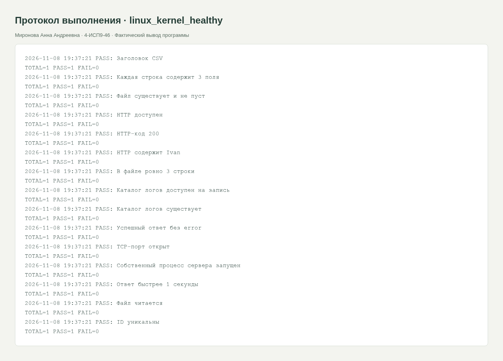
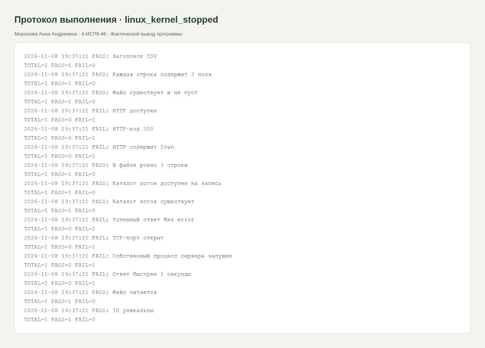

<div class="cover"><p class="course">ПРАКТИЧЕСКАЯ РАБОТА · МДК.05.03</p><h1>Bash: базовые проверки ИС и обработка сбоев</h1><div class="author"><p>Выполнила: Миронова Анна Андреевна<br>Группа: 4-ИСП9-46</p></div><div class="meta"><p>Преподаватель: А. Кондыбаева<br>Дата выполнения: 08.11.2026<br>Репозиторий: <a href="https://github.com/RealLalka/mdk-coursework-mironova-2026">https://github.com/RealLalka/mdk-coursework-mironova-2026</a></p></div></div>

## Цель работы

Проверить корректность работы ИС и научиться обнаруживать воспроизводимые дефекты.

Условие: [practice_rosa_linux_basic_test_kernel.md.md](https://github.com/softboxdev/test_methodologies/blob/e428908592dc365348cf30024e3e61cbc9e97395/it_test_methodologies/practice_rosa_linux_basic_test_kernel.md.md).

## Выполненная работа

Реализован run_tests.sh с проверками CSV-файла, чтения, числа строк, структуры, процесса, порта, HTTP-кода и содержимого. Добавлены порог ответа 1 секунда, уникальные ID и alerts.log на каждый FAIL. Агрегатор корректно возвращает exit 1, даже если последний отдельный тест прошёл.

## Стенд и воспроизведение

Фактическая ОС: Arch Linux в WSL/Linux, ядро 6.6.87.2-microsoft-standard-WSL2. Python 3.14.6, SQLite 3.53.3, Flask 3.1.2; браузер Chromium; настольный Postman 9.31.30 и Newman 6.2.1 для API-прогонов. Условия некоторых заданий называют РОСА и Python 3.8: переносимые команды выполнены на текущем Linux; совместимость именно с РОСА и Python 3.8 отдельным прогоном не подтверждена. Ограничения окружения отражены как WARN/SKIP, а не как успешные проверки.

Команды установки и запуска приведены в [README](https://github.com/RealLalka/mdk-coursework-mironova-2026#readme). Полный автоматический прогон: `python tools/verify.py --workspace <новый-каталог-результатов> --newman <путь-к-newman>`. Он создаёт изолированные копии, запускает локальные сервисы и отрицательные сценарии, затем останавливает собственные процессы. Ненулевой код ожидается только в явно помеченных отрицательных опытах.

## Анализ сложности

Чтение CSV и HTTP-тела O(B); поиск дубликатов через sort O(n log n), память зависит от sort. Набор из k последовательных проверок O(k) обращений с ограниченными таймаутами.

### Самостоятельная работа

Проверка response_time требует успешного curl и time_total < 1. Порог проверяется по фактическому времени, а не по HTTP-коду. test_unique_ids.sh отклоняет повтор ID. check.sh пишет FAIL в alerts.log и диагностический журнал. Cron подготовлен для запуска каждые 5 минут; фактические события приведены в отдельном приложении. У сервера, остановленного после положительного прогона, сетевые проверки возвращают FAIL, а файловые — PASS.

## Скриншоты и примеры выполнения

<figure><figcaption>Рисунок 1. linux_kernel_healthy. Фактический запуск; для консольных работ показан оформленный протокол вывода, для веб-приложений и Postman — интерфейс программы.</figcaption></figure>

<figure><figcaption>Рисунок 2. linux_kernel_stopped. Фактический запуск; для консольных работ показан оформленный протокол вывода, для веб-приложений и Postman — интерфейс программы.</figcaption></figure>


## Ответы на контрольные вопросы

### 1. Что такое код возврата и как его проверить?

Число, возвращаемое процессом оболочке: 0 — успех, ненулевое значение — ошибка. Сразу после команды выполните echo "$?". В наших агрегаторах наличие хотя бы одного FAIL даёт exit 1.

### 2. Зачем shift в check?

Первый аргумент — название проверки. shift удаляет его из позиционных параметров; "$@" становится выполняемой командой с её аргументами.

### 3. Для чего timeout?

Ограничивает ожидание соединения. Без него недоступный адрес может задержать весь прогон на системный TCP-таймаут.

### 4. Файл существует и сервер отдаёт файл — одно и то же?

Нет. Файл может быть на диске при остановленном сервере, неправильном URL, запрете доступа или неверном корне публикации. Проверки диска и HTTP независимы.

### 5. Как организовать 100 проверок?

Разделить по подсистемам, вынести общую функцию и конфигурацию, задать стабильные ID, агрегировать ненулевые коды, добавить машинный отчёт и запуск в CI. Независимые проверки можно распараллелить с лимитом.

### 6. Почему логировать каждый тест?

Итоговый счётчик не объясняет место и время сбоя. Имя проверки, timestamp и диагностика позволяют воспроизвести ошибку и сравнить ретест.


## Протоколы проверок

### linux_kernel_healthy

Полный протокол: [evidence/linux_kernel_healthy.md](https://github.com/RealLalka/mdk-coursework-mironova-2026/blob/main/evidence/linux_kernel_healthy.md).

```text
2026-11-08 19:50:47 PASS: Заголовок CSV
TOTAL=1 PASS=1 FAIL=0
2026-11-08 19:50:47 PASS: Каждая строка содержит 3 поля
TOTAL=1 PASS=1 FAIL=0
2026-11-08 19:50:47 PASS: Файл существует и не пуст
TOTAL=1 PASS=1 FAIL=0
2026-11-08 19:50:47 PASS: HTTP доступен
TOTAL=1 PASS=1 FAIL=0
2026-11-08 19:50:47 PASS: HTTP-код 200
TOTAL=1 PASS=1 FAIL=0
2026-11-08 19:50:47 PASS: HTTP содержит Ivan
TOTAL=1 PASS=1 FAIL=0
2026-11-08 19:50:47 PASS: В файле ровно 3 строки
TOTAL=1 PASS=1 FAIL=0
2026-11-08 19:50:47 PASS: Каталог логов доступен на запись
TOTAL=1 PASS=1 FAIL=0
2026-11-08 19:50:47 PASS: Каталог логов существует
TOTAL=1 PASS=1 FAIL=0
2026-11-08 19:50:47 PASS: Успешный ответ без error
TOTAL=1 PASS=1 FAIL=0
2026-11-08 19:50:47 PASS: TCP-порт открыт
TOTAL=1 PASS=1 FAIL=0
2026-11-08 19:50:47 PASS: Собственный процесс сервера запущен
TOTAL=1 PASS=1 FAIL=0
2026-11-08 19:50:47 PASS: Ответ быстрее 1 секунды
TOTAL=1 PASS=1 FAIL=0
2026-11-08 19:50:47 PASS: Файл читается
TOTAL=1 PASS=1 FAIL=0
2026-11-08 19:50:47 PASS: ID уникальны
TOTAL=1 PASS=1 FAIL=0
```

### linux_kernel_stopped

Полный протокол: [evidence/linux_kernel_stopped.md](https://github.com/RealLalka/mdk-coursework-mironova-2026/blob/main/evidence/linux_kernel_stopped.md).

```text
2026-11-08 19:50:47 PASS: Заголовок CSV
TOTAL=1 PASS=1 FAIL=0
2026-11-08 19:50:47 PASS: Каждая строка содержит 3 поля
TOTAL=1 PASS=1 FAIL=0
2026-11-08 19:50:47 PASS: Файл существует и не пуст
TOTAL=1 PASS=1 FAIL=0
2026-11-08 19:50:47 FAIL: HTTP доступен
TOTAL=1 PASS=0 FAIL=1
2026-11-08 19:50:47 FAIL: HTTP-код 200
TOTAL=1 PASS=0 FAIL=1
2026-11-08 19:50:47 FAIL: HTTP содержит Ivan
TOTAL=1 PASS=0 FAIL=1
2026-11-08 19:50:47 PASS: В файле ровно 3 строки
TOTAL=1 PASS=1 FAIL=0
2026-11-08 19:50:47 PASS: Каталог логов доступен на запись
TOTAL=1 PASS=1 FAIL=0
2026-11-08 19:50:47 PASS: Каталог логов существует
TOTAL=1 PASS=1 FAIL=0
2026-11-08 19:50:47 FAIL: Успешный ответ без error
TOTAL=1 PASS=0 FAIL=1
2026-11-08 19:50:47 FAIL: TCP-порт открыт
TOTAL=1 PASS=0 FAIL=1
2026-11-08 19:50:47 FAIL: Собственный процесс сервера запущен
TOTAL=1 PASS=0 FAIL=1
2026-11-08 19:50:47 FAIL: Ответ быстрее 1 секунды
TOTAL=1 PASS=0 FAIL=1
2026-11-08 19:50:47 PASS: Файл читается
TOTAL=1 PASS=1 FAIL=0
2026-11-08 19:50:47 PASS: ID уникальны
TOTAL=1 PASS=1 FAIL=0
```


## Протоколы проверок

### cron

Полный протокол: [evidence/cron.md](https://github.com/RealLalka/mdk-coursework-mironova-2026/blob/main/evidence/cron.md).

```text
*/5 * * * * /LoL/.scratch/mdk-coursework/cron-job.sh bash5
*/15 * * * * /LoL/.scratch/mdk-coursework/cron-job.sh json15

2026-11-08T19:40:00+03:00 scheduled=bash5
2026-11-08T19:45:00+03:00 scheduled=json15
2026-11-08T19:45:00+03:00 scheduled=bash5
2026-11-08T19:50:00+03:00 scheduled=bash5
```

### bash-scheduled.log

```text
2026-11-08 19:40:00 PASS: Файл существует и не пуст
TOTAL=1 PASS=1 FAIL=0
2026-11-08 19:45:00 PASS: Файл существует и не пуст
TOTAL=1 PASS=1 FAIL=0
2026-11-08 19:50:00 PASS: Заголовок CSV
TOTAL=1 PASS=1 FAIL=0
2026-11-08 19:50:00 PASS: Каждая строка содержит 3 поля
TOTAL=1 PASS=1 FAIL=0
2026-11-08 19:50:00 PASS: Файл существует и не пуст
TOTAL=1 PASS=1 FAIL=0
2026-11-08 19:50:00 PASS: HTTP доступен
TOTAL=1 PASS=1 FAIL=0
2026-11-08 19:50:00 PASS: HTTP-код 200
TOTAL=1 PASS=1 FAIL=0
2026-11-08 19:50:00 PASS: HTTP содержит Ivan
TOTAL=1 PASS=1 FAIL=0
2026-11-08 19:50:00 PASS: В файле ровно 3 строки
TOTAL=1 PASS=1 FAIL=0
2026-11-08 19:50:00 PASS: Каталог логов доступен на запись
TOTAL=1 PASS=1 FAIL=0
2026-11-08 19:50:00 PASS: Каталог логов существует
TOTAL=1 PASS=1 FAIL=0
2026-11-08 19:50:00 PASS: Успешный ответ без error
TOTAL=1 PASS=1 FAIL=0
2026-11-08 19:50:00 PASS: TCP-порт открыт
TOTAL=1 PASS=1 FAIL=0
2026-11-08 19:50:00 PASS: Собственный процесс сервера запущен
TOTAL=1 PASS=1 FAIL=0
2026-11-08 19:50:00 PASS: Ответ быстрее 1 секунды
TOTAL=1 PASS=1 FAIL=0
2026-11-08 19:50:00 PASS: Файл читается
TOTAL=1 PASS=1 FAIL=0
2026-11-08 19:50:00 PASS: ID уникальны
TOTAL=1 PASS=1 FAIL=0

```

### kernel-scheduled.log

```text
2026-11-08 19:50:00 PASS: Заголовок CSV
TOTAL=1 PASS=1 FAIL=0
2026-11-08 19:50:00 PASS: Каждая строка содержит 3 поля
TOTAL=1 PASS=1 FAIL=0
2026-11-08 19:50:00 PASS: Файл существует и не пуст
TOTAL=1 PASS=1 FAIL=0
2026-11-08 19:50:00 PASS: HTTP доступен
TOTAL=1 PASS=1 FAIL=0
2026-11-08 19:50:00 PASS: HTTP-код 200
TOTAL=1 PASS=1 FAIL=0
2026-11-08 19:50:00 PASS: HTTP содержит Ivan
TOTAL=1 PASS=1 FAIL=0
2026-11-08 19:50:00 PASS: В файле ровно 3 строки
TOTAL=1 PASS=1 FAIL=0
2026-11-08 19:50:00 PASS: Каталог логов доступен на запись
TOTAL=1 PASS=1 FAIL=0
2026-11-08 19:50:00 PASS: Каталог логов существует
TOTAL=1 PASS=1 FAIL=0
2026-11-08 19:50:00 PASS: Успешный ответ без error
TOTAL=1 PASS=1 FAIL=0
2026-11-08 19:50:00 PASS: TCP-порт открыт
TOTAL=1 PASS=1 FAIL=0
2026-11-08 19:50:01 PASS: Собственный процесс сервера запущен
TOTAL=1 PASS=1 FAIL=0
2026-11-08 19:50:01 PASS: Ответ быстрее 1 секунды
TOTAL=1 PASS=1 FAIL=0
2026-11-08 19:50:01 PASS: Файл читается
TOTAL=1 PASS=1 FAIL=0
2026-11-08 19:50:01 PASS: ID уникальны
TOTAL=1 PASS=1 FAIL=0

```

### json-scheduled.log

```text
2026-11-08 19:45:00 PASS: JSON email_format
TOTAL=1 PASS=1 FAIL=0
2026-11-08 19:45:00 PASS: UTF-8 broken.json
2026-11-08 19:45:00 PASS: UTF-8 config.json
2026-11-08 19:45:00 PASS: UTF-8 orders.json
2026-11-08 19:45:00 PASS: UTF-8 products.json
2026-11-08 19:45:00 PASS: UTF-8 users.json
TOTAL=5 PASS=5 FAIL=0
2026-11-08 19:45:00 PASS: users.json существует
2026-11-08 19:45:00 PASS: config.json существует
TOTAL=2 PASS=2 FAIL=0
2026-11-08 19:45:00 PASS: JSON fields
TOTAL=1 PASS=1 FAIL=0
SKIP: jq отсутствует; необязательная зависимость
2026-11-08 19:45:00 PASS: JSON no_extra_fields
TOTAL=1 PASS=1 FAIL=0
2026-11-08 19:45:00 PASS: JSON orders
TOTAL=1 PASS=1 FAIL=0
2026-11-08 19:45:00 PASS: JSON products
TOTAL=1 PASS=1 FAIL=0
2026-11-08 19:45:01 PASS: JSON ranges
TOTAL=1 PASS=1 FAIL=0
2026-11-08 19:45:01 PASS: JSON schema
TOTAL=1 PASS=1 FAIL=0
2026-11-08 19:45:01 PASS: JSON types
TOTAL=1 PASS=1 FAIL=0
2026-11-08 19:45:01 PASS: JSON unique_ids
TOTAL=1 PASS=1 FAIL=0
2026-11-08 19:45:01 PASS: JSON users
TOTAL=1 PASS=1 FAIL=0
2026-11-08 19:45:01 PASS: JSON valid
TOTAL=1 PASS=1 FAIL=0
```


## Вывод

Положительный и отрицательный прогоны разделены. Намеренный дефект обнаружен, исходные данные не повреждены. Полные протоколы и способ повторения входят в репозиторий; ограничения стенда явно указаны.

## Использованные материалы

Условия работ: репозитории softboxdev/programming_course и softboxdev/test_methodologies; точные ссылки и commit SHA зафиксированы в SOURCES.md.

Документация: [Python sqlite3](https://docs.python.org/3.14/library/sqlite3.html), [Python json](https://docs.python.org/3.14/library/json.html), [Flask Quickstart](https://flask.palletsprojects.com/en/stable/quickstart/), [Postman Newman](https://learning.postman.com/docs/reference/newman-cli/command-line-integration-with-newman/).

<div class="pagebreak"></div>

## Приложение. Листинги файлов

### testing/linux_kernel/check.sh

```bash
#!/usr/bin/env bash
set -u
ROOT="$(cd "$(dirname "${BASH_SOURCE[0]}")" && pwd)"
DATA="${QA_DATA:-$ROOT/data}"
RUN="${QA_RUN:-$ROOT/.logs}"
mkdir -p "$RUN"
LOG_FILE="$RUN/test_$(date +%Y%m%d_%H%M%S)_$$.log"
PASS=0
FAIL=0
check() {
    local name="$1"
    shift
    if "$@" >"$RUN/last_stdout.txt" 2>"$RUN/last_stderr.txt"; then
        echo "$(date '+%F %T') PASS: $name" | tee -a "$LOG_FILE"
        PASS=$((PASS + 1))
    else
        echo "$(date '+%F %T') FAIL: $name" | tee -a "$LOG_FILE" "$RUN/alerts.log"
        cat "$RUN/last_stderr.txt" >> "$LOG_FILE"
        FAIL=$((FAIL + 1))
    fi
}
finish() {
    echo "TOTAL=$((PASS + FAIL)) PASS=$PASS FAIL=$FAIL" | tee -a "$LOG_FILE"
    test "$FAIL" -eq 0
}
```

### testing/linux_kernel/data/users.csv

```text
id,name,status
1,Ivan,active
2,Maria,inactive
```

### testing/linux_kernel/functions.sh

```bash
#!/usr/bin/env bash
source "$(dirname "${BASH_SOURCE[0]}")/check.sh"
URL="${QA_URL:-http://127.0.0.1:8080/users.csv}"
HOST="${QA_HOST:-127.0.0.1}"
PORT="${QA_PORT:-8080}"
fetch() { curl -fsS --max-time 3 "$URL"; }
file_rows() { test "$(wc -l < "$DATA/users.csv")" -eq 3; }
file_fields() { awk -F, 'NF!=3{bad=1} END{exit bad}' "$DATA/users.csv"; }
unique_ids() { test -z "$(tail -n +2 "$DATA/users.csv" | cut -d, -f1 | sort | uniq -d)"; }
http_code() { test "$(curl -s -o /dev/null -w '%{http_code}' --max-time 3 "$URL")" = 200; }
http_content() { local body; body="$(fetch)" || return 1; [[ "$body" == *Ivan* ]]; }
no_errors() { local body; body="$(fetch)" || return 1; ! printf '%s' "$body" | grep -qi error; }
process_alive() { test -n "${QA_PID:-}" && kill -0 "$QA_PID" 2>/dev/null; }
port_open() { timeout 2 bash -c 'exec 3<>/dev/tcp/$1/$2' bash "$HOST" "$PORT"; }
response_fast() { local seconds; seconds="$(curl -fsS -o /dev/null -w '%{time_total}' --max-time 3 "$URL")" || return 1; awk -v t="$seconds" 'BEGIN{exit !(t<1)}'; }
```

### testing/linux_kernel/run_all.sh

```bash
#!/usr/bin/env bash
ROOT="$(cd "$(dirname "${BASH_SOURCE[0]}")" && pwd)"
result=0
for script in "$ROOT"/test_*.sh; do
    bash "$script" || result=1
done
exit "$result"
```

### testing/linux_kernel/run_tests.sh

```bash
#!/usr/bin/env bash
exec bash "$(dirname "${BASH_SOURCE[0]}")/run_all.sh" "$@"
```

### testing/linux_kernel/test_content.sh

```bash
#!/usr/bin/env bash
source "$(dirname "${BASH_SOURCE[0]}")/functions.sh"
check "Заголовок CSV" grep -q "^id,name,status$" "$DATA/users.csv"
finish
```

### testing/linux_kernel/test_csv_format.sh

```bash
#!/usr/bin/env bash
source "$(dirname "${BASH_SOURCE[0]}")/functions.sh"
check "Каждая строка содержит 3 поля" file_fields
finish
```

### testing/linux_kernel/test_file.sh

```bash
#!/usr/bin/env bash
source "$(dirname "${BASH_SOURCE[0]}")/functions.sh"
check "Файл существует и не пуст" test -s "$DATA/users.csv"
finish
```

### testing/linux_kernel/test_http.sh

```bash
#!/usr/bin/env bash
source "$(dirname "${BASH_SOURCE[0]}")/functions.sh"
check "HTTP доступен" fetch
finish
```

### testing/linux_kernel/test_http_code.sh

```bash
#!/usr/bin/env bash
source "$(dirname "${BASH_SOURCE[0]}")/functions.sh"
check "HTTP-код 200" http_code
finish
```

### testing/linux_kernel/test_http_content.sh

```bash
#!/usr/bin/env bash
source "$(dirname "${BASH_SOURCE[0]}")/functions.sh"
check "HTTP содержит Ivan" http_content
finish
```

### testing/linux_kernel/test_lines.sh

```bash
#!/usr/bin/env bash
source "$(dirname "${BASH_SOURCE[0]}")/functions.sh"
check "В файле ровно 3 строки" file_rows
finish
```

### testing/linux_kernel/test_log_writable.sh

```bash
#!/usr/bin/env bash
source "$(dirname "${BASH_SOURCE[0]}")/functions.sh"
check "Каталог логов доступен на запись" test -w "$RUN"
finish
```

### testing/linux_kernel/test_logs.sh

```bash
#!/usr/bin/env bash
source "$(dirname "${BASH_SOURCE[0]}")/functions.sh"
check "Каталог логов существует" test -d "$RUN"
finish
```

### testing/linux_kernel/test_no_errors.sh

```bash
#!/usr/bin/env bash
source "$(dirname "${BASH_SOURCE[0]}")/functions.sh"
check "Успешный ответ без error" no_errors
finish
```

### testing/linux_kernel/test_port.sh

```bash
#!/usr/bin/env bash
source "$(dirname "${BASH_SOURCE[0]}")/functions.sh"
check "TCP-порт открыт" port_open
finish
```

### testing/linux_kernel/test_process.sh

```bash
#!/usr/bin/env bash
source "$(dirname "${BASH_SOURCE[0]}")/functions.sh"
check "Собственный процесс сервера запущен" process_alive
finish
```

### testing/linux_kernel/test_response_time.sh

```bash
#!/usr/bin/env bash
source "$(dirname "${BASH_SOURCE[0]}")/functions.sh"
check "Ответ быстрее 1 секунды" response_fast
finish
```

### testing/linux_kernel/test_rights.sh

```bash
#!/usr/bin/env bash
source "$(dirname "${BASH_SOURCE[0]}")/functions.sh"
check "Файл читается" test -r "$DATA/users.csv"
finish
```

### testing/linux_kernel/test_unique_ids.sh

```bash
#!/usr/bin/env bash
source "$(dirname "${BASH_SOURCE[0]}")/functions.sh"
check "ID уникальны" unique_ids
finish
```
