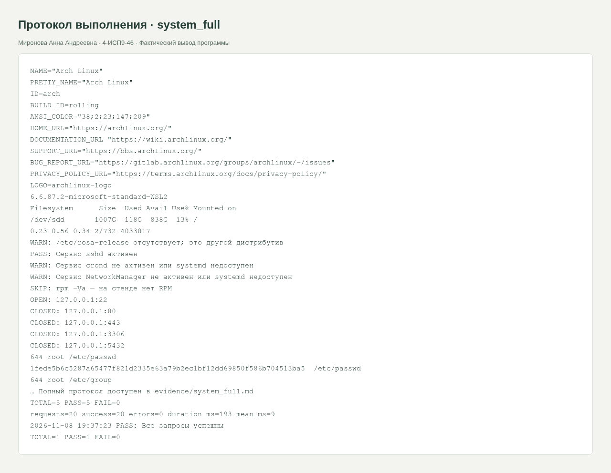
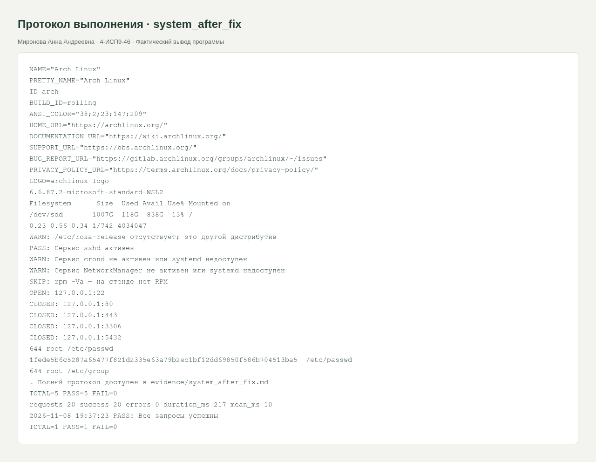

<div class="cover"><p class="course">ПРАКТИЧЕСКАЯ РАБОТА · МДК.05.03</p><h1>Тестирование типовых ИС в Linux</h1><div class="author"><p>Выполнила: Миронова Анна Андреевна<br>Группа: 4-ИСП9-46</p></div><div class="meta"><p>Преподаватель: А. Кондыбаева<br>Дата выполнения: 08.11.2026<br>Репозиторий: <a href="https://github.com/RealLalka/mdk-coursework-mironova-2026">https://github.com/RealLalka/mdk-coursework-mironova-2026</a></p></div></div>

## Цель работы

Проверить корректность работы ИС и научиться обнаруживать воспроизводимые дефекты.

Условие: [practice_rosa_linux.md](https://github.com/softboxdev/test_methodologies/blob/e428908592dc365348cf30024e3e61cbc9e97395/it_test_methodologies/practice_rosa_linux.md).

## Выполненная работа

Реализованы setup.sh, os_check.sh, web_test.sh, port_check.sh, integrity_check.sh, log_check.sh, load_test.sh и агрегатор. Выполнены сведения об ОС/ядре/диске/нагрузке, проверка локальных портов 22/80/443/3306/5432, хэшей ключевых конфигов, прав и доступности журналов. Нагрузочный мини-тест содержит 20 последовательных запросов только к локальному стенду.

## Стенд и воспроизведение

Фактическая ОС: Arch Linux в WSL/Linux, ядро 6.6.87.2-microsoft-standard-WSL2. Python 3.14.6, SQLite 3.53.3, Flask 3.1.2; браузер Chromium; настольный Postman 9.31.30 и Newman 6.2.1 для API-прогонов. Условия некоторых заданий называют РОСА и Python 3.8: переносимые команды выполнены на текущем Linux; совместимость именно с РОСА и Python 3.8 отдельным прогоном не подтверждена. Ограничения окружения отражены как WARN/SKIP, а не как успешные проверки.

Команды установки и запуска приведены в [README](https://github.com/RealLalka/mdk-coursework-mironova-2026#readme). Полный автоматический прогон: `python tools/verify.py --workspace <новый-каталог-результатов> --newman <путь-к-newman>`. Он создаёт изолированные копии, запускает локальные сервисы и отрицательные сценарии, затем останавливает собственные процессы. Ненулевой код ожидается только в явно помеченных отрицательных опытах.

## Анализ сложности

Последовательный мини-тест: O(q) запросов, память O(1). SHA256 файлов суммарной длиной B: O(B); анализ журнала O(B). Обхода всего диска нет, проверяется фиксированный перечень конфигов.

### Найденные дефекты учебного стенда

| ID | Шаги | Ожидалось | Фактически | Severity | Ретест |
|---|---|---|---|---|---|
| LNX-01 | chmod 666 app.conf; integrity_check.sh | Запись только владельцу | Запись разрешена всем, FAIL | Major | chmod 644, PASS |
| LNX-02 | Подать app.log с ERROR; log_check.sh | Нет ERROR/FATAL | Обнаружены ошибки, FAIL | Major | Чистый учебный журнал, PASS |
| LNX-03 | Остановить учебный HTTP-сервис; web_test.sh | Страницы 200/404 по контракту | curl не соединяется | Critical | Сервер запущен, PASS |

Это намеренно созданные дефекты изолированного учебного стенда. Системные конфиги и службы рабочей машины не изменялись. Отсутствие /etc/rosa-release, RPM и журналов авторизации — ограничения текущей среды, а не выдуманные дефекты РОСА. Указанная в методичке проверка служб сделана информационно: наличие sshd или PostgreSQL не является обязательным требованием нашего приложения.

## Скриншоты и примеры выполнения

<figure><figcaption>Рисунок 1. system_full. Фактический запуск; для консольных работ показан оформленный протокол вывода, для веб-приложений и Postman — интерфейс программы.</figcaption></figure>

<figure><figcaption>Рисунок 2. system_after_fix. Фактический запуск; для консольных работ показан оформленный протокол вывода, для веб-приложений и Postman — интерфейс программы.</figcaption></figure>


## Ответы на контрольные вопросы

### 1. Тестирование ОС и веб-приложения: разница?

ОС проверяют по службам, процессам, ресурсам, пакетам и правам. Веб-приложение — по HTTP, пользовательским сценариям, данным, безопасности и производительности. Доступность ОС не доказывает правильность веб-ответа.

### 2. Какие метрики нагрузки использовать?

Частота запросов, доля ошибок, задержки p50/p95/p99, одновременные запросы, CPU/RAM и насыщение ресурсов. В этой работе измерены успехи/ошибки и среднее время последовательного мини-прогона; это не полноценный тест конкурентной нагрузки.

### 3. Как проверить целостность пакетов РОСА?

rpm -Va сравнивает установленные файлы с метаданными RPM: размеры, хэши, права и другие признаки. Изменённый конфиг не всегда дефект. На Arch RPM отсутствует; команда отмечена SKIP, результат для РОСА не заявляется.

### 4. Что проверяет curl -w http_code?

Выводит HTTP-код ответа, который нужно сравнить с ожидаемым. Код возврата самого curl и код HTTP различны: без -f успешная передача 404 может дать exit 0.

### 5. Как искать опасные права?

Проверять world-writable, владельца и доступ к конфигам/секретам. В работе используется stat и битовая маска записи для others; chmod 666 учебного конфига воспроизводит нарушение, chmod 644 устраняет его.


## Протоколы проверок

### system_full

Полный протокол: [evidence/system_full.md](https://github.com/RealLalka/mdk-coursework-mironova-2026/blob/main/evidence/system_full.md).

```text
NAME="Arch Linux"
PRETTY_NAME="Arch Linux"
ID=arch
BUILD_ID=rolling
ANSI_COLOR="38;2;23;147;209"
HOME_URL="https://archlinux.org/"
DOCUMENTATION_URL="https://wiki.archlinux.org/"
SUPPORT_URL="https://bbs.archlinux.org/"
BUG_REPORT_URL="https://gitlab.archlinux.org/groups/archlinux/-/issues"
PRIVACY_POLICY_URL="https://terms.archlinux.org/docs/privacy-policy/"
LOGO=archlinux-logo
6.6.87.2-microsoft-standard-WSL2
Filesystem      Size  Used Avail Use% Mounted on
/dev/sdd       1007G  119G  838G  13% /
0.08 0.23 0.27 1/814 4084488
WARN: /etc/rosa-release отсутствует; это другой дистрибутив
PASS: Сервис sshd активен
WARN: Сервис crond не активен или systemd недоступен
WARN: Сервис NetworkManager не активен или systemd недоступен
SKIP: rpm -Va — на стенде нет RPM
OPEN: 127.0.0.1:22
CLOSED: 127.0.0.1:80
CLOSED: 127.0.0.1:443
CLOSED: 127.0.0.1:3306
CLOSED: 127.0.0.1:5432
644 root /etc/passwd
1fede5b6c5287a65477f821d2335e63a79b2ec1bf12dd69850f586b704513ba5  /etc/passwd
644 root /etc/group
342d9c4043953ce5c9efddfa9e34e0c2d8868f96fd182c33ecd880c61e0549f4  /etc/group
644 root /etc/hosts
fca6fb32ed9529aacbaf6103a9132a11e3172a8203c130b64a7b8a35daa576aa  /etc/hosts
644 root /etc/fstab
e54626e74ed8fee4173b62a545ab1c3a3a069e4217a0ee8fc398d9933e9c1696  /etc/fstab
440 root /etc/sudoers
ef8f58e8047b9308914150b8d0cabdd2120e4dfd7a4599b0f2d3d1e5cf4405aa  /etc/sudoers
2026-11-08 19:50:48 FAIL: Учебный конфиг не world-writable
TOTAL=1 PASS=0 FAIL=1
Nov 06 01:05:10 DESKTOP-4R10HKQ kernel: misc dxg: dxgk: dxgkio_escape: Ioctl failed: -75
Nov 06 01:05:10 DESKTOP-4R10HKQ kernel: misc dxg: dxgk: dxgkio_escape: Ioctl failed: -75
Nov 06 01:05:10 DESKTOP-4R10HKQ kernel: misc dxg: dxgk: dxgkio_escape: Ioctl failed: -75
Nov 06 01:05:10 DESKTOP-4R10HKQ kernel: misc dxg: dxgk: dxgkio_escape: Ioctl failed: -75
Nov 06 01:05:15 DESKTOP-4R10HKQ kernel: misc dxg: dxgk: dxgkio_escape: Ioctl failed: -75
Nov 06 01:05:15 DESKTOP-4R10HKQ kernel: misc dxg: dxgk: dxgkio_escape: Ioctl failed: -75
Nov 06 07:41:05 DESKTOP-4R10HKQ unknown: WSL (246) ERROR: CheckConnection: getaddrinfo() failed: -5
Nov 06 12:50:50 DESKTOP-4R10HKQ unknown: WSL (246) ERROR: CheckConnection: getaddrinfo() failed: -5
Nov 07 15:38:37 DESKTOP-4R10HKQ sshd-session[2543105]: fatal: userauth_pubkey: parse publickey packet: incomplete message [preauth]
Nov 08 10:49:31 DESKTOP-4R10HKQ sshd-session[3553533]: fatal: userauth_pubkey: parse publickey packet: incomplete message [preauth]
SKIP: журналы secure/auth.log недоступны
577M	/var/log
2026-11-08 19:50:48 FAIL: Нет ERROR/FATAL в учебном журнале
TOTAL=1 PASS=0 FAIL=1
2026-11-08 19:50:48 PASS: Главная 200
2026-11-08 19:50:48 PASS: robots.txt 200
2026-11-08 19:50:48 PASS: Отсутствующий путь 404
2026-11-08 19:50:48 PASS: favicon.ico 200
2026-11-08 19:50:48 PASS: Время ответа меньше 2 секунд
response_time_seconds=0.001286
TOTAL=5 PASS=5 FAIL=0
requests=20 success=20 errors=0 duration_ms=192 mean_ms=9
2026-11-08 19:50:48 PASS: Все запросы успешны
TOTAL=1 PASS=1 FAIL=0
```

### system_after_fix

Полный протокол: [evidence/system_after_fix.md](https://github.com/RealLalka/mdk-coursework-mironova-2026/blob/main/evidence/system_after_fix.md).

```text
NAME="Arch Linux"
PRETTY_NAME="Arch Linux"
ID=arch
BUILD_ID=rolling
ANSI_COLOR="38;2;23;147;209"
HOME_URL="https://archlinux.org/"
DOCUMENTATION_URL="https://wiki.archlinux.org/"
SUPPORT_URL="https://bbs.archlinux.org/"
BUG_REPORT_URL="https://gitlab.archlinux.org/groups/archlinux/-/issues"
PRIVACY_POLICY_URL="https://terms.archlinux.org/docs/privacy-policy/"
LOGO=archlinux-logo
6.6.87.2-microsoft-standard-WSL2
Filesystem      Size  Used Avail Use% Mounted on
/dev/sdd       1007G  119G  838G  13% /
0.08 0.23 0.27 1/814 4084652
WARN: /etc/rosa-release отсутствует; это другой дистрибутив
PASS: Сервис sshd активен
WARN: Сервис crond не активен или systemd недоступен
WARN: Сервис NetworkManager не активен или systemd недоступен
SKIP: rpm -Va — на стенде нет RPM
OPEN: 127.0.0.1:22
CLOSED: 127.0.0.1:80
CLOSED: 127.0.0.1:443
CLOSED: 127.0.0.1:3306
CLOSED: 127.0.0.1:5432
644 root /etc/passwd
1fede5b6c5287a65477f821d2335e63a79b2ec1bf12dd69850f586b704513ba5  /etc/passwd
644 root /etc/group
342d9c4043953ce5c9efddfa9e34e0c2d8868f96fd182c33ecd880c61e0549f4  /etc/group
644 root /etc/hosts
fca6fb32ed9529aacbaf6103a9132a11e3172a8203c130b64a7b8a35daa576aa  /etc/hosts
644 root /etc/fstab
e54626e74ed8fee4173b62a545ab1c3a3a069e4217a0ee8fc398d9933e9c1696  /etc/fstab
440 root /etc/sudoers
ef8f58e8047b9308914150b8d0cabdd2120e4dfd7a4599b0f2d3d1e5cf4405aa  /etc/sudoers
2026-11-08 19:50:49 PASS: Учебный конфиг не world-writable
TOTAL=1 PASS=1 FAIL=0
Nov 06 01:05:10 DESKTOP-4R10HKQ kernel: misc dxg: dxgk: dxgkio_escape: Ioctl failed: -75
Nov 06 01:05:10 DESKTOP-4R10HKQ kernel: misc dxg: dxgk: dxgkio_escape: Ioctl failed: -75
Nov 06 01:05:10 DESKTOP-4R10HKQ kernel: misc dxg: dxgk: dxgkio_escape: Ioctl failed: -75
Nov 06 01:05:10 DESKTOP-4R10HKQ kernel: misc dxg: dxgk: dxgkio_escape: Ioctl failed: -75
Nov 06 01:05:15 DESKTOP-4R10HKQ kernel: misc dxg: dxgk: dxgkio_escape: Ioctl failed: -75
Nov 06 01:05:15 DESKTOP-4R10HKQ kernel: misc dxg: dxgk: dxgkio_escape: Ioctl failed: -75
Nov 06 07:41:05 DESKTOP-4R10HKQ unknown: WSL (246) ERROR: CheckConnection: getaddrinfo() failed: -5
Nov 06 12:50:50 DESKTOP-4R10HKQ unknown: WSL (246) ERROR: CheckConnection: getaddrinfo() failed: -5
Nov 07 15:38:37 DESKTOP-4R10HKQ sshd-session[2543105]: fatal: userauth_pubkey: parse publickey packet: incomplete message [preauth]
Nov 08 10:49:31 DESKTOP-4R10HKQ sshd-session[3553533]: fatal: userauth_pubkey: parse publickey packet: incomplete message [preauth]
SKIP: журналы secure/auth.log недоступны
577M	/var/log
2026-11-08 19:50:49 PASS: Нет ERROR/FATAL в учебном журнале
TOTAL=1 PASS=1 FAIL=0
2026-11-08 19:50:49 PASS: Главная 200
2026-11-08 19:50:49 PASS: robots.txt 200
2026-11-08 19:50:49 PASS: Отсутствующий путь 404
2026-11-08 19:50:49 PASS: favicon.ico 200
2026-11-08 19:50:49 PASS: Время ответа меньше 2 секунд
response_time_seconds=0.000927
TOTAL=5 PASS=5 FAIL=0
requests=20 success=20 errors=0 duration_ms=179 mean_ms=8
2026-11-08 19:50:49 PASS: Все запросы успешны
TOTAL=1 PASS=1 FAIL=0
```


## Вывод

Положительный и отрицательный прогоны разделены. Намеренный дефект обнаружен, исходные данные не повреждены. Полные протоколы и способ повторения входят в репозиторий; ограничения стенда явно указаны.

## Использованные материалы

Условия работ: репозитории softboxdev/programming_course и softboxdev/test_methodologies; точные ссылки и commit SHA зафиксированы в SOURCES.md.

Документация: [Python sqlite3](https://docs.python.org/3.14/library/sqlite3.html), [Python json](https://docs.python.org/3.14/library/json.html), [Flask Quickstart](https://flask.palletsprojects.com/en/stable/quickstart/), [Postman Newman](https://learning.postman.com/docs/reference/newman-cli/command-line-integration-with-newman/).

<div class="pagebreak"></div>

## Приложение. Листинги файлов

### testing/linux_system/check.sh

```bash
#!/usr/bin/env bash
set -u
ROOT="$(cd "$(dirname "${BASH_SOURCE[0]}")" && pwd)"
DATA="${QA_DATA:-$ROOT/data}"
RUN="${QA_RUN:-$ROOT/.logs}"
mkdir -p "$RUN"
LOG_FILE="$RUN/test_$(date +%Y%m%d_%H%M%S)_$$.log"
PASS=0
FAIL=0
check() {
    local name="$1"
    shift
    if "$@" >"$RUN/last_stdout.txt" 2>"$RUN/last_stderr.txt"; then
        echo "$(date '+%F %T') PASS: $name" | tee -a "$LOG_FILE"
        PASS=$((PASS + 1))
    else
        echo "$(date '+%F %T') FAIL: $name" | tee -a "$LOG_FILE" "$RUN/alerts.log"
        cat "$RUN/last_stderr.txt" >> "$LOG_FILE"
        FAIL=$((FAIL + 1))
    fi
}
finish() {
    echo "TOTAL=$((PASS + FAIL)) PASS=$PASS FAIL=$FAIL" | tee -a "$LOG_FILE"
    test "$FAIL" -eq 0
}
```

### testing/linux_system/integrity_check.sh

```bash
#!/usr/bin/env bash
source "$(dirname "${BASH_SOURCE[0]}")/check.sh"
for file in /etc/passwd /etc/group /etc/hosts /etc/fstab /etc/sudoers; do
    if [ -f "$file" ]; then
        stat -c '%a %U %n' "$file"
        sha256sum "$file"
        mode=$(stat -c '%a' "$file")
        if (( (8#$mode & 2) != 0 )); then echo "WARN: world-writable $file"; fi
    fi
done
if [ -n "${QA_CONF:-}" ]; then
    not_world_writable() { local mode; mode=$(stat -c '%a' "$QA_CONF"); (( (8#$mode & 2) == 0 )); }
    check "Учебный конфиг не world-writable" not_world_writable
fi
finish
```

### testing/linux_system/load_test.sh

```bash
#!/usr/bin/env bash
source "$(dirname "${BASH_SOURCE[0]}")/check.sh"
URL="${1:-http://127.0.0.1:8080}"
N="${2:-20}"
if ! [[ "$N" =~ ^[1-9][0-9]*$ ]] || [ "$N" -gt 100 ]; then echo "N должно быть от 1 до 100"; exit 2; fi
start=$(date +%s%N)
OK=0
ERR=0
for ((i=0; i<N; i++)); do
    code=$(curl -s -o /dev/null -w '%{http_code}' --max-time 3 "$URL")
    if [ "$code" = 200 ]; then OK=$((OK+1)); else ERR=$((ERR+1)); fi
done
end=$(date +%s%N)
duration=$(((end-start)/1000000))
echo "requests=$N success=$OK errors=$ERR duration_ms=$duration mean_ms=$((duration/N))"
check "Все запросы успешны" test "$ERR" -eq 0
finish
```

### testing/linux_system/log_check.sh

```bash
#!/usr/bin/env bash
source "$(dirname "${BASH_SOURCE[0]}")/check.sh"
if command -v journalctl >/dev/null; then journalctl -p err -n 10 --no-pager 2>/dev/null || true; fi
found=0
for file in /var/log/secure /var/log/auth.log; do
    if [ -r "$file" ]; then
        echo "Неудачные логины: $(grep -ic 'failed password' "$file" || true)"
        found=1
    fi
done
if [ "$found" -eq 0 ]; then echo "SKIP: журналы secure/auth.log недоступны"; fi
du -sh /var/log 2>/dev/null || true
if [ -n "${QA_APP_LOG:-}" ]; then
    clean_log() { test -r "$QA_APP_LOG" && ! grep -qiE 'ERROR|FATAL' "$QA_APP_LOG"; }
    check "Нет ERROR/FATAL в учебном журнале" clean_log
fi
finish
```

### testing/linux_system/os_check.sh

```bash
#!/usr/bin/env bash
source "$(dirname "${BASH_SOURCE[0]}")/check.sh"
cat /etc/os-release
uname -r
df -h /
cat /proc/loadavg
if [ -f /etc/rosa-release ]; then cat /etc/rosa-release; else echo "WARN: /etc/rosa-release отсутствует; это другой дистрибутив"; fi
for svc in sshd crond NetworkManager; do
    if systemctl is-active --quiet "$svc" 2>/dev/null; then
        echo "PASS: Сервис $svc активен"
    else
        echo "WARN: Сервис $svc не активен или systemd недоступен"
    fi
done
if command -v rpm >/dev/null; then
    echo "INFO: rpm доступен; rpm -Va запускается вручную на РОСА"
else
    echo "SKIP: rpm -Va — на стенде нет RPM"
fi
```

### testing/linux_system/port_check.sh

```bash
#!/usr/bin/env bash
source "$(dirname "${BASH_SOURCE[0]}")/check.sh"
for port in 22 80 443 3306 5432; do
    if timeout 2 bash -c 'exec 3<>/dev/tcp/127.0.0.1/$1' bash "$port" 2>/dev/null; then
        echo "OPEN: 127.0.0.1:$port"
    else
        echo "CLOSED: 127.0.0.1:$port"
    fi
done
```

### testing/linux_system/run_all.sh

```bash
#!/usr/bin/env bash
ROOT="$(cd "$(dirname "${BASH_SOURCE[0]}")" && pwd)"
result=0
for script in os_check.sh port_check.sh integrity_check.sh log_check.sh; do bash "$ROOT/$script" || result=1; done
bash "$ROOT/web_test.sh" "${QA_URL_BASE:-http://127.0.0.1:8080}" || result=1
bash "$ROOT/load_test.sh" "${QA_URL_BASE:-http://127.0.0.1:8080}" 20 || result=1
exit "$result"
```

### testing/linux_system/setup.sh

```bash
#!/usr/bin/env bash
set -eu
ROOT="$(cd "$(dirname "${BASH_SOURCE[0]}")" && pwd)"
mkdir -p "${QA_RUN:-$ROOT/.logs}"
echo "Среда подготовлена: ${QA_RUN:-$ROOT/.logs}"
```

### testing/linux_system/web_test.sh

```bash
#!/usr/bin/env bash
source "$(dirname "${BASH_SOURCE[0]}")/check.sh"
URL="${1:-http://127.0.0.1:8080}"
code_is() { test "$(curl -sS -o /dev/null -w '%{http_code}' --max-time 3 "$URL$1")" = "$2"; }
check "Главная 200" code_is / 200
check "robots.txt 200" code_is /robots.txt 200
check "Отсутствующий путь 404" code_is /nonexist 404
check "favicon.ico 200" code_is /favicon.ico 200
seconds="$(curl -fsS -o /dev/null -w '%{time_total}' --max-time 3 "$URL/")" || seconds=999
check "Время ответа меньше 2 секунд" awk -v t="$seconds" 'BEGIN{exit !(t<2)}'
echo "response_time_seconds=$seconds"
finish
```
