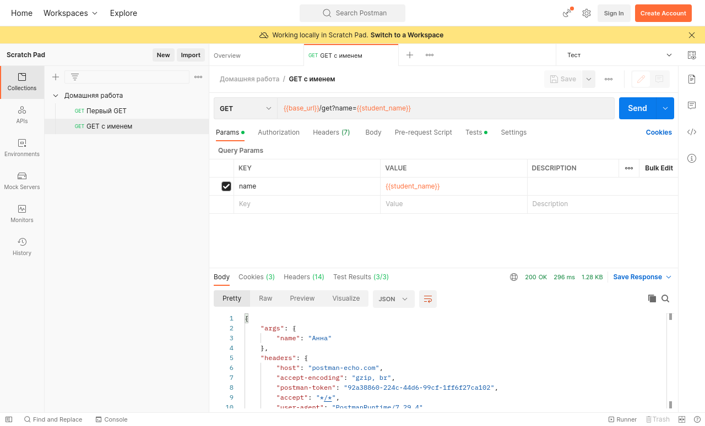
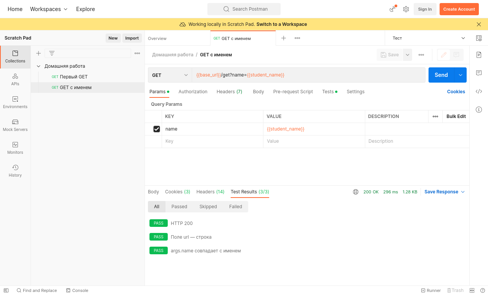
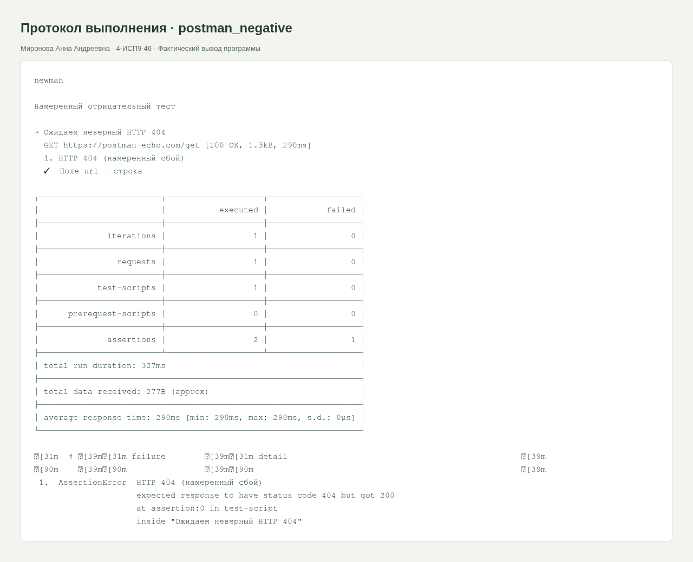

<div class="cover"><p class="course">ПРАКТИЧЕСКАЯ РАБОТА · МДК.05.03</p><h1>Postman: установка, коллекция и первые API-тесты</h1><div class="author"><p>Выполнила: Миронова Анна Андреевна<br>Группа: 4-ИСП9-46</p></div><div class="meta"><p>Преподаватель: А. Кондыбаева<br>Дата выполнения: 08.11.2026<br>Репозиторий: <a href="https://github.com/RealLalka/mdk-coursework-mironova-2026">https://github.com/RealLalka/mdk-coursework-mironova-2026</a></p></div></div>

## Цель работы

Проверить корректность работы ИС и научиться обнаруживать воспроизводимые дефекты.

Условие: [selfpractice_postman.md](https://github.com/softboxdev/test_methodologies/blob/e428908592dc365348cf30024e3e61cbc9e97395/it_test_methodologies/selfpractice_postman.md).

## Выполненная работа

Установлен и запущен настольный Postman. Для локальных коллекций без регистрации использован Postman 9.31.30 Scratch Pad; актуальная скачанная версия 12.35.5 требует аккаунт для сохранения коллекций. Импортированы Домашняя работа и окружение Тест. Два GET к postman-echo.com выполнены в интерфейсе и автоматически через Newman.

## Стенд и воспроизведение

Фактическая ОС: Arch Linux в WSL/Linux, ядро 6.6.87.2-microsoft-standard-WSL2. Python 3.14.6, SQLite 3.53.3, Flask 3.1.2; браузер Chromium; настольный Postman 9.31.30 и Newman 6.2.1 для API-прогонов. Условия некоторых заданий называют РОСА и Python 3.8: переносимые команды выполнены на текущем Linux; совместимость именно с РОСА и Python 3.8 отдельным прогоном не подтверждена. Ограничения окружения отражены как WARN/SKIP, а не как успешные проверки.

Команды установки и запуска приведены в [README](https://github.com/RealLalka/mdk-coursework-mironova-2026#readme). Полный автоматический прогон: `python tools/verify.py --workspace <новый-каталог-результатов> --newman <путь-к-newman>`. Он создаёт изолированные копии, запускает локальные сервисы и отрицательные сценарии, затем останавливает собственные процессы. Ненулевой код ожидается только в явно помеченных отрицательных опытах.

## Анализ сложности

Для тела B байтов парсинг JSON и проверки O(B) времени и памяти. Число запросов фиксировано — 2; фактическое время определяется сетью. Это функциональная API-проверка, не нагрузочный тест.

### Фактические результаты

Первый запрос: GET https://postman-echo.com/get, статус 200, поле url равно https://postman-echo.com/get. Второй: GET https://postman-echo.com/get?name=Анна; args.name равно Анна. В окружении base_url=https://postman-echo.com и student_name=Анна. Первый запрос имеет 2 проверки, второй — 3, итого 5/5 в Newman; в интерфейсе получены 2/2 и 3/3.

Отрицательная коллекция ожидает 404 от успешного GET: проверка статуса проваливается и Newman возвращает exit 1. Основная коллекция сохранена с правильным 200. Скриншоты показывают настоящее окно приложения, коллекцию слева, JSON-ответ и вкладку Test Results. Аккаунт Postman не создавался; локальная версия выбрана только для учебного стенда.

## Скриншоты и примеры выполнения

<figure><figcaption>Рисунок 1. postman-desktop-response. Фактический запуск; для консольных работ показан оформленный протокол вывода, для веб-приложений и Postman — интерфейс программы.</figcaption></figure>

<figure><figcaption>Рисунок 2. postman-desktop-tests. Фактический запуск; для консольных работ показан оформленный протокол вывода, для веб-приложений и Postman — интерфейс программы.</figcaption></figure>

<figure><figcaption>Рисунок 3. postman_negative. Фактический запуск; для консольных работ показан оформленный протокол вывода, для веб-приложений и Postman — интерфейс программы.</figcaption></figure>


## Ответы на контрольные вопросы

### 1. Что такое API? Пример вне программирования.

Согласованный интерфейс взаимодействия с системой. Аналогия — меню и заказ у официанта: клиент выбирает доступную операцию и получает результат, не управляя кухней напрямую.

### 2. GET и POST: разница?

GET запрашивает представление и должен быть безопасным; POST передаёт данные для обработки и может изменять состояние. Не следует считать, что POST сам по себе шифрует данные: для транспорта нужен HTTPS.

### 3. Что означают 200 и 404?

200 OK — запрос успешно обработан; 404 Not Found — запрошенный ресурс не найден.

### 4. Зачем коллекции?

Группируют запросы, тесты и настройки; их можно экспортировать, импортировать, повторять в Runner/Newman и хранить рядом с кодом.

### 5. Что делает pm.response.to.have.status(200)?

Проверяет, что полученный HTTP-статус равен 200. Внутри pm.test результат отображается PASS/FAIL и влияет на результат прогона.


## Протоколы проверок

### postman_positive

Полный протокол: [evidence/postman_positive.md](https://github.com/RealLalka/mdk-coursework-mironova-2026/blob/main/evidence/postman_positive.md).

```text
newman

Домашняя работа

→ Первый GET
  GET https://postman-echo.com/get [200 OK, 1.29kB, 277ms]
  ✓  HTTP 200
  ✓  Поле url — строка

→ GET с именем
  GET https://postman-echo.com/get?name=Анна [200 OK, 1.23kB, 262ms]
  ✓  HTTP 200
  ✓  Поле url — строка
  ✓  args.name совпадает с именем

┌─────────────────────────┬────────────────────┬───────────────────┐
│                         │           executed │            failed │
├─────────────────────────┼────────────────────┼───────────────────┤
│              iterations │                  1 │                 0 │
├─────────────────────────┼────────────────────┼───────────────────┤
│                requests │                  2 │                 0 │
├─────────────────────────┼────────────────────┼───────────────────┤
│            test-scripts │                  2 │                 0 │
├─────────────────────────┼────────────────────┼───────────────────┤
│      prerequest-scripts │                  0 │                 0 │
├─────────────────────────┼────────────────────┼───────────────────┤
│              assertions │                  5 │                 0 │
├─────────────────────────┴────────────────────┴───────────────────┤
│ total run duration: 607ms                                        │
├──────────────────────────────────────────────────────────────────┤
│ total data received: 1.03kB (approx)                             │
├──────────────────────────────────────────────────────────────────┤
│ average response time: 269ms [min: 262ms, max: 277ms, s.d.: 7ms] │
└──────────────────────────────────────────────────────────────────┘
```

### postman_negative

Полный протокол: [evidence/postman_negative.md](https://github.com/RealLalka/mdk-coursework-mironova-2026/blob/main/evidence/postman_negative.md).

```text
newman

Намеренный отрицательный тест

→ Ожидаем неверный HTTP 404
  GET https://postman-echo.com/get [200 OK, 1.3kB, 269ms]
  1. HTTP 404 (намеренный сбой)
  ✓  Поле url — строка

┌─────────────────────────┬────────────────────┬───────────────────┐
│                         │           executed │            failed │
├─────────────────────────┼────────────────────┼───────────────────┤
│              iterations │                  1 │                 0 │
├─────────────────────────┼────────────────────┼───────────────────┤
│                requests │                  1 │                 0 │
├─────────────────────────┼────────────────────┼───────────────────┤
│            test-scripts │                  1 │                 0 │
├─────────────────────────┼────────────────────┼───────────────────┤
│      prerequest-scripts │                  0 │                 0 │
├─────────────────────────┼────────────────────┼───────────────────┤
│              assertions │                  2 │                 1 │
├─────────────────────────┴────────────────────┴───────────────────┤
│ total run duration: 317ms                                        │
├──────────────────────────────────────────────────────────────────┤
│ total data received: 277B (approx)                               │
├──────────────────────────────────────────────────────────────────┤
│ average response time: 269ms [min: 269ms, max: 269ms, s.d.: 0µs] │
└──────────────────────────────────────────────────────────────────┘

  #  failure         detail                                                
                                                                           
 1.  AssertionError  HTTP 404 (намеренный сбой)
                     expected response to have status code 404 but got 200
                     at assertion:0 in test-script
                     inside "Ожидаем неверный HTTP 404"
```


## Вывод

Положительный и отрицательный прогоны разделены. Намеренный дефект обнаружен, исходные данные не повреждены. Полные протоколы и способ повторения входят в репозиторий; ограничения стенда явно указаны.

## Использованные материалы

Условия работ: репозитории softboxdev/programming_course и softboxdev/test_methodologies; точные ссылки и commit SHA зафиксированы в SOURCES.md.

Документация: [Python sqlite3](https://docs.python.org/3.14/library/sqlite3.html), [Python json](https://docs.python.org/3.14/library/json.html), [Flask Quickstart](https://flask.palletsprojects.com/en/stable/quickstart/), [Postman Newman](https://learning.postman.com/docs/reference/newman-cli/command-line-integration-with-newman/).

<div class="pagebreak"></div>

## Приложение. Листинги файлов

### testing/postman/homework.postman_collection.json

```json
{
  "info": {
    "name": "Домашняя работа",
    "schema": "https://schema.getpostman.com/json/collection/v2.1.0/collection.json"
  },
  "item": [
    {
      "name": "Первый GET",
      "request": {
        "method": "GET",
        "header": [],
        "url": "{{base_url}}/get"
      },
      "event": [
        {
          "listen": "test",
          "script": {
            "type": "text/javascript",
            "exec": [
              "pm.test(\"HTTP 200\", function () { pm.response.to.have.status(200); });",
              "pm.test(\"Поле url — строка\", function () { pm.expect(pm.response.json().url).to.be.a(\"string\"); });"
            ]
          }
        }
      ]
    },
    {
      "name": "GET с именем",
      "request": {
        "method": "GET",
        "header": [],
        "url": "{{base_url}}/get?name={{student_name}}"
      },
      "event": [
        {
          "listen": "test",
          "script": {
            "type": "text/javascript",
            "exec": [
              "pm.test(\"HTTP 200\", function () { pm.response.to.have.status(200); });",
              "pm.test(\"Поле url — строка\", function () { pm.expect(pm.response.json().url).to.be.a(\"string\"); });",
              "pm.test(\"args.name совпадает с именем\", function () { pm.expect(pm.response.json().args.name).to.eql(pm.environment.get(\"student_name\")); });"
            ]
          }
        }
      ]
    }
  ]
}
```

### testing/postman/negative.postman_collection.json

```json
{
  "info": {
    "name": "Намеренный отрицательный тест",
    "schema": "https://schema.getpostman.com/json/collection/v2.1.0/collection.json"
  },
  "item": [
    {
      "name": "Ожидаем неверный HTTP 404",
      "request": {
        "method": "GET",
        "header": [],
        "url": "{{base_url}}/get"
      },
      "event": [
        {
          "listen": "test",
          "script": {
            "type": "text/javascript",
            "exec": [
              "pm.test(\"HTTP 404 (намеренный сбой)\", function () { pm.response.to.have.status(404); });",
              "pm.test(\"Поле url — строка\", function () { pm.expect(pm.response.json().url).to.be.a(\"string\"); });"
            ]
          }
        }
      ]
    }
  ]
}
```

### testing/postman/test.postman_environment.json

```json
{
  "name": "Тест",
  "values": [
    {
      "key": "base_url",
      "value": "https://postman-echo.com",
      "enabled": true
    },
    {
      "key": "student_name",
      "value": "Анна",
      "enabled": true
    }
  ]
}
```
