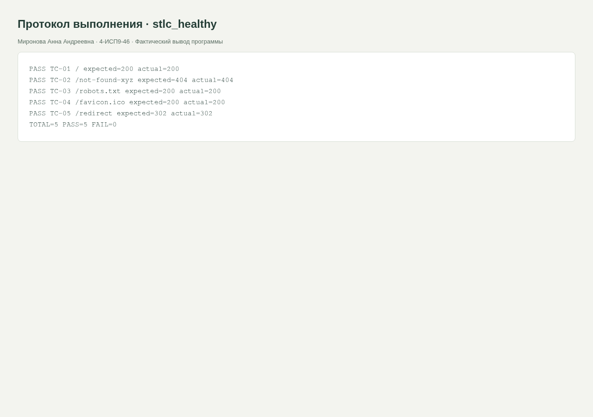
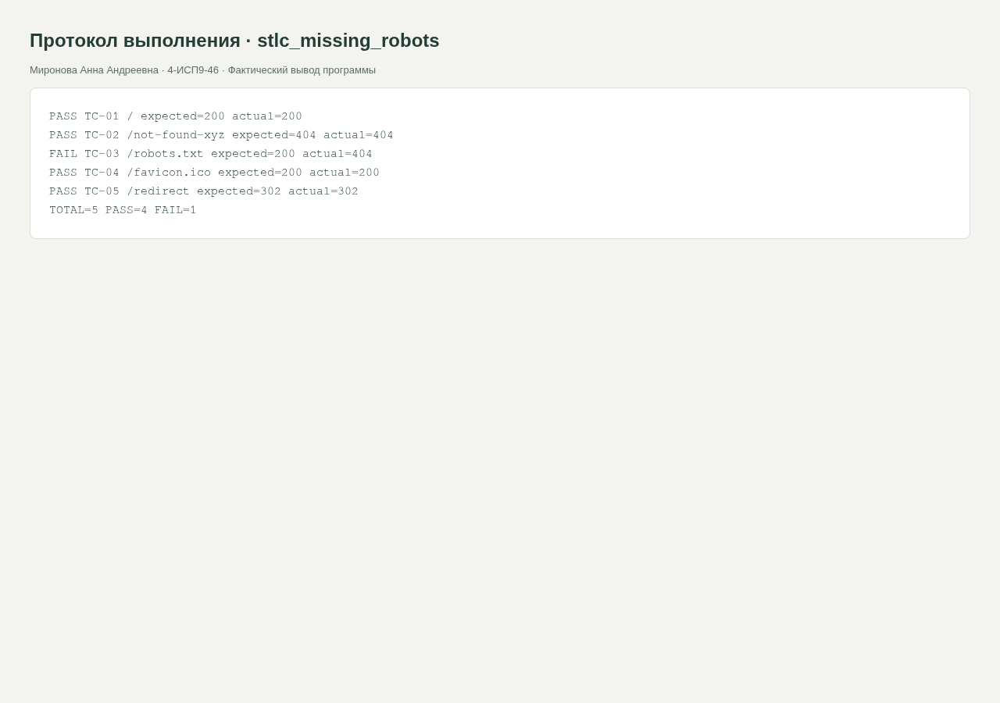

<div class="cover"><p class="course">ПРАКТИЧЕСКАЯ РАБОТА · МДК.05.03</p><h1>Методологии тестирования и практический цикл STLC</h1><div class="author"><p>Выполнила: Миронова Анна Андреевна<br>Группа: 4-ИСП9-46</p></div><div class="meta"><p>Преподаватель: А. Кондыбаева<br>Дата выполнения: 08.11.2026<br>Репозиторий: <a href="https://github.com/RealLalka/mdk-coursework-mironova-2026">https://github.com/RealLalka/mdk-coursework-mironova-2026</a></p></div></div>

## Цель работы

Проверить корректность работы ИС и научиться обнаруживать воспроизводимые дефекты.

Условие: [basic_it_systems_test_methodologies/practice_test_system_methodoligies.md](https://github.com/softboxdev/test_methodologies/blob/e428908592dc365348cf30024e3e61cbc9e97395/it_test_methodologies/basic_it_systems_test_methodologies/practice_test_system_methodoligies.md).

## Выполненная работа

Подготовлены теоретические ответы, сравнительная таблица десяти подходов, выбор методологии для трёх проектов, тест-план приложения доставки, Gherkin и локальный STLC-прогон с отрицательным сценарием.

## Стенд и воспроизведение

Фактическая ОС: Arch Linux в WSL/Linux, ядро 6.6.87.2-microsoft-standard-WSL2. Python 3.14.6, SQLite 3.53.3, Flask 3.1.2; браузер Chromium; настольный Postman 9.31.30 и Newman 6.2.1 для API-прогонов. Условия некоторых заданий называют РОСА и Python 3.8: переносимые команды выполнены на текущем Linux; совместимость именно с РОСА и Python 3.8 отдельным прогоном не подтверждена. Ограничения окружения отражены как WARN/SKIP, а не как успешные проверки.

Команды установки и запуска приведены в [README](https://github.com/RealLalka/mdk-coursework-mironova-2026#readme). Полный автоматический прогон: `python tools/verify.py --workspace <новый-каталог-результатов> --newman <путь-к-newman>`. Он создаёт изолированные копии, запускает локальные сервисы и отрицательные сценарии, затем останавливает собственные процессы. Ненулевой код ожидается только в явно помеченных отрицательных опытах.

## Анализ сложности

Для k URL последовательный прогон O(k) сетевых обращений, память O(1) без хранения полных тел. При max-time=5 верхняя граница ожидания запросов порядка 5k секунд плюс запуск процессов и окружение.

## Часть 1. Теоретические ответы

### 1. Waterfall и Agile

В Waterfall разработка проходит последовательные фазы, а системное тестирование обычно сосредоточено после реализации. Преимущества: понятные контрольные точки и документированная прослеживаемость требований. Недостатки: позднее обнаружение интеграционных ошибок и высокая стоимость изменения утверждённого требования.

В Agile тестирование выполняется в каждой короткой итерации вместе с разработкой. Преимущества: быстрая обратная связь и возможность проверять изменяющиеся требования. Недостатки: необходимо постоянно поддерживать автотесты, а слабая дисциплина команды может привести к неполному регрессионному покрытию. Scrum задаёт ритм итераций; Kanban ограничивает незавершённую работу и поддерживает непрерывный поток.

### 2. V-модель

Слева уточняются требования и дизайн, внизу пишется код, справа выполняются соответствующие уровни тестирования. Тесты проектируются заранее. Пользовательские требования сопоставляются приёмочным тестам, системные — системным, архитектура — интеграционным, дизайн модулей — модульным.

```text
Требования пользователя                 Приёмочное тестирование
    Требования системы              Системное тестирование
        Архитектура              Интеграционные тесты
            Дизайн модулей    Модульные тесты
                       Код
```

### 3. TDD и BDD

TDD — короткий цикл: написать падающий тест, реализовать минимальный код, добиться успеха, затем выполнить рефакторинг. Тест задаёт конкретное поведение программного компонента. BDD делает акцент на согласованном поведении системы на языке предметной области. Сценарии обсуждают разработчик, тестировщик и представитель бизнеса. Пример: Given зарегистрирован активный пользователь; When введён верный пароль; Then создана сессия. ATDD задаёт приёмочные критерии совместно с заказчиком до реализации.

### 4. Пирамида тестирования

В основании много быстрых unit-тестов, выше меньше интеграционных, на вершине небольшой набор сквозных UI-сценариев. Unit-тесты проще локализуют дефекты и дешевле запускаются при каждом изменении. UI-тесты медленнее и чувствительнее к окружению, но необходимы для критических пользовательских путей. Соотношение определяется рисками, а не фиксированным процентом.

### 5. Шесть этапов STLC

Анализ требований выявляет проверяемые условия и пробелы. Планирование определяет объём, риски, ресурсы и критерии готовности. Проектирование создаёт тест-кейсы и данные. Подготовка среды обеспечивает воспроизводимый стенд. Выполнение фиксирует результаты, дефекты и ретесты. Закрытие собирает итоговые метрики и рекомендации. В учебном шестикаталожном шаблоне анализ включён в planning, reporting выделен отдельно; это организационная группировка, а не другой жизненный цикл.

### 6. Shift-Left

Проверки переносятся на ранние стадии, когда исправление дешевле. Три примера: ревью критериев приёмки до разработки, unit-тесты и статический анализ в pull request, проверка API-контрактов до интеграции сервисов. Shift-Right дополняет это наблюдением за реальным поведением после выпуска и анализом эксплуатационных метрик.

### 7. Risk-Based Testing

Применяется при ограниченном времени и разной цене отказа функций. Приоритет оценивается как вероятность дефекта × тяжесть последствий, с учётом частоты использования и истории изменений. Для доставки платежи и оформление заказа проверяются раньше второстепенных визуальных деталей. Высокий риск требует более глубоких отрицательных и интеграционных тестов. Оценка пересматривается после новых дефектов.

## Часть 2. Сравнительный анализ

| Подход | Когда применять | Роль тестировщика | Автоматизация | Основной риск |
|---|---|---|---|---|
| Waterfall | Стабильные требования, контрактные этапы | План и приёмка по спецификации | Регрессия после сборки | Поздняя обратная связь |
| V-модель | Высокие требования к прослеживаемости | Связывает требования и уровни тестов | От unit до приёмки | Негибкость при изменениях |
| Scrum | Частые релизы и обратная связь | Участник команды в каждом спринте | Проверки каждого increment | Неполный регресс под дедлайн |
| Kanban | Поток поддержки и изменений | Контролирует качество и WIP | Непрерывные проверки | Накопление задач без критериев выхода |
| TDD | Модульная бизнес-логика | Помогает определить граничные случаи | Высокая на уровне компонентов | Тесты повторяют реализацию |
| BDD | Общий язык команды и бизнеса | Формулирует примеры поведения | Выборочная автоматизация сценариев | Сценарии становятся деталями UI |
| ATDD | Важна согласованная приёмка | Совместно определяет критерии | Автоматизированная приёмка | Неполные бизнес-примеры |
| DevOps/CI-CD | Частая безопасная доставка | Строит quality gates и метрики | Высокая в pipeline | Нестабильные тесты блокируют выпуск |
| Exploratory | Новая область, слабая спецификация | Исследует риски по charter | Низкая; инструменты помогают | Невоспроизводимость без заметок |
| Risk-Based | Мало времени, критичные функции | Приоритизирует по риску | Для повторяемых критичных путей | Ошибочная оценка вероятности |

## Часть 3. Практическое задание

### 3.1. Выбор методологии

**Проект А — банковская ИС.** Основной подход — V-модель с управлением по рискам. Требования зафиксированы, поэтому можно заранее сопоставить им приёмочные и системные тесты. Для каждого требования ведётся связь с тест-кейсом и протоколом. Интеграционные проверки планируются на уровне архитектуры. Критичные расчёты покрываются unit-тестами и независимыми контрольными примерами. Изменения проходят формальное согласование, а релиз — документированную приёмку. Такая организация поддерживает проверяемость контракта и регуляторных требований.

**Проект Б — доставка еды.** Выбирается Agile/Scrum с BDD для основных бизнес-сценариев. Двухнедельный спринт позволяет тестировать небольшое изменение и быстро получать обратную связь. Критерии приёмки уточняются до реализации. Unit- и API-тесты запускаются в CI при каждом изменении. Исследовательское тестирование проверяет новые пользовательские пути на мобильных устройствах. Платёж, расчёт суммы и создание заказа имеют наивысший приоритет. Короткий smoke-набор проверяет релиз перед публикацией.

**Проект В — ERP.** Подходит итерационная модель с управлением регрессиями по рискам. Долгое внедрение делится на проверяемые функциональные этапы. Стабильные интерфейсы покрываются интеграционными автотестами. Сквозные сценарии проверяют связь склада, закупок и бухгалтерских операций. Пользователи ключевых подразделений участвуют в UAT. Перед обновлением запускается регрессионный набор на копии обезличенных данных. Нагрузочный профиль строится по одновременной активности, поскольку 500 зарегистрированных пользователей не равны 500 одновременным запросам.

### 3.2. Тест-план приложения доставки

**Цель:** проверить вход, каталог, корзину, оформление и отслеживание заказа; предотвратить потерю денег и заказов. **Объект:** Android/iOS-клиенты, API, интеграции оплаты и уведомлений. Вне объёма — внутренние алгоритмы платёжного провайдера; проверяется контракт и sandbox.

**Уровни:** unit — расчёт цены, скидки, состояния заказа; integration — API/БД, оплата, уведомления; system — полный заказ и отмена; acceptance — согласованные сценарии владельца продукта. **Виды:** функциональные позитивные/негативные, регрессия, нагрузка, безопасность, доступность и UX на поддерживаемых устройствах.

**Методология:** Scrum + BDD, автоматическая регрессия в CI. **Инструменты:** pytest для бизнес-логики, Postman/Newman для API, Appium для мобильного smoke, k6 или JMeter для нагрузки, GitHub Issues для дефектов. Инструменты в этом плане предложены для проекта Б; фактический учебный стенд использует Bash, pytest и Newman.

**Критерии входа:** сборка развёрнута, доступен sandbox, есть тестовые аккаунты и данные, критерии приёмки утверждены, smoke среды пройден. **Критерии выхода:** все критичные сценарии и согласованный регресс пройдены, нет открытых Blocker/Critical, остальные дефекты имеют согласованное решение, отчёт доступен. **Риски:** отказ провайдера — контрактные заглушки плюс sandbox; нестабильная сеть — ретраи с идемпотентностью; разные устройства — матрица платформ; гонки заказов — параллельные проверки; нехватка времени — приоритет рискованных путей.

### 3.3. BDD

Файл login.feature содержит Background, три сценария, Scenario Outline с двумя наборами данных и проверку блокировки после пятой ошибки. Длительность блокировки 15 минут — явное допущение учебной спецификации, требующее согласования с владельцем продукта в реальном проекте. Это спецификация поведения, а не заявление о реализованном сервисе авторизации.

## Часть 4. STLC-стенд

Локальный HTTP-стенд отдаёт главную, robots.txt, favicon.ico и маршрут /redirect. Отсутствующий URL даёт 404. Сценарий отсутствующего robots.txt воспроизводится удалением только учебного файла, после чего файл восстанавливается и повторяется проверка. Для example.com также сохранён реальный прогон: нельзя предполагать, что публичный сайт обязан иметь favicon.ico и robots.txt с кодом 200.

| ID | Шаги | Ожидаемый результат | Приоритет |
|---|---|---|---|
| TC-01 | GET / | HTTP 200 | High |
| TC-02 | GET /not-found-xyz | HTTP 404 | High |
| TC-03 | GET /robots.txt | HTTP 200 | Medium |
| TC-04 | GET /favicon.ico | HTTP 200 | Low |
| TC-05 | GET /redirect без follow | HTTP 302 | Medium |

**Метрики:** исходный локальный прогон 5/5; после удаления robots.txt — 4/5; после восстановления — 5/5. Покрыто 5 из 5 требований этой ограниченной спецификации. Это не означает полного покрытия произвольного веб-приложения. **Дефект STLC-01:** удалить robots.txt и запросить его; ожидается 200, фактически 404; severity Minor; статус — исправлен восстановлением файла и подтверждён ретестом.

**Закрытие:** тесты выявили намеренный дефект и подтвердили восстановление. Полезны фиксированные данные и отдельный отрицательный прогон. Далее следует добавить проверку тела, заголовков и Location, а не ограничиваться кодами HTTP. Скрипты возвращают exit 1 при FAIL, поэтому подходят для CI.

## Скриншоты и примеры выполнения

<figure><figcaption>Рисунок 1. stlc_healthy. Фактический запуск; для консольных работ показан оформленный протокол вывода, для веб-приложений и Postman — интерфейс программы.</figcaption></figure>

<figure><figcaption>Рисунок 2. stlc_missing_robots. Фактический запуск; для консольных работ показан оформленный протокол вывода, для веб-приложений и Postman — интерфейс программы.</figcaption></figure>


## Ответы на контрольные вопросы

### 1. Какой подход выбрать при меняющихся требованиях?

Agile с непрерывной регрессией; Scrum при итерационном ритме или Kanban для потока изменений.

### 2. Почему DevOps сдвигает проверки влево?

Частая доставка требует получать обратную связь до слияния и выпуска: ревью, статический анализ, unit- и контрактные тесты.

### 3. Общее и различия TDD, BDD и ATDD?

Все уточняют ожидаемое поведение до реализации. TDD фокусируется на коде компонента, BDD — примерах поведения на языке области, ATDD — совместно согласованной приёмке.

### 4. Как пирамида снижает стоимость дефектов?

Много быстрых локальных проверок обнаруживают ошибку раньше и точнее. Небольшой сквозной слой проверяет интеграцию без чрезмерных затрат на UI.

### 5. Какие этапы STLC автоматизировать первыми?

Подготовку повторяемой среды, регрессионное выполнение и сбор результатов. Оценка рисков, исследование и приёмочные решения требуют участия человека.


## Протоколы проверок

### stlc_healthy

Полный протокол: [evidence/stlc_healthy.md](https://github.com/RealLalka/mdk-coursework-mironova-2026/blob/main/evidence/stlc_healthy.md).

```text
PASS TC-01 / expected=200 actual=200
PASS TC-02 /not-found-xyz expected=404 actual=404
PASS TC-03 /robots.txt expected=200 actual=200
PASS TC-04 /favicon.ico expected=200 actual=200
PASS TC-05 /redirect expected=302 actual=302
TOTAL=5 PASS=5 FAIL=0
```

### stlc_missing_robots

Полный протокол: [evidence/stlc_missing_robots.md](https://github.com/RealLalka/mdk-coursework-mironova-2026/blob/main/evidence/stlc_missing_robots.md).

```text
PASS TC-01 / expected=200 actual=200
PASS TC-02 /not-found-xyz expected=404 actual=404
FAIL TC-03 /robots.txt expected=200 actual=404
PASS TC-04 /favicon.ico expected=200 actual=200
PASS TC-05 /redirect expected=302 actual=302
TOTAL=5 PASS=4 FAIL=1
```


## Спецификация Gherkin

```gherkin
Feature: Авторизация пользователя
  Background:
    Given существует активный пользователь "anna@example.test" с паролем "Correct123!"
    And счётчик неудачных попыток равен 0

  Scenario: Успешный вход
    When пользователь вводит "anna@example.test" и "Correct123!"
    Then создаётся сессия и открывается личный кабинет
    And пароль отсутствует в ответе и журнале

  Scenario Outline: Неверный пароль
    When пользователь вводит "anna@example.test" и "<password>"
    Then сессия не создаётся
    And отображается "Неверный email или пароль"
    And счётчик неудачных попыток равен 1
    Examples:
      | password |
      | wrong123 |
      | WRONG456 |

  Scenario: Блокировка после 5 неудачных попыток
    Given пользователь уже выполнил 4 неудачных попытки за 15 минут
    When пользователь вводит "anna@example.test" и "wrong123"
    Then вход блокируется на 15 минут
    And следующая попытка с верным паролем отклоняется до окончания блокировки
```


## Протоколы проверок

### stlc_restored

Полный протокол: [evidence/stlc_restored.md](https://github.com/RealLalka/mdk-coursework-mironova-2026/blob/main/evidence/stlc_restored.md).

```text
PASS TC-01 / expected=200 actual=200
PASS TC-02 /not-found-xyz expected=404 actual=404
PASS TC-03 /robots.txt expected=200 actual=200
PASS TC-04 /favicon.ico expected=200 actual=200
PASS TC-05 /redirect expected=302 actual=302
TOTAL=5 PASS=5 FAIL=0
```

### stlc_public_example

Полный протокол: [evidence/stlc_public_example.md](https://github.com/RealLalka/mdk-coursework-mironova-2026/blob/main/evidence/stlc_public_example.md).

```text
PASS TC-01 / expected=200 actual=200
PASS TC-02 /not-found-xyz expected=404 actual=404
FAIL TC-03 /robots.txt expected=200 actual=404
FAIL TC-04 /favicon.ico expected=200 actual=404
FAIL TC-05 /redirect expected=302 actual=404
TOTAL=5 PASS=2 FAIL=3
```


## Вывод

Положительный и отрицательный прогоны разделены. Намеренный дефект обнаружен, исходные данные не повреждены. Полные протоколы и способ повторения входят в репозиторий; ограничения стенда явно указаны.

## Использованные материалы

Условия работ: репозитории softboxdev/programming_course и softboxdev/test_methodologies; точные ссылки и commit SHA зафиксированы в SOURCES.md.

Документация: [Python sqlite3](https://docs.python.org/3.14/library/sqlite3.html), [Python json](https://docs.python.org/3.14/library/json.html), [Flask Quickstart](https://flask.palletsprojects.com/en/stable/quickstart/), [Postman Newman](https://learning.postman.com/docs/reference/newman-cli/command-line-integration-with-newman/).

<div class="pagebreak"></div>

## Приложение. Листинги файлов

### testing/stlc/login.feature

```text
Feature: Авторизация пользователя
  Background:
    Given существует активный пользователь "anna@example.test" с паролем "Correct123!"
    And счётчик неудачных попыток равен 0

  Scenario: Успешный вход
    When пользователь вводит "anna@example.test" и "Correct123!"
    Then создаётся сессия и открывается личный кабинет
    And пароль отсутствует в ответе и журнале

  Scenario Outline: Неверный пароль
    When пользователь вводит "anna@example.test" и "<password>"
    Then сессия не создаётся
    And отображается "Неверный email или пароль"
    And счётчик неудачных попыток равен 1
    Examples:
      | password |
      | wrong123 |
      | WRONG456 |

  Scenario: Блокировка после 5 неудачных попыток
    Given пользователь уже выполнил 4 неудачных попытки за 15 минут
    When пользователь вводит "anna@example.test" и "wrong123"
    Then вход блокируется на 15 минут
    And следующая попытка с верным паролем отклоняется до окончания блокировки
```

### testing/stlc/run_stlc_tests.sh

```bash
#!/usr/bin/env bash
set -u
ROOT="$(cd "$(dirname "${BASH_SOURCE[0]}")" && pwd)"
RUN="${QA_RUN:-$ROOT/.logs}"
mkdir -p "$RUN"
URL="${1:-https://example.com}"
PASS=0
FAIL=0
run_case() {
    local id="$1" path="$2" expected="$3" code
    code=$(curl -sS -o /dev/null -w '%{http_code}' --max-time 5 "$URL$path")
    if [ "$code" = "$expected" ]; then
        echo "PASS $id $path expected=$expected actual=$code"
        PASS=$((PASS+1))
    else
        echo "FAIL $id $path expected=$expected actual=$code"
        FAIL=$((FAIL+1))
    fi
}
run_case TC-01 / 200
run_case TC-02 /not-found-xyz 404
run_case TC-03 /robots.txt 200
run_case TC-04 /favicon.ico 200
run_case TC-05 /redirect 302
echo "TOTAL=$((PASS+FAIL)) PASS=$PASS FAIL=$FAIL"
test "$FAIL" -eq 0
```

### testing/stlc/setup_stlc.sh

```bash
#!/usr/bin/env bash
set -eu
TARGET="${1:?Укажите каталог результатов STLC}"
for section in 01_planning 02_design 03_environment 04_execution 05_reporting 06_closure; do mkdir -p "$TARGET/$section"; done
echo "STLC-структура создана: $TARGET"
```
