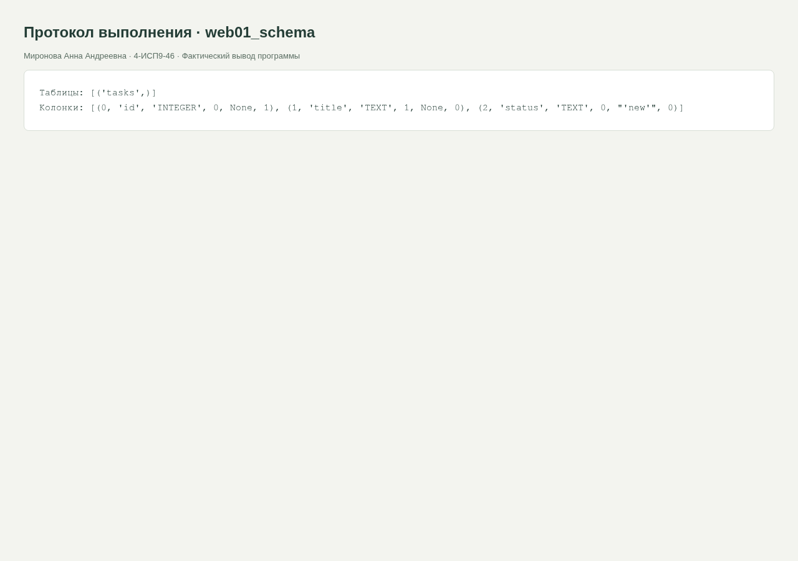

<div class="cover"><p class="course">ПРАКТИЧЕСКАЯ РАБОТА · МДК.09.01</p><h1>№1. Инициализация базы данных SQLite</h1><div class="author"><p>Выполнила: Миронова Анна Андреевна<br>Группа: 4-ИСП9-46</p></div><div class="meta"><p>Преподаватель: А. Кондыбаева<br>Дата выполнения: 08.11.2026<br>Репозиторий: <a href="https://github.com/RealLalka/mdk-coursework-mironova-2026">https://github.com/RealLalka/mdk-coursework-mironova-2026</a></p></div></div>

## Цель работы

Освоить: инициализация базы данных sqlite.

Условие: [практическая работа №1](https://github.com/softboxdev/programming_course/blob/5a0653dd8acd2209367840687924e6be31715792/practice/01_practice_client_server_app.md).

## Реализованный функционал

Создана таблица tasks(id INTEGER PRIMARY KEY, title TEXT NOT NULL, status TEXT DEFAULT new). Скрипт init_db.py использует параметр TASK_DB или путь рядом со скриптом. Повторный запуск не удаляет данные и не создаёт таблицу повторно. check_db.py показывает таблицу и её колонки.

## Запуск

```bash
python web/practice_01/init_db.py
```

## Стенд и воспроизведение

Фактическая ОС: Arch Linux в WSL/Linux, ядро 6.6.87.2-microsoft-standard-WSL2. Python 3.14.6, SQLite 3.53.3, Flask 3.1.2; браузер Chromium; настольный Postman 9.31.30 и Newman 6.2.1 для API-прогонов. Условия некоторых заданий называют РОСА и Python 3.8: переносимые команды выполнены на текущем Linux; совместимость именно с РОСА и Python 3.8 отдельным прогоном не подтверждена. Ограничения окружения отражены как WARN/SKIP, а не как успешные проверки.

Команды установки и запуска приведены в [README](https://github.com/RealLalka/mdk-coursework-mironova-2026#readme). Полный автоматический прогон: `python tools/verify.py --workspace <новый-каталог-результатов> --newman <путь-к-newman>`. Он создаёт изолированные копии, запускает локальные сервисы и отрицательные сценарии, затем останавливает собственные процессы. Ненулевой код ожидается только в явно помеченных отрицательных опытах.

## Анализ сложности

Для одной фиксированной таблицы инициализация считается O(1) относительно числа задач n; каталог схемы имеет собственную стоимость поиска. Объём схемы O(1). Вставка в B-дерево по INTEGER PRIMARY KEY — O(log n), чтение всех задач — O(n).


## Скриншоты и примеры выполнения

<figure><figcaption>Рисунок 1. web01_schema. Фактический запуск; для консольных работ показан оформленный протокол вывода, для веб-приложений и Postman — интерфейс программы.</figcaption></figure>


## Ответы на контрольные вопросы

### 1. Что произойдёт без commit()?

Для данного одиночного CREATE TABLE в Python sqlite3 без явного BEGIN DDL обычно выполняется в режиме SQLite autocommit: таблица останется и без вызова commit(). Утверждение методички об обязательном исчезновении таблицы в этом случае неточно. В явной транзакции BEGIN; CREATE TABLE... отсутствие commit и закрытие соединения приведут к откату. Для INSERT/UPDATE/DELETE в стандартном legacy-режиме Python sqlite3 commit необходим; поведение зависит от режима транзакций. В решении commit оставлен для явного завершения операции.

### 2. Чем connection отличается от cursor?

Connection управляет соединением, транзакцией и закрытием ресурса. Cursor выполняет SQL и читает строки результата. Connection.execute() создаёт и возвращает курсор автоматически.

### 3. Почему id заполняется автоматически?

INTEGER PRIMARY KEY является псевдонимом rowid. Если id не передать, SQLite выберет целый идентификатор. Это не гарантирует запрета повторного использования ранее удалённых значений, как отдельное правило AUTOINCREMENT.

### 4. Что делает DEFAULT new?

Если status отсутствует в INSERT, SQLite подставит строку new. Явный NULL не заменяется значением по умолчанию.

### 5. Где находятся данные?

В файле app.db, путь к которому выводит скрипт. При запуске проверок TASK_DB указывает на изолированный файл стенда. Оперативные журналы SQLite могут существовать рядом с БД.


## Протоколы проверок

### web01_init

Полный протокол: [evidence/web01_init.md](https://github.com/RealLalka/mdk-coursework-mironova-2026/blob/main/evidence/web01_init.md).

```text
База данных и таблица tasks успешно созданы.
Путь: /LoL/.logs/mdk-coursework/verification-final/web01.db
```

### web01_repeat

Полный протокол: [evidence/web01_repeat.md](https://github.com/RealLalka/mdk-coursework-mironova-2026/blob/main/evidence/web01_repeat.md).

```text
База данных и таблица tasks успешно созданы.
Путь: /LoL/.logs/mdk-coursework/verification-final/web01.db
```

### web01_schema

Полный протокол: [evidence/web01_schema.md](https://github.com/RealLalka/mdk-coursework-mironova-2026/blob/main/evidence/web01_schema.md).

```text
Таблицы: [('tasks',)]
Колонки: [(0, 'id', 'INTEGER', 0, None, 1), (1, 'title', 'TEXT', 1, None, 0), (2, 'status', 'TEXT', 0, "'new'", 0)]
```

### additional_checks

Полный протокол: [evidence/additional_checks.md](https://github.com/RealLalka/mdk-coursework-mironova-2026/blob/main/evidence/additional_checks.md).

```text
implicit: table persists without commit = True
explicit: table persists without commit = False
Flask debug reloader: Hello, Flask! -> Hello, Reload! PASS; isolated copy only
 * Serving Flask app 'app'
 * Debug mode: on
WARNING: This is a development server. Do not use it in a production deployment. Use a production WSGI server instead.
 * Running on http://127.0.0.1:33669
Press CTRL+C to quit
 * Restarting with stat
 * Debugger is active!
127.0.0.1 - - [08/Nov/2026 19:45:25] "GET / HTTP/1.1" 200 -
127.0.0.1 - - [08/Nov/2026 19:45:25] "GET / HTTP/1.1" 200 -
127.0.0.1 - - [08/Nov/2026 19:45:25] "GET / HTTP/1.1" 200 -
127.0.0.1 - - [08/Nov/2026 19:45:26] "GET / HTTP/1.1" 200 -
127.0.0.1 - - [08/Nov/2026 19:45:26] "GET / HTTP/1.1" 200 -
127.0.0.1 - - [08/Nov/2026 19:45:26] "GET / HTTP/1.1" 200 -
```


## Вывод

Требования выбранной практики реализованы. Результат проверен фактическим выполнением и автоматическими проверками; детали и границы проверки приведены выше.

## Использованные материалы

Условия работ: репозитории softboxdev/programming_course и softboxdev/test_methodologies; точные ссылки и commit SHA зафиксированы в SOURCES.md.

Документация: [Python sqlite3](https://docs.python.org/3.14/library/sqlite3.html), [Python json](https://docs.python.org/3.14/library/json.html), [Flask Quickstart](https://flask.palletsprojects.com/en/stable/quickstart/), [Postman Newman](https://learning.postman.com/docs/reference/newman-cli/command-line-integration-with-newman/).

<div class="pagebreak"></div>

## Приложение. Листинги файлов

### web/practice_01/check_db.py

```python
import sqlite3
from init_db import DB_PATH

conn = sqlite3.connect(DB_PATH)
try:
    print(
        "Таблицы:",
        conn.execute("SELECT name FROM sqlite_master WHERE type='table'").fetchall(),
    )
    print("Колонки:", conn.execute("PRAGMA table_info(tasks)").fetchall())
finally:
    conn.close()
```

### web/practice_01/init_db.py

```python
import os
import sqlite3
from pathlib import Path

DB_PATH = Path(os.environ.get("TASK_DB", Path(__file__).with_name("app.db")))


def init_db(db_path=DB_PATH):
    conn = sqlite3.connect(db_path)
    try:
        conn.execute(
            "CREATE TABLE IF NOT EXISTS tasks (id INTEGER PRIMARY KEY, title TEXT NOT NULL, status TEXT DEFAULT 'new')"
        )
        conn.commit()
    finally:
        conn.close()


if __name__ == "__main__":
    init_db()
    print("База данных и таблица tasks успешно созданы.")
    print(f"Путь: {DB_PATH.resolve()}")
```
