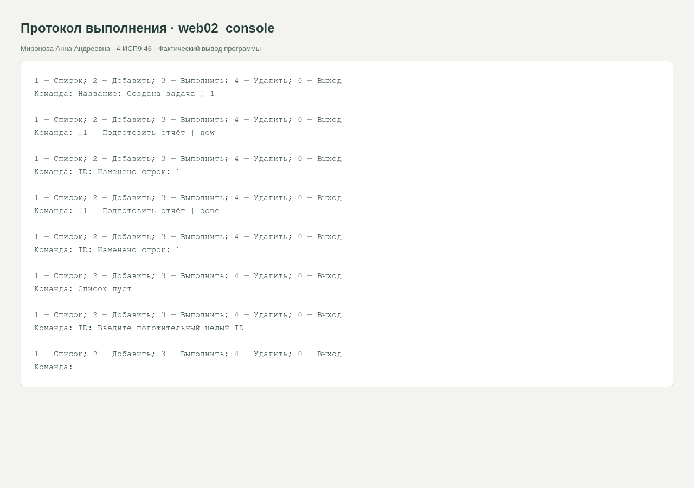

<div class="cover"><p class="course">ПРАКТИЧЕСКАЯ РАБОТА · МДК.09.01</p><h1>№2. Базовые CRUD-операции через консоль</h1><div class="author"><p>Выполнила: Миронова Анна Андреевна<br>Группа: 4-ИСП9-46</p></div><div class="meta"><p>Преподаватель: А. Кондыбаева<br>Дата выполнения: 08.11.2026<br>Репозиторий: <a href="https://github.com/RealLalka/mdk-coursework-mironova-2026">https://github.com/RealLalka/mdk-coursework-mironova-2026</a></p></div></div>

## Цель работы

Освоить: базовые crud-операции через консоль.

Условие: [практическая работа №2](https://github.com/softboxdev/programming_course/blob/5a0653dd8acd2209367840687924e6be31715792/practice/02_practice_client_server_app.md).

## Реализованный функционал

Реализовано меню: список, добавление, завершение задачи, удаление и выход. Все пользовательские значения передаются через placeholders ?. Ввод ID проверяется до преобразования; отсутствующий ID возвращает 0 изменённых строк. Соединения закрываются в finally, ошибки транзакций вызывают rollback.

## Запуск

```bash
python web/practice_02/crud_console.py
```

## Стенд и воспроизведение

Фактическая ОС: Arch Linux в WSL/Linux, ядро 6.6.87.2-microsoft-standard-WSL2. Python 3.14.6, SQLite 3.53.3, Flask 3.1.2; браузер Chromium; настольный Postman 9.31.30 и Newman 6.2.1 для API-прогонов. Условия некоторых заданий называют РОСА и Python 3.8: переносимые команды выполнены на текущем Linux; совместимость именно с РОСА и Python 3.8 отдельным прогоном не подтверждена. Ограничения окружения отражены как WARN/SKIP, а не как успешные проверки.

Команды установки и запуска приведены в [README](https://github.com/RealLalka/mdk-coursework-mironova-2026#readme). Полный автоматический прогон: `python tools/verify.py --workspace <новый-каталог-результатов> --newman <путь-к-newman>`. Он создаёт изолированные копии, запускает локальные сервисы и отрицательные сценарии, затем останавливает собственные процессы. Ненулевой код ожидается только в явно помеченных отрицательных опытах.

## Анализ сложности

Пусть n — число строк, L — длина названия. Список ORDER BY id: O(n) времени и O(n) памяти результата. INSERT, UPDATE и DELETE по первичному ключу: O(log n) для поиска/изменения B-дерева; обработка названия добавляет O(L). Дополнительная память одиночной операции O(L).


## Скриншоты и примеры выполнения

<figure><figcaption>Рисунок 1. web02_console. Фактический запуск; для консольных работ показан оформленный протокол вывода, для веб-приложений и Postman — интерфейс программы.</figcaption></figure>


## Ответы на контрольные вопросы

### 1. Почему SELECT не требует commit, а INSERT требует?

SELECT не меняет данные. INSERT в используемом режиме открывает транзакцию; commit фиксирует изменения. Незавершённая транзакция при закрытии откатывается.

### 2. Что вернёт fetchone без строк?

None.

### 3. fetchone и fetchall: когда использовать?

fetchone возвращает одну следующую строку или None; удобен при поиске по уникальному ID. fetchall возвращает список оставшихся строк; удобен для небольшого полного списка.

### 4. Почему (title,) — кортеж?

Кортеж из одного элемента создаётся запятой. Скобки без запятой лишь группируют выражение.

### 5. Что вернёт rowcount при отсутствующем ID?

0: ни одна строка не подошла под WHERE.

### 6. Зачем проверять isdigit перед int?

Чтобы заранее отклонить недопустимый ввод и не получить ValueError. В решении также проверяются ASCII-цифры и положительность: некоторые Unicode-символы проходят isdigit, но не преобразуются int.

### 7. Как placeholders защищают от SQL-инъекции?

SQL-текст и значения передаются отдельно. Вредоносная строка становится содержимым title и не интерпретируется как команда DROP TABLE.


## Протоколы проверок

### web02_console

Полный протокол: [evidence/web02_console.md](https://github.com/RealLalka/mdk-coursework-mironova-2026/blob/main/evidence/web02_console.md).

```text
1 — Список; 2 — Добавить; 3 — Выполнить; 4 — Удалить; 0 — Выход
Команда: Название: Создана задача # 1

1 — Список; 2 — Добавить; 3 — Выполнить; 4 — Удалить; 0 — Выход
Команда: #1 | Подготовить отчёт | new

1 — Список; 2 — Добавить; 3 — Выполнить; 4 — Удалить; 0 — Выход
Команда: ID: Изменено строк: 1

1 — Список; 2 — Добавить; 3 — Выполнить; 4 — Удалить; 0 — Выход
Команда: #1 | Подготовить отчёт | done

1 — Список; 2 — Добавить; 3 — Выполнить; 4 — Удалить; 0 — Выход
Команда: ID: Изменено строк: 1

1 — Список; 2 — Добавить; 3 — Выполнить; 4 — Удалить; 0 — Выход
Команда: Список пуст

1 — Список; 2 — Добавить; 3 — Выполнить; 4 — Удалить; 0 — Выход
Команда: ID: Введите положительный целый ID

1 — Список; 2 — Добавить; 3 — Выполнить; 4 — Удалить; 0 — Выход
Команда:
```

### python_tests

Полный протокол: [evidence/python_tests.md](https://github.com/RealLalka/mdk-coursework-mironova-2026/blob/main/evidence/python_tests.md).

```text
...............................                                          [100%]
31 passed in 0.22s
```


## Вывод

Требования выбранной практики реализованы. Результат проверен фактическим выполнением и автоматическими проверками; детали и границы проверки приведены выше.

## Использованные материалы

Условия работ: репозитории softboxdev/programming_course и softboxdev/test_methodologies; точные ссылки и commit SHA зафиксированы в SOURCES.md.

Документация: [Python sqlite3](https://docs.python.org/3.14/library/sqlite3.html), [Python json](https://docs.python.org/3.14/library/json.html), [Flask Quickstart](https://flask.palletsprojects.com/en/stable/quickstart/), [Postman Newman](https://learning.postman.com/docs/reference/newman-cli/command-line-integration-with-newman/).

<div class="pagebreak"></div>

## Приложение. Листинги файлов

### web/practice_02/crud_console.py

```python
import os
import sqlite3
from pathlib import Path

DB_PATH = Path(os.environ.get("TASK_DB", Path(__file__).with_name("app.db")))


def init_db(db_path=DB_PATH):
    conn = sqlite3.connect(db_path)
    try:
        conn.execute(
            "CREATE TABLE IF NOT EXISTS tasks (id INTEGER PRIMARY KEY, title TEXT NOT NULL, status TEXT DEFAULT 'new')"
        )
        conn.commit()
    finally:
        conn.close()


def query(sql, params=(), db_path=DB_PATH, read=False):
    conn = sqlite3.connect(db_path)
    try:
        cursor = conn.execute(sql, params)
        if read:
            return cursor.fetchall()
        conn.commit()
        return cursor.lastrowid if sql.startswith("INSERT") else cursor.rowcount
    except sqlite3.Error:
        conn.rollback()
        raise
    finally:
        conn.close()


def list_tasks(db_path=DB_PATH):
    return query(
        "SELECT id,title,status FROM tasks ORDER BY id", db_path=db_path, read=True
    )


def add_task(title, db_path=DB_PATH):
    title = title.strip()
    if not title:
        raise ValueError("Название не может быть пустым")
    return query("INSERT INTO tasks(title) VALUES (?)", (title,), db_path)


def complete_task(task_id, db_path=DB_PATH):
    return query("UPDATE tasks SET status='done' WHERE id=?", (task_id,), db_path)


def delete_task(task_id, db_path=DB_PATH):
    return query("DELETE FROM tasks WHERE id=?", (task_id,), db_path)


def main():
    init_db()
    while True:
        print("\n1 — Список; 2 — Добавить; 3 — Выполнить; 4 — Удалить; 0 — Выход")
        try:
            choice = input("Команда: ").strip()
            if choice == "0":
                return
            if choice == "1":
                rows = list_tasks()
                for row in rows:
                    print(f"#{row[0]} | {row[1]} | {row[2]}")
                if not rows:
                    print("Список пуст")
            elif choice == "2":
                print("Создана задача #", add_task(input("Название: ")))
            elif choice in ("3", "4"):
                value = input("ID: ").strip()
                if not value.isascii() or not value.isdigit() or int(value) < 1:
                    print("Введите положительный целый ID")
                    continue
                result = (complete_task if choice == "3" else delete_task)(int(value))
                print("Изменено строк:", result)
            else:
                print("Неизвестная команда")
        except (sqlite3.Error, ValueError) as exc:
            print("Ошибка:", exc)
        except (EOFError, KeyboardInterrupt):
            return


if __name__ == "__main__":
    main()
```

### web/practice_02/init_db.py

```python
import os
import sqlite3
from pathlib import Path

DB_PATH = Path(os.environ.get("TASK_DB", Path(__file__).with_name("app.db")))


def init_db(db_path=DB_PATH):
    conn = sqlite3.connect(db_path)
    try:
        conn.execute(
            "CREATE TABLE IF NOT EXISTS tasks (id INTEGER PRIMARY KEY, title TEXT NOT NULL, status TEXT DEFAULT 'new')"
        )
        conn.commit()
    finally:
        conn.close()


if __name__ == "__main__":
    init_db()
    print("База данных и таблица tasks успешно созданы.")
    print(f"Путь: {DB_PATH.resolve()}")
```
