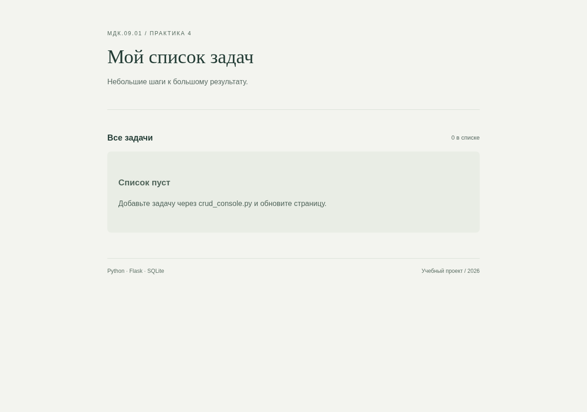
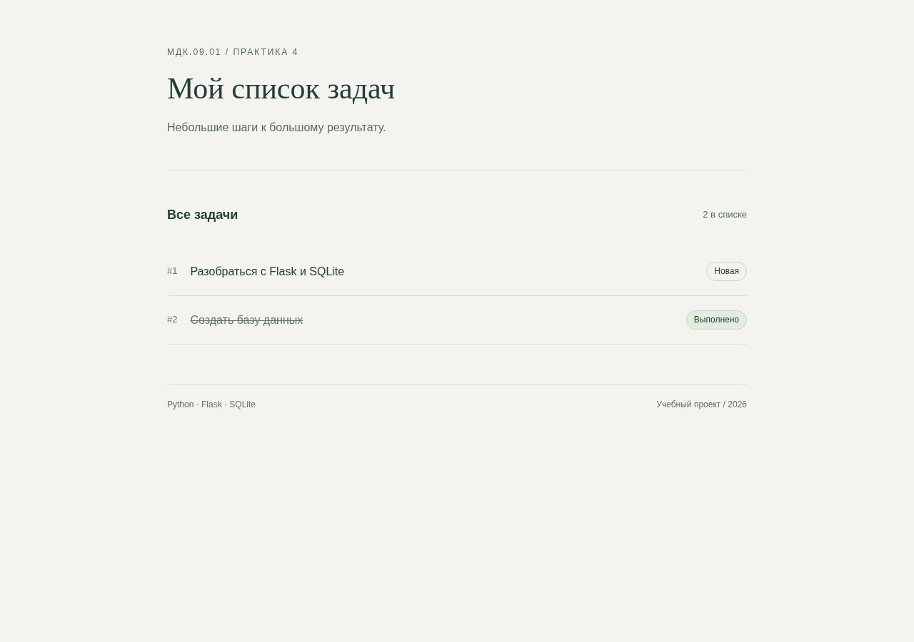
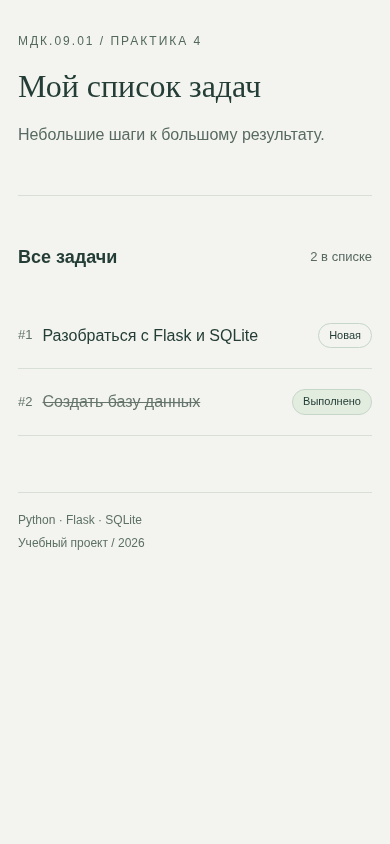

<div class="cover"><p class="course">ПРАКТИЧЕСКАЯ РАБОТА · МДК.09.01</p><h1>№4. Flask и SQLite: чтение данных</h1><div class="author"><p>Выполнила: Миронова Анна Андреевна<br>Группа: 4-ИСП9-46</p></div><div class="meta"><p>Преподаватель: А. Кондыбаева<br>Дата выполнения: 08.11.2026<br>Репозиторий: <a href="https://github.com/RealLalka/mdk-coursework-mironova-2026">https://github.com/RealLalka/mdk-coursework-mironova-2026</a></p></div></div>

## Цель работы

Освоить: flask и sqlite: чтение данных.

Условие: [практическая работа №4](https://github.com/softboxdev/programming_course/blob/5a0653dd8acd2209367840687924e6be31715792/practice/04_practice_client_server_app.md).

## Реализованный функционал

Добавлены шаблон Jinja2 и чтение SQLite с row_factory=sqlite3.Row. Список упорядочен по ID, выполненные задачи зачёркнуты. Есть отдельное пустое состояние. Изменение БД через консоль видно после обновления страницы. Jinja2 экранирует HTML из названий задач.

## Запуск

```bash
python web/practice_04/app.py
```

## Стенд и воспроизведение

Фактическая ОС: Arch Linux в WSL/Linux, ядро 6.6.87.2-microsoft-standard-WSL2. Python 3.14.6, SQLite 3.53.3, Flask 3.1.2; браузер Chromium; настольный Postman 9.31.30 и Newman 6.2.1 для API-прогонов. Условия некоторых заданий называют РОСА и Python 3.8: переносимые команды выполнены на текущем Linux; совместимость именно с РОСА и Python 3.8 отдельным прогоном не подтверждена. Ограничения окружения отражены как WARN/SKIP, а не как успешные проверки.

Команды установки и запуска приведены в [README](https://github.com/RealLalka/mdk-coursework-mironova-2026#readme). Полный автоматический прогон: `python tools/verify.py --workspace <новый-каталог-результатов> --newman <путь-к-newman>`. Он создаёт изолированные копии, запускает локальные сервисы и отрицательные сценарии, затем останавливает собственные процессы. Ненулевой код ожидается только в явно помеченных отрицательных опытах.

## Анализ сложности

Чтение n задач в порядке первичного ключа — O(n), поскольку отдельная сортировка не требуется. Материализация списка и HTML занимают O(n + S), где S — суммарная длина названий. Отдельной операции сортировки O(n log n) здесь нет.


## Скриншоты и примеры выполнения

<figure><figcaption>Рисунок 1. practice_04-empty. Фактический запуск; для консольных работ показан оформленный протокол вывода, для веб-приложений и Postman — интерфейс программы.</figcaption></figure>

<figure><figcaption>Рисунок 2. practice_04-desktop. Фактический запуск; для консольных работ показан оформленный протокол вывода, для веб-приложений и Postman — интерфейс программы.</figcaption></figure>

<figure><figcaption>Рисунок 3. practice_04-mobile. Фактический запуск; для консольных работ показан оформленный протокол вывода, для веб-приложений и Postman — интерфейс программы.</figcaption></figure>


## Ответы на контрольные вопросы

### 1. Зачем Jinja2?

Отделяет представление от обработки запросов, даёт циклы, условия и автоматическое HTML-экранирование. Большая HTML-строка в Python сложнее сопровождается.

### 2. Разница {{ }} и ?

{{ expression }} выводит значение,  управляет выполнением: for, if, endif.

### 3. Что делает render_template?

Загружает index.html и рендерит его с переменной items, которой передан набор строк SQLite.

### 4. Почему не нужен commit при чтении?

Операция не меняет данные. После получения результата достаточно закрыть соединение.

### 5. Что такое sqlite3.Row и почему item.title работает?

Row — строка результата с доступом по индексу и имени колонки. Jinja2 разрешает item.title через доступ к ключу title. Такой синтаксис работает также с dict и объектами с атрибутами, поэтому ограничение «только с Row» в вопросе неточно; обычный tuple не имеет именованных колонок.

### 6. Где лежат шаблоны?

В templates рядом с приложением по умолчанию. В решении root_path задан явно, чтобы приложение корректно импортировалось в тестах. template_folder позволяет выбрать другой каталог.

### 7. Что произойдёт с пустым items?

Ветка if items не выполняется, показывается «Список пуст» и инструкция добавить задачу через консоль.


## Протоколы проверок

### python_tests

Полный протокол: [evidence/python_tests.md](https://github.com/RealLalka/mdk-coursework-mironova-2026/blob/main/evidence/python_tests.md).

```text
...............................                                          [100%]
31 passed in 0.22s
```


## Вывод

Требования выбранной практики реализованы. Результат проверен фактическим выполнением и автоматическими проверками; детали и границы проверки приведены выше.

## Использованные материалы

Условия работ: репозитории softboxdev/programming_course и softboxdev/test_methodologies; точные ссылки и commit SHA зафиксированы в SOURCES.md.

Документация: [Python sqlite3](https://docs.python.org/3.14/library/sqlite3.html), [Python json](https://docs.python.org/3.14/library/json.html), [Flask Quickstart](https://flask.palletsprojects.com/en/stable/quickstart/), [Postman Newman](https://learning.postman.com/docs/reference/newman-cli/command-line-integration-with-newman/).

<div class="pagebreak"></div>

## Приложение. Листинги файлов

### web/practice_04/app.py

```python
import os
import sqlite3
from pathlib import Path
from flask import Flask, render_template, request, redirect, url_for


def create_app(db_path=None):
    app = Flask(__name__, root_path=str(Path(__file__).parent))
    app.config["DATABASE"] = str(
        db_path or os.environ.get("TASK_DB", Path(__file__).with_name("app.db"))
    )
    conn = sqlite3.connect(app.config["DATABASE"])
    try:
        conn.execute(
            "CREATE TABLE IF NOT EXISTS tasks (id INTEGER PRIMARY KEY, title TEXT NOT NULL, status TEXT DEFAULT 'new')"
        )
        conn.commit()
    finally:
        conn.close()

    def fetch_all_tasks():
        conn = sqlite3.connect(app.config["DATABASE"])
        conn.row_factory = sqlite3.Row
        try:
            return conn.execute(
                "SELECT id,title,status FROM tasks ORDER BY id"
            ).fetchall()
        finally:
            conn.close()

    @app.route("/", methods=["GET"])
    def index():
        try:
            if request.method == "POST":
                title = request.form.get("title", "").strip()
                if not title or len(title) > 200:
                    return render_template(
                        "index.html",
                        items=fetch_all_tasks(),
                        error="Введите название от 1 до 200 символов.",
                    ), 400
                conn = sqlite3.connect(app.config["DATABASE"])
                try:
                    conn.execute("INSERT INTO tasks(title) VALUES (?)", (title,))
                    conn.commit()
                except sqlite3.Error:
                    conn.rollback()
                    raise
                finally:
                    conn.close()
                return redirect(url_for("index"))
            return render_template("index.html", items=fetch_all_tasks())
        except sqlite3.Error:
            app.logger.exception("Ошибка SQLite")
            return render_template(
                "index.html",
                items=[],
                error="Не удалось обратиться к базе данных. Повторите запрос позже.",
            ), 503

    return app


if __name__ == "__main__":
    create_app().run(
        host="127.0.0.1",
        port=int(os.environ.get("PORT", "5000")),
        debug=os.environ.get("FLASK_DEBUG") == "1",
    )
```

### web/practice_04/crud_console.py

```python
import os
import sqlite3
from pathlib import Path

DB_PATH = Path(os.environ.get("TASK_DB", Path(__file__).with_name("app.db")))


def init_db(db_path=DB_PATH):
    conn = sqlite3.connect(db_path)
    try:
        conn.execute(
            "CREATE TABLE IF NOT EXISTS tasks (id INTEGER PRIMARY KEY, title TEXT NOT NULL, status TEXT DEFAULT 'new')"
        )
        conn.commit()
    finally:
        conn.close()


def query(sql, params=(), db_path=DB_PATH, read=False):
    conn = sqlite3.connect(db_path)
    try:
        cursor = conn.execute(sql, params)
        if read:
            return cursor.fetchall()
        conn.commit()
        return cursor.lastrowid if sql.startswith("INSERT") else cursor.rowcount
    except sqlite3.Error:
        conn.rollback()
        raise
    finally:
        conn.close()


def list_tasks(db_path=DB_PATH):
    return query(
        "SELECT id,title,status FROM tasks ORDER BY id", db_path=db_path, read=True
    )


def add_task(title, db_path=DB_PATH):
    title = title.strip()
    if not title:
        raise ValueError("Название не может быть пустым")
    return query("INSERT INTO tasks(title) VALUES (?)", (title,), db_path)


def complete_task(task_id, db_path=DB_PATH):
    return query("UPDATE tasks SET status='done' WHERE id=?", (task_id,), db_path)


def delete_task(task_id, db_path=DB_PATH):
    return query("DELETE FROM tasks WHERE id=?", (task_id,), db_path)


def main():
    init_db()
    while True:
        print("\n1 — Список; 2 — Добавить; 3 — Выполнить; 4 — Удалить; 0 — Выход")
        try:
            choice = input("Команда: ").strip()
            if choice == "0":
                return
            if choice == "1":
                rows = list_tasks()
                for row in rows:
                    print(f"#{row[0]} | {row[1]} | {row[2]}")
                if not rows:
                    print("Список пуст")
            elif choice == "2":
                print("Создана задача #", add_task(input("Название: ")))
            elif choice in ("3", "4"):
                value = input("ID: ").strip()
                if not value.isascii() or not value.isdigit() or int(value) < 1:
                    print("Введите положительный целый ID")
                    continue
                result = (complete_task if choice == "3" else delete_task)(int(value))
                print("Изменено строк:", result)
            else:
                print("Неизвестная команда")
        except (sqlite3.Error, ValueError) as exc:
            print("Ошибка:", exc)
        except (EOFError, KeyboardInterrupt):
            return


if __name__ == "__main__":
    main()
```

### web/practice_04/init_db.py

```python
import os
import sqlite3
from pathlib import Path

DB_PATH = Path(os.environ.get("TASK_DB", Path(__file__).with_name("app.db")))


def init_db(db_path=DB_PATH):
    conn = sqlite3.connect(db_path)
    try:
        conn.execute(
            "CREATE TABLE IF NOT EXISTS tasks (id INTEGER PRIMARY KEY, title TEXT NOT NULL, status TEXT DEFAULT 'new')"
        )
        conn.commit()
    finally:
        conn.close()


if __name__ == "__main__":
    init_db()
    print("База данных и таблица tasks успешно созданы.")
    print(f"Путь: {DB_PATH.resolve()}")
```

### web/practice_04/static/style.css

```css
*{box-sizing:border-box}body{margin:0;background:#f3f4ef;color:#243d36;font:16px/1.6 Arial,sans-serif}main{max-width:860px;margin:64px auto;padding:0 24px}header{border-bottom:1px solid #d8dfd6;padding-bottom:32px}.eyebrow{font-size:12px;letter-spacing:2px;color:#53685c}h1{font:normal 42px/1.2 Georgia,serif;margin:16px 0}.intro{color:#586a62}form{margin:32px 0}label{display:block;font-size:14px;margin-bottom:8px}.form-row{display:flex;gap:12px}input{min-width:0;flex:1;border:1px solid #b6c5ba;border-radius:6px;padding:14px;font:inherit;background:#fff}button{border:0;border-radius:6px;background:#285b46;color:white;padding:12px 22px;font:inherit;cursor:pointer}button:hover{background:#19432f}input:focus-visible,button:focus-visible{outline:3px solid #94b9a3;outline-offset:3px}section{margin-top:32px}.section-head{display:flex;justify-content:space-between;align-items:center}.section-head span{font-size:13px;color:#586a62}h2{font-size:18px}ul{list-style:none;padding:0}li{display:flex;gap:18px;align-items:center;padding:20px 0;border-bottom:1px solid #d8dfd6}.number{font-size:13px;color:#617369}.title{flex:1;overflow-wrap:anywhere;min-width:0}.status{font-size:12px;padding:3px 10px;border:1px solid #c6d6c9;border-radius:20px;white-space:nowrap}.done .title{text-decoration:line-through;color:#65756d}.done .status{background:#e3eddf}.empty{padding:34px 24px;background:#e9ede5;border-radius:8px;color:#50645a}.error{background:#f9e4df;color:#922f25;padding:14px;border-radius:6px}footer{display:flex;justify-content:space-between;gap:16px;border-top:1px solid #d8dfd6;margin-top:56px;padding-top:18px;font-size:12px;color:#5d7065}@media(max-width:540px){main{margin:32px auto;padding:0 18px}h1{font-size:32px}.form-row{flex-direction:column}li{gap:10px}.status{font-size:11px}footer{flex-direction:column;gap:4px}}
```

### web/practice_04/templates/index.html

```html
<!doctype html>
<html lang="ru">
<head><meta charset="utf-8"><meta name="viewport" content="width=device-width, initial-scale=1"><title>Список задач · Практика 4</title>
<link rel="stylesheet" href="{{ url_for('static', filename='style.css') }}"></head>
<body><main><header><p class="eyebrow">МДК.09.01 / ПРАКТИКА 4</p><h1>Мой список задач</h1><p class="intro">Небольшие шаги к большому результату.</p></header>
<p class="error" role="alert">{{ error }}</p>

<section aria-label="Задачи"><div class="section-head"><h2>Все задачи</h2><span>{{ items|length }} в списке</span></div>
<ul><li class="{{ 'done' if item.status == 'done' else '' }}"><span class="number">#{{ item.id }}</span><span class="title">{{ item.title }}</span><span class="status">{{ 'Выполнено' if item.status == 'done' else 'Новая' }}</span></li></ul>
<div class="empty"><h3>Список пуст</h3><p>Добавьте задачу через crud_console.py и обновите страницу.</p></div></section>
<footer>Python · Flask · SQLite <span>Учебный проект / 2026</span></footer></main></body></html>
```
